# Spiking Neural Networks per Sistemi Biomedicali Impiantabili: Applicazioni e Architetture Circuitali CMOS

**Relazione Tecnica di Ricerca Bibliografica e Analisi Circuitale**  
**Corso di Elettronica Biomedica**

---

## Indice Generale

1. [**Capitolo 1 — Principi di Funzionamento delle Spiking Neural Networks (SNN) e Modelli di Neurone Artificiale**](#capitolo-1--principi-di-funzionamento-delle-spiking-neural-networks-snn-e-modelli-di-neurone-artificiale)
   - 1.1 Evoluzione delle Reti Neurali Artificiali: dalla Prima alla Terza Generazione
   - 1.2 Schemi di Codifica dell'Informazione negli Spike (*Neural Coding*) e Conversione Analogico-Evento
   - 1.3 Tassonomia Matematica dei Modelli di Neurone Spiking
     - 1.3.1 Il Modello Biofisico di Hodgkin–Huxley (H–H)
     - 1.3.2 Il Modello *Leaky Integrate-and-Fire* (LIF): Derivazione Fisica, Soluzione Analitica e Curva $f\text{–}I$
     - 1.3.3 Il Modello *Quadratic Integrate-and-Fire* (QIF) e il Modello Bidimensionale di Izhikevich
     - 1.3.4 Il Modello *Adaptive Exponential Integrate-and-Fire* (AdEx)
     - 1.3.5 Il Modello a Soglia Adattativa di Mihalas–Niebur
   - 1.4 Dinamiche Sinaptiche e Paradigmi di Plasticità e Apprendimento (STDP, SDSP, STP, BPTT con Surrogate Gradient, ENAS)
2. [**Capitolo 2 — Perché Utilizzare una SNN in un Dispositivo Biomedicale Impiantabile?**](#capitolo-2--perché-utilizzare-una-snn-in-un-dispositivo-biomedicale-impiantabile)
   - 2.1 Vincoli Fisici, Termici ed Energetici dei Sistemi Impiantabili Intracranici e Indossabili
   - 2.2 Limiti dell'Elaborazione Digitale Convenzionale (Campionamento di Nyquist + Architettura von Neumann)
   - 2.3 I Vantaggi Fondamentali del Paradigma Neuromorfico Spiking (*Event-Driven*)
3. [**Capitolo 3 — Applicazioni Biomedicali delle SNN nell'Elaborazione di Segnali Biologici**](#capitolo-3--applicazioni-biomedicali-delle-snn-nellelaborazione-di-segnali-biologici)
   - 3.1 Rilevamento a Bassissima Latenza di Crisi Epilettiche in Segnali LFP Intracranici: Il Sistema **NET-TEN** *(Ronchini et al., 2023)*
   - 3.2 Rilevamento Real-Time Sub-Milliwatt di Epilessia da EEG da Scalpo su Processore Neuromorfico Digitale Edge: **WaveSense su SynSense Xylo** *(Li et al., 2024)*
   - 3.3 Rilevamento Event-Driven di Crisi Epilettiche da iEEG Umano tramite Sincronizzazione Parziale su Processore Mixed-Signal: **DYNAP-SE2** *(Bartels et al., 2025)*
   - 3.4 Interfaccia Neurale Impiantabile a 32 Canali con Direct Multiplexing, Rilevazione Clockless di Spike e Telemetria Wireless IR-UWB: **NeuroSEED** *(Wu et al., 2026)*
4. [**Capitolo 4 — Implementazioni Circuitali CMOS di Neuroni e Sinapsi Spiking**](#capitolo-4--implementazioni-circuitali-cmos-di-neuroni-e-sinapsi-spiking)
   - 4.1 Fisica del MOSFET in Sottosoglia (*Weak Inversion*), Principio Translineare e Filtri *Log-Domain* (Tau-Cell, LPF, **DPI**)
   - 4.2 I Blocchi Funzionali del Neurone al Silicio e Analisi Transistor-per-Transistor delle Topologie in Letteratura *(Indiveri et al., 2011)*
     - 4.2.1 Circuito *Axon-Hillock* *(Mead, 1989)*
     - 4.2.2 Neurone I&F a Comparatore di Tensione e *Starved Inverters* *(van Schaik, 2001)*
     - 4.2.3 Neuroni Basati su Conduttanza (*Conductance-Based*): Talamico, H–H Translineare, H–H BiCMOS SiGe e Accelerato $\times 10^4$
     - 4.2.4 Neuroni I&F Compatti a Basso Consumo (*Octopus Retina* e *DVS Differencing Neuron*)
     - 4.2.5 Il Neurone *Tau-Cell* *(van Schaik et al., 2010)*
     - 4.2.6 Il Neurone *Log-Domain LPF* (LLN) a Feedback Positivo Cubico *(Arthur & Boahen, 2007)*
     - 4.2.7 Il Neurone **DPI** (*Adaptive Exponential I&F* in Modalità Corrente) *(Livi & Indiveri, 2009; Indiveri et al., 2010)*
     - 4.2.8 Il Neurone Quadratico di **Izhikevich** in CMOS *(Wijekoon & Dudek, 2008; Ronchini et al., 2023)*
     - 4.2.9 Il Neurone *Switched-Capacitor* di **Mihalas–Niebur** *(Folowosele et al., 2009)* e Architetture Impulsate/Digitali
   - 4.3 Architettura e Circuiti Transistor-Level del Processore Neuromorfico **ROLLS** *(Qiao et al., 2015)*
     - 4.3.1 Architettura del Chip e Distribuzione dell'Area Silicea
     - 4.3.2 Analisi Transistor-per-Transistor del Soma AdEx in ROLLS (`NMDA`, `LEAK`, `AHP`, `Na+`, `K+`)
     - 4.3.3 Circuiti Post-Sinaptici di Apprendimento (*Stop-Learning* del Calcio e Circuiti *Winner-Take-All*)
     - 4.3.4 Sinapsi Plastica Bistabile a Lungo Termine (LTP: blocchi `SET`, `JUMP`, `BIST`, `CC`)
     - 4.3.5 Sinapsi Programmabile a Breve Termine (STP: DAC a 2 bit, `STD`, `ECC`, `ICC`) e Circuiti EPSC/STDP di NET-TEN
   - 4.4 Architetture Multi-Core Scalabili, Routing Asincrono QDI e Memorie Eterogenee Ibride CAM/SRAM: **DYNAPs / DYNAP-SE** *(Moradi et al., 2018)*
     - 4.4.1 Ottimizzazione Analitica della Memoria di Routing Tag-Based a Due Stadi
     - 4.4.2 Architettura del Nodo Computazionale e Sintesi Asincrona QDI (*CHP $\to$ HSE $\to$ Production Rules*)
     - 4.4.3 Rete di Routing Gerarchica Ibrida 2D-Mesh/Albero: Router **R1**, **R2** e **R3**
     - 4.4.4 Circuito della Memoria **CAM Asincrona a 9 Transistor (9T NOR-type)** e Invarianza Spaziale del *Pulse-Width*
5. [**Capitolo 5 — Confronto Multiparametrico Globale e Analisi dei Compromessi (Trade-off)**](#capitolo-5--confronto-multiparametrico-globale-e-analisi-dei-compromessi-trade-off)
   - 5.1 Confronto Sinottico delle Topologie di Neuroni al Silicio
   - 5.2 Confronto Multiparametrico Completo dei Processori e Sistemi Neuromorfici Analizzati (7 Articoli)
   - 5.3 Analisi Fisica del *Device Mismatch* in Sottosoglia (Legge di Pelgrom) e Strategie di Mitigazione
6. [**Capitolo 6 — Discussione Critica Conclusiva: Il Vero Bilancio Energetico nei Sistemi Biomedicali Impiantabili**](#capitolo-6--discussione-critica-conclusiva-il-vero-bilancio-energetico-nei-sistemi-biomedicali-impiantabili)
   - 6.1 Scomposizione Quantitativa dei "Costi Nascosti": Acquisizione (AFE), Sinapsi, Memoria (CAM/SRAM), Clock/Bias e Interconnessioni
   - 6.2 Perché le SNN Mantengono un Vantaggio Energetico Concreto e Decisivo a Livello di Sistema End-to-End
7. [**Bibliografia di Riferimento**](#bibliografia-di-riferimento)

---

## Capitolo 1 — Principi di Funzionamento delle Spiking Neural Networks (SNN) e Modelli di Neurone Artificiale

### 1.1 Evoluzione delle Reti Neurali Artificiali: dalla Prima alla Terza Generazione

Secondo la classificazione classica introdotta da Maass (1997), l'evoluzione dei modelli computazionali ispirati al cervello biologico si articola in tre generazioni successive, distinte dalla natura del segnale scambiato tra le unità di calcolo e dal ruolo della variabile temporale:

1. **Prima Generazione (Reti a Soglia Binaria — McCulloch & Pitts, 1943; Percettrone di Rosenblatt, 1958):**  
   Le unità computazionali calcolano una somma pesata di ingressi ed emettono un'uscita puramente binaria ($y \in \{0, 1\}$ o $\{-1, +1\}$) mediante una funzione a gradino di Heaviside. Non esiste alcuna dinamica temporale intrinseca né rappresentazione continua del grado di attivazione.
2. **Seconda Generazione (Reti Neurali Artificiali Continue / *Rate-Based* — MLP, CNN, RNN, LSTM):**  
   I neuroni applicano funzioni di attivazione continue e differenziabili (sigmoide, $\tanh$, ReLU) alla somma pesata degli ingressi:
   $$y_i = \varphi\left(\sum_{j} w_{ij} x_j + b_i\right)$$
   In questo paradigma, il valore scalare reale $y_i \in \mathbb{R}$ astrae la **frequenza media di scarica (*firing rate*)** di un neurone biologico valutata su una finestra temporale prestabilita. Sebbene il calcolo continuo consenta l'addestramento diretto tramite *backpropagation* del gradiente, la sua esecuzione su hardware digitale sincrono impone che ad ogni colpo di clock tutte le unità eseguano moltiplicazioni e accumulazioni in virgola mobile o intera (*Multiply-and-Accumulate*, MAC) e accedano continuamente alla memoria, indipendentemente dalla variazione o dalla sparsità del segnale d'ingresso.
3. **Terza Generazione (*Spiking Neural Networks* — SNN):**  
   Le SNN reintroducono la **dinamica biofisica spazio-temporale** dei neuroni reali. I neuroni non scambiano valori numerici continui ad ogni ciclo di clock, bensì comunicano attraverso **eventi impulsivi discreti, asincroni e stereotipati nel tempo**, detti **spike** (potenziali d'azione). L'informazione non risiede nell'ampiezza o nella forma del singolo impulso (che è essenzialmente un evento binario puntiforme nel tempo), bensì negli **istanti esatti di occorrenza degli spike** $\{t_j^{(f)}\}$:
   $$s_j(t) = \sum_{f} \delta\left(t - t_j^{(f)}\right)$$
   dove $\delta(\cdot)$ è la distribuzione delta di Dirac e $t_j^{(f)}$ rappresenta l'istante del $f$-esimo spike emesso dal neurone pre-sinaptico $j$.

In una SNN (specialmente nelle implementazioni neuromorfiche analogiche e *mixed-signal*), **"il tempo rappresenta se stesso"** (*time represents itself*, Mead, 1989; Indiveri et al., 2011): ciascun neurone e ciascuna sinapsi è un sistema dinamico governato da equazioni differenziali nel tempo continuo che integra passivamente gli eventi in ingresso e consuma energia dinamica **esclusivamente quando si verifica un evento (elaborazione *event-driven*)**.

---

### 1.2 Schemi di Codifica dell'Informazione negli Spike (*Neural Coding*) e Conversione Analogico-Evento

Poiché i segnali biologici acquisiti da elettrodi (potenziali d'azione intracorticali, *Local Field Potentials* — LFP, elettrocorticografia — ECoG/iEEG, o elettroencefalografia da scalpo — EEG) sono grandezze analogiche continue nel tempo $V_{\text{bio}}(t)$, il loro trattamento mediante una SNN richiede la comprensione di come l'informazione venga codificata nei treni di spike:

* **Codifica in Frequenza (*Rate Coding*):** L'intensità dello stimolo è codificata dal numero medio di spike $N_{\text{spike}}$ emessi in una finestra di osservazione $T$, ossia dal *firing rate* $\nu = N_{\text{spike}} / T$. È robusta al rumore e al jitter sui singoli spike, ma richiede finestre temporali più lunghe e un maggior numero di impulsi.
* **Codifica Temporale (*Temporal Coding*):** Sfrutta la struttura fine degli istanti di sparo:
  * **Inter-Spike Interval (ISI):** L'informazione è racchiusa nella distanza temporale tra impulsi specifici (ad esempio, come dimostrato in **NET-TEN**, Ronchini et al., 2023, l'intervallo tra il primo e il secondo spike $\text{ISI}_{\text{I}-\text{II}}$ o tra il primo e il terzo spike $\text{ISI}_{\text{I}-\text{III}}$ permette di separare linearmente in pochi millisecondi una crisi epilettica ictale da una scarica interictale o da un artefatto).
  * **Time-to-First-Spike (TTFS):** Neuroni più fortemente stimolati raggiungono la soglia per primi; una singola ondata di spike basta per classificare lo stimolo.
  * **Codifica per Sincronia e Correlazione di Popolazione (*Synchrony / Correlation Coding*):** L'informazione patologica (come l'insorgenza di una crisi epilettica su più canali iEEG) non dipende solo dal *firing rate* del singolo canale, ma dalla **coincidenza temporale (sincronizzazione parziale / stati Chimera)** degli spike tra popolazioni diverse, come sfruttato nel layer *Non-Local Non-Global* (NLNG) di **Bartels et al. (2025)**.

#### Tecniche Circuitali di Conversione Analogico-Spike (*Spike Encoding*)
Nei sistemi biomedicali neuromorfici analizzati in questa relazione, la conversione diretta del segnale biologico $S(t)$ in due flussi di eventi asincroni (**UP** per pendenze positive e **DOWN / DN** per pendenze negative) avviene tramite convertitori *level-crossing* a modulazione delta asincrona:

1. **Asynchronous Delta Modulator (ADM) / Step-Forward Encoding (SFE)** *(usato in Paper 3 — NET-TEN e Paper 6 — DYNAP-SE2)*:  
   Definito un livello di riferimento dinamico $V_{\text{base}}(t)$ e una finestra di soglia simmetrica $\pm \Delta$ (es. $\Delta = 2.7\,\mu\text{V}$ riferita all'ingresso in NET-TEN), il modulatore confronta continuamente il segnale $S(t)$ con i due limiti:
   $$\begin{cases}
   \text{Se } S(t) > V_{\text{base}}(t) + \Delta \implies \text{emetti evento } \mathbf{UP} = 1, \quad V_{\text{base}}(t^+) \leftarrow V_{\text{base}}(t) + \Delta \\
   \text{Se } S(t) < V_{\text{base}}(t) - \Delta \implies \text{emetti evento } \mathbf{DN} = 1, \quad V_{\text{base}}(t^+) \leftarrow V_{\text{base}}(t) - \Delta
   \end{cases}$$
2. **Codificatore Sigma-Delta ($\Sigma\Delta$)** *(usato in Paper 4 — SynSense Xylo)*:  
   Suddivide l'escursione dinamica del segnale EEG in intervalli di ampiezza equidistanti ed emette impulsi UP o DOWN ad ogni attraversamento di livello.
3. **Analog-to-Spike Converter (ASC) con *Signal Folding* Capacitivo e Periodo Refrattario Bio-Ispirato** *(usato in Paper 7 — NeuroSEED)*:  
   Utilizza un DAC a capacità commutate a 1 bit ($C_1, C_2$) e due comparatori asincroni con soglie $V_H$ e $V_L$ intorno alla tensione di centro-scala $V_M$: ogni volta che il segnale supera $V_H$ o scende sotto $V_L$, il circuito emette uno spike `UP` o `DN`, attiva un circuito refrattario che spegne in *power-gating* i comparatori per un tempo morto $T_{\text{refr}}$ e **riporta ("ripiega", *folds*) la tensione di ingresso a $V_M$** mediante ridistribuzione di carica. La frequenza istantanea di campionamento si adatta automaticamente alla derivata temporale $\left|\frac{dV}{dt}\right|$ del segnale biologico, rispettando il vincolo di ritardo di loop:
   $$T_{\min} = \frac{V_{\text{LSB}}}{\left.\frac{dV(t)}{dt}\right|_{\max}} = \frac{1}{2^M \pi f_{\text{IN}}}$$

---

### 1.3 Tassonomia Matematica dei Modelli di Neurone Spiking

La progettazione di un neurone artificiale in tecnologia CMOS richiede un compromesso fondamentale tra **fedeltà biofisica** (capacità di riprodurre le dinamiche non lineari dei neuroni corticali: *regular spiking*, *fast spiking*, *bursting*, *chattering*, adattamento di frequenza, risonanza) e **compattezza circuitale** (numero di transistor, numero di condensatori di stato e potenza dissipata).

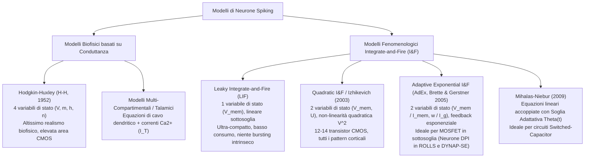

---

#### 1.3.1 Il Modello Biofisico di Hodgkin–Huxley (H–H)

Formulato da Hodgkin e Huxley (1952) sulla base delle misure sull'assone gigante di calamaro, modella la membrana cellulare come una capacità $C_m$ in parallelo a tre canali ionici principali: un canale passivo di perdita (*leak*) con conduttanza costante $g_L$ e potenziale di inversione $E_L$, un canale del Sodio ($\text{Na}^+$) voltaggio-dipendente e un canale del Potassio ($\text{K}^+$) voltaggio-dipendente. Il sistema è retto da **quattro equazioni differenziali non lineari accoppiate**:

$$C_m \frac{dV_m}{dt} = I_{\text{ext}}(t) - \underbrace{\bar{g}_{\text{Na}} m^3 h (V_m - E_{\text{Na}})}_{I_{\text{Na}}} - \underbrace{\bar{g}_{\text{K}} n^4 (V_m - E_{\text{K}})}_{I_{\text{K}}} - \underbrace{g_L (V_m - E_L)}_{I_L}$$

dove $m, h, n \in [0, 1]$ sono le variabili di *gating* (probabilità di attivazione del $\text{Na}^+$, inattivazione del $\text{Na}^+$ e attivazione del $\text{K}^+$), ciascuna governata da una cinetica del primo ordine dipendente dalla tensione:

$$\frac{dx}{dt} = \alpha_x(V_m)(1 - x) - \beta_x(V_m)x = \frac{x_\infty(V_m) - x}{\tau_x(V_m)}, \qquad x \in \{m, h, n\}$$

con valore di stato stazionario sigmoidale $x_\infty(V_m) = \frac{\alpha_x(V_m)}{\alpha_x(V_m) + \beta_x(V_m)}$ e costante di tempo a campana $\tau_x(V_m) = \frac{1}{\alpha_x(V_m) + \beta_x(V_m)}$.  
Sebbene il modello H–H riproduca esattamente la forma d'onda fisica del potenziale d'azione, la sua implementazione in silicio (es. Yu & Cauwenberghs, 2010a; Saighi et al., 2011) richiede circuiti dedicati per ciascuna variabile di gating, calcolatori di funzioni sigmoidali e moltiplicatori translineari per i termini $m^3 h$ e $n^4$, occupando un'area molto elevata e risultando adatta solo a piccole reti bio-ibride (pochi neuroni) e non a grandi matrici impiantabili.

---

#### 1.3.2 Il Modello *Leaky Integrate-and-Fire* (LIF): Derivazione Fisica, Soluzione Analitica e Curva $f\text{–}I$

Il modello **Leaky Integrate-and-Fire (LIF)** (introdotto originariamente da Lapicque nel 1907) rappresenta il riferimento cardine dell'ingegneria neuromorfica poiché cattura i tre processi essenziali dell'eccitabilità neuronale — **integrazione sinaptica, perdita passiva di carica (*leakage*) e generazione di eventi a soglia con reset** — utilizzando **una sola variabile di stato** ($V_{\text{mem}}$).

##### A. Circuito Elettrico Equivalente ed Equazione Differenziale di Membrana
Dal punto di vista biofisico ed circuitale (si veda la **Figura 17**, pannelli Fig. 1 e Fig. 2 estratti da *Li et al., 2024*), la membrana cellulare in regime sottosoglia è modellata da un circuito **RC parallelo** composto da:
* **Capacità di membrana $C_m$ (o $C_{\text{mem}}$):** rappresenta il doppio strato fosfolipidico impermeabile agli ioni, che accumula carica elettrica $Q = C_m V_{\text{mem}}$.
* **Resistenza di membrana $R_m = 1/g_L$ in serie alla batteria $E_L$:** rappresenta i canali ionici passivi (*leak channels*) sempre aperti, che tendono a riportare esponenzialmente il potenziale di membrana verso il potenziale di riposo $E_L$ (spesso posto convenzionalmente a $0\,\text{V}$ o massa nei modelli semplificati).
* **Generatore di corrente d'ingresso $I(t) = I_{\text{syn}}(t) + I_{\text{inj}}(t)$:** rappresenta la somma delle correnti post-sinaptiche eccitatorie (EPSC) e inibitorie (IPSC) che attraversano i recettori di membrana.

Applicando la **Legge di Kirchhoff delle Correnti (KCL)** al nodo del potenziale di membrana $V_{\text{mem}}(t)$, la corrente totale iniettata si ripartisce tra la corrente capacitiva $I_C = C_m \frac{dV_{\text{mem}}}{dt}$ e la corrente resistiva di perdita $I_{\text{leak}} = \frac{V_{\text{mem}}(t) - E_L}{R_m}$:

$$C_m \frac{dV_{\text{mem}}(t)}{dt} = -g_L \left(V_{\text{mem}}(t) - E_L\right) + I(t)$$

Moltiplicando ambo i membri per $R_m = 1/g_L$ e definendo la **costante di tempo di membrana** $\tau_m \triangleq R_m C_m = \frac{C_m}{g_L}$, si ottiene la forma canonica del modello LIF:

$$\tau_m \frac{dV_{\text{mem}}(t)}{dt} = -\left(V_{\text{mem}}(t) - E_L\right) + R_m I(t)$$

*(Ponendo il riferimento di riposo $E_L = 0$, l'equazione assume la forma compatta $R C \frac{dV_{\text{mem}}(t)}{dt} = -V_{\text{mem}}(t) + R I(t)$ riportata in Li et al., 2024).*

##### B. Meccanismo di Soglia, Reset e Periodo Refrattario Assoluto
Poiché l'equazione RC è puramente lineare e passiva, non possiede i termini non lineari di attivazione del $\text{Na}^+$ e del $\text{K}^+$ necessari per generare autonomamente il picco dello spike. Nel modello LIF, la forma d'onda stereotipata del potenziale d'azione non viene risolta analiticamente ma è sostituita da una **condizione al contorno algoritmica/circuitale (comparatore di soglia + switch di reset)**:

1. **Condizione di Firing (Emissione dello Spike):** Quando $V_{\text{mem}}(t)$ raggiunge dall'inferiore la tensione di soglia $V_{\text{th}}$ all'istante $t = t^{(f)}$:
   $$V_{\text{mem}}\left(t^{(f)-}\right) = V_{\text{th}} \implies \text{emissione di uno spike } \delta\left(t - t^{(f)}\right)$$
2. **Reset Post-Spike:** Istantaneamente dopo l'emissione dello spike, il potenziale di membrana viene forzato al potenziale di reset $V_{\text{reset}} < V_{\text{th}}$:
   $$V_{\text{mem}}\left(t^{(f)+}\right) = V_{\text{reset}}$$
3. **Periodo Refrattario Assoluto ($\tau_{\text{ref}}$):** Per un intervallo temporale $t \in \left(t^{(f)},\, t^{(f)} + \tau_{\text{ref}}\right]$, il potenziale è mantenuto bloccato (*clamped*) a $V_{\text{reset}}$ (l'interruttore di reset in parallelo a $C_m$ rimane chiuso) e l'integrazione riprende solo per $t > t^{(f)} + \tau_{\text{ref}}$.

##### C. Soluzione Analitica, Corrente Reobase e Curva di Trasferimento $f\text{–}I$
Consideriamo un neurone LIF stimolato da una corrente costante $I(t) = I_0$ a partire da $V_{\text{mem}}(0) = V_{\text{reset}}$. La soluzione dell'equazione differenziale lineare del primo ordine per $t > 0$ è:

$$V_{\text{mem}}(t) = E_L + R_m I_0 + \left(V_{\text{reset}} - E_L - R_m I_0\right) e^{-t/\tau_m}$$

Per $t \to \infty$, in assenza di soglia il potenziale tenderebbe asintoticamente al valore di regime $V_\infty = E_L + R_m I_0$. Di conseguenza, il neurone può raggiungere la soglia $V_{\text{th}}$ in un tempo finito **se e solo se** $V_\infty > V_{\text{th}}$, il che definisce la **corrente di soglia minima (corrente reobase, *rheobase current*)**:

$$I_{\text{rh}} = \frac{V_{\text{th}} - E_L}{R_m} = g_L (V_{\text{th}} - E_L)$$

* Se $I_0 \le I_{\text{rh}}$: il neurone non emette alcuno spike ($f = 0$); la corrente di perdita $I_{\text{leak}}$ bilancia completamente la corrente iniettata prima che venga toccata la soglia.
* Se $I_0 > I_{\text{rh}}$: imponendo $V_{\text{mem}}(T_{\text{int}}) = V_{\text{th}}$, si ricava il tempo di carica (integrazione) $T_{\text{int}}$:
  $$V_{\text{th}} = E_L + R_m I_0 - \left(E_L + R_m I_0 - V_{\text{reset}}\right) e^{-T_{\text{int}}/\tau_m} \implies T_{\text{int}} = \tau_m \ln\left(\frac{R_m I_0 + E_L - V_{\text{reset}}}{R_m I_0 + E_L - V_{\text{th}}}\right)$$
  Sommando il periodo refrattario assoluto $\tau_{\text{ref}}$, l'intervallo inter-spike totale vale $\text{ISI} = \tau_{\text{ref}} + T_{\text{int}}$, da cui si ottiene la celebre **curva di trasferimento frequenza-corrente ($f\text{–}I$) del neurone LIF**:

$$f(I_0) = \frac{1}{\text{ISI}} = \begin{cases} 0 & \text{se } I_0 \le I_{\text{rh}} \\ \left[ \tau_{\text{ref}} + \tau_m \ln\left( \dfrac{R_m I_0 - (V_{\text{reset}} - E_L)}{R_m I_0 - (V_{\text{th}} - E_L)} \right) \right]^{-1} & \text{se } I_0 > I_{\text{rh}} \end{cases}$$

Per correnti molto grandi ($I_0 \gg I_{\text{rh}}$), sviluppando il logaritmo al primo ordine ($\ln(1+x) \approx x$), il tempo di integrazione scala come $T_{\text{int}} \approx \frac{C_m(V_{\text{th}} - V_{\text{reset}})}{I_0}$ (comportamento da integratore puro), e la frequenza di scarica satura asintoticamente alla **frequenza massima di firing** $f_{\max} = \frac{1}{\tau_{\text{ref}}}$.

##### D. Filtraggio Sinaptico Esponenziale e Discretizzazione Digitale
Nel modello LIF completo (ad es. implementato nel processore **SynSense Xylo** in *Li et al., 2024*), gli spike pre-sinaptici non iniettano impulsi di Dirac direttamente nella membrana, ma vengono prima filtrati da **sinapsi esponenziali** con costante di tempo sinaptica $\tau_{\text{syn},j}$ e peso $w_{ij}$:

$$\tau_{\text{syn},j} \frac{dI_{\text{syn},j}(t)}{dt} = -I_{\text{syn},j}(t) + \sum_{f} w_{ij} \delta\left(t - t_j^{(f)}\right), \qquad I_{\text{app},i}(t) = \sum_{j} I_{\text{syn},j}(t)$$

Nelle implementazioni CMOS **completamente digitali** a tempo discreto con passo $\Delta t$ (come Xylo), l'integrazione di Eulero delle equazioni sinaptica e di membrana diventa:

$$I_{\text{syn}}[n+1] = \alpha_{\text{syn}} I_{\text{syn}}[n] + \sum_{j} w_j s_j[n], \qquad V_{\text{mem}}[n+1] = \beta_{\text{mem}} V_{\text{mem}}[n] + I_{\text{syn}}[n]$$

dove i fattori di decadimento esponenziale $\alpha_{\text{syn}} = e^{-\Delta t / \tau_{\text{syn}}}$ e $\beta_{\text{mem}} = e^{-\Delta t / \tau_m}$ possono essere realizzati senza moltiplicatori hardware tramite semplici operazioni di **bit-shift e sottrazione** (*bit-shift decay*: $x \leftarrow x - (x \gg k)$, cui corrisponde $\beta = 1 - 2^{-k}$).

---

#### 1.3.3 Il Modello *Quadratic Integrate-and-Fire* (QIF) e il Modello Bidimensionale di Izhikevich

Il modello LIF standard presenta due limitazioni biofisiche: (1) l'avvicinamento alla soglia è concavo verso il basso (mentre nei neuroni reali l'attivazione dei canali $\text{Na}^+$ produce un'accelerazione rigenerativa convessa prima dello spike); (2) avendo una sola variabile di stato che viene resettata ad ogni spike, non conserva memoria degli spike precedenti e quindi non può esibire *spike-frequency adaptation* né *bursting* intrinseco.

Il modello di **Izhikevich (2003)** risolve entrambi i problemi mediante la riduzione per teoria delle biforcazioni dei modelli di tipo Hodgkin–Huxley a un sistema bidimensionale con non-linearità quadratica (implementato direttamente in silicio in *Wijekoon & Dudek, 2008* — `paperSNN1` Fig. 16, e nel chip **NET-TEN** di *Ronchini et al., 2023* — `paperSNN3` Fig. 3b):

$$\begin{cases}
\dfrac{dV_{\text{mem}}}{dt} = 0.04 V_{\text{mem}}^2 + 5 V_{\text{mem}} + 140 - U + I_{\text{syn}} \\
\dfrac{dU}{dt} = a\left(b V_{\text{mem}} - U\right)
\end{cases}$$

con condizione ausiliaria di reset post-spike:
$$\text{se } V_{\text{mem}} \ge 30\,\text{mV}: \quad \begin{cases} V_{\text{mem}} \leftarrow c \\ U \leftarrow U + d \end{cases}$$

* **$V_{\text{mem}}$** rappresenta il potenziale transmembrana e il termine $+0.04 V_{\text{mem}}^2$ genera il feedback positivo rigenerativo che porta $V_{\text{mem}}$ all'apice dello spike senza bisogno di una soglia artificiale fissa di innesco.
* **$U$** è la variabile lenta di recupero della membrana (*membrane recovery variable*), che rende conto dell'attivazione delle correnti ioniche $\text{K}^+$ e dell'inattivazione delle correnti $\text{Na}^+$, fornendo un feedback negativo su $V_{\text{mem}}$.
* I quattro parametri adimensionali $(a, b, c, d)$ controllano rispettivamente: la scala temporale del recupero $U$ ($a$), la sensibilità sottosoglia di $U$ alle fluttuazioni di $V_{\text{mem}}$ ($b$), il valore di reset post-spike della tensione ($c$) e il salto incrementale post-spike della variabile di recupero ($d$). Variando le tensioni di polarizzazione corrispondenti a $c$ e $d$ su silicio, lo stesso circuito di 12–14 transistor riproduce *Regular Spiking (RS)*, *Intrinsically Bursting (IB)*, *Chattering (CH)* e *Fast Spiking (FS)*.

---

#### 1.3.4 Il Modello *Adaptive Exponential Integrate-and-Fire* (AdEx)

Proposto da **Brette & Gerstner (2005)**, sostituisce il termine quadratico di Izhikevich con un termine **esponenziale** (derivato direttamente dalla fisica dell'attivazione dei canali del Sodio di Hodgkin–Huxley vicino alla soglia di innesco):

$$\begin{cases}
C \dfrac{dV}{dt} = -g_L (V - E_L) + g_L \Delta_T \exp\left(\dfrac{V - V_T}{\Delta_T}\right) - w + I \\
\tau_w \dfrac{dw}{dt} = a(V - E_L) - w
\end{cases}$$

con regola di reset per $V \ge V_{\text{peak}}$:
$$V \leftarrow V_r, \qquad w \leftarrow w + b$$
dove $V_T$ è la tensione di soglia effettiva di innesco del run-away esponenziale, $\Delta_T$ è il fattore di pendenza dello spike (*slope factor*) e $w$ è la corrente di adattamento (*adaptation current*).

> [!IMPORTANT]
> **Perché il modello AdEx è il "Gold Standard" per i circuiti CMOS analogici in sottosoglia?**  
> Poiché un transistor MOSFET polarizzato in inversione debole (*sub-threshold*) possiede una caratteristica fisica corrente-tensione **intrinsecamente esponenziale** ($I_D = I_0 e^{\kappa V_G / U_T}$), il termine esponenziale $\exp\left(\frac{V - V_T}{\Delta_T}\right)$ del modello AdEx non deve essere approssimato: **è generato gratis dalla fisica del singolo transistor CMOS!** Come dimostrato da Livi & Indiveri (2009) e Indiveri et al. (2011) (Equazione 2, p. 13), traducendo il modello AdEx nel dominio delle correnti sottosoglia tramite due filtri **DPI (Differential Pair Integrator)** si ottiene il **Neurone DPI**, che costituisce il cuore computazionale dei processori **ROLLS** (`paperSNN2`), **DYNAP-SE** (`paperSNN5`) e **DYNAP-SE2** (`paperSNN6`):
> $$\begin{cases}
> \tau \dfrac{d}{dt} I_{\text{mem}} = -I_{\text{mem}} \left(1 + \dfrac{I_g}{I_\tau}\right) + I_{\text{mem}\infty} + f(I_{\text{mem}}) \\
> \tau_g \dfrac{d}{dt} I_g = -I_g + I_{g\max} r(t)
> \end{cases}$$

---

#### 1.3.5 Il Modello a Soglia Adattativa di Mihalas–Niebur

Introdotto da **Mihalas & Niebur (2009)** e implementato in tecnologia *Switched-Capacitor* da Folowosele et al. (2009a,b) (`paperSNN1`, Fig. 18–19), evita qualsiasi non-linearità nell'equazione di membrana accoppiando linearmente il potenziale $V_m(t)$ a una **tensione di soglia dinamica adattativa $\Theta(t)$**:

$$\begin{cases}
\dfrac{dV_m(t)}{dt} = -\dfrac{1}{\tau_m}\left(V_m(t) - E_L\right) + \dfrac{I_{\text{in}}(t)}{C_m} + \sum_j I_j(t) \\
\dfrac{d\Theta(t)}{dt} = a\left(V_m(t) - E_L\right) - b\left(\Theta(t) - \Theta_\infty\right)
\end{cases}$$

Quando $V_m(t) = \Theta(t)$, viene emesso uno spike e le variabili vengono aggiornate secondo $V_m \leftarrow E_L$ e $\Theta \leftarrow \max(\Theta_r, \Theta)$. Essendo tutte le equazioni differenziali strettamente lineari, l'intero modello può essere realizzato mediante condensatori e interruttori MOSFET pilotati da fasi di clock non sovrapposte ($\phi_1, \phi_2$), garantendo un'altissima immunità alle variazioni di processo.

---

### 1.4 Dinamiche Sinaptiche e Paradigmi di Plasticità e Apprendimento

Nelle SNN analizzate nei 7 articoli, la configurazione dei pesi sinaptici e la dinamica delle sinapsi seguono cinque paradigmi complementari:

1. **Plasticità Dipendente dal Tempo di Spike (STDP — *Spike-Timing-Dependent Plasticity*):**  
   Utilizzata in hardware in **NET-TEN** (`paperSNN3`), aggiorna il peso sinaptico in base alla differenza temporale $\Delta t = t_{\text{post}} - t_{\text{pre}}$ tra lo spike post-sinaptico e quello pre-sinaptico:
   $$\Delta W(\Delta t) = \begin{cases} +A_+ \exp(-\Delta t / \tau_+) & \text{se } \Delta t \ge 0 \quad (\text{LTP: causalità pre}\to\text{post}) \\ -A_- \exp(+\Delta t / \tau_-) & \text{se } \Delta t < 0 \quad (\text{LTD: anti-causalità post}\to\text{pre}) \end{cases}$$
2. **Plasticità Bistabile Guidata dagli Spike e dal Calcio Post-Sinaptico (SDSP — Brader, Senn & Fusi, 2007):**  
   Implementata nelle $64\text{K}$ sinapsi di apprendimento on-line del chip **ROLLS** (`paperSNN2`). Risolve il problema del decadimento rapido della carica sui piccoli condensatori CMOS combinando salti analogici istantanei ($\pm \Delta w$) all'arrivo dello spike pre-sinaptico (condizionati dal potenziale di membrana $V_{\text{mem}}(t_{\text{pre}})$ e dalla concentrazione post-sinaptica di ioni Calcio $Ca(t_{\text{pre}})$ che agisce da meccanismo di *stop-learning*) con un **drift bistabile lento** che attira il peso verso due stati asintotici stabili ($w_{\min}$ o $w_{\max}$), garantendo la ritenzione a lungo termine della memoria senza memoria digitale esterna.
3. **Plasticità a Breve Termine (STP / STD — *Short-Term Depression*):**  
   Implementata nelle $64\text{K}$ sinapsi programmabili di **ROLLS** (`paperSNN2`), riduce transitoriamente l'ampiezza dell'EPSC durante treni di spike ad alta frequenza, fungendo da controllo automatico di guadagno dinamico.
4. **Addestramento Supervisionato Off-Chip tramite *Backpropagation Through Time* (BPTT) con *Surrogate Gradient* e Regolarizzazione di Sparsità:**  
   Utilizzato in **Li et al. (2024)** (`paperSNN4`, processore Xylo). Poiché la funzione di generazione dello spike $\Theta(V_{\text{mem}} - V_{\text{th}})$ ha derivata nulla ovunque tranne una delta di Dirac in $V_{\text{th}}$, durante il backward pass la derivata discontinua viene sostituita da una derivata surrogata liscia (*surrogate gradient*), aggiungendo alla *Cross-Entropy Loss* una penalità quadratica sul numero di spike in eccesso per minimizzare il consumo energetico su silicio.
5. **Ricerca Architetturale Evolutiva Hardware-Aware (ENAS — *Evolutionary Neural Architecture Search*):**  
   Utilizzata in **Bartels et al. (2025)** (`paperSNN6`, processore DYNAP-SE2) per trovare la matrice di connettività spaziale ottima (`1-2-1-0-1-2-1`) capace di estrarre la sincronizzazione parziale dei segnali iEEG nonostante il *device mismatch* del $20\text{–}30\%$ dei circuiti analogici in sottosoglia.

---

## Capitolo 2 — Perché Utilizzare una SNN in un Dispositivo Biomedicale Impiantabile?

### 2.1 Vincoli Fisici, Termici ed Energetici dei Sistemi Impiantabili Intracranici e Indossabili

Un dispositivo biomedicale impiantabile (come un'interfaccia neurale intracorticale iBMI o un neurostimolatore *closed-loop* per l'epilessia farmacoresistente) opera in uno degli ambienti più severi dell'ingegneria elettronica ed è soggetto a quattro vincoli stringenti:

1. **Vincolo Termico e Bio-Compatibilità Tissutale:**  
   Il tessuto cerebrale non tollera un innalzamento cronico della temperatura locale superiore a **$\Delta T_{\max} \approx 1\,^\circ\text{C}$** (standard IEEE/ISO per dispositivi medici impiantabili attivi), cui corrisponde una densità massima di potenza dissipata di circa **$10\text{–}40\,\text{mW/cm}^2$**. Come evidenziato in **Ronchini et al. (2023)** (`paperSNN3`), un singolo neurone biologico consuma tra **$0.5\,\text{nW}$ e $4.0\,\text{nW}$** a riposo/in attività: progettare una rete neuromorfica al silicio come **NET-TEN** che dissipa in media **$3.50\,\text{nW}$** sull'intero task di rilevazione significa operare esattamente alla scala metabolica del tessuto ospite, azzerando il rischio di necrosi termica.
2. **Budget Energetico Ultra-Ridotto (Batteria o *Wireless Power Transfer*):**  
   Per evitare frequenti interventi chirurgici di sostituzione della batteria o per consentire l'alimentazione wireless induttiva/ultrasonica con antenne millimetriche, l'intero System-on-Chip (acquisizione + elaborazione + telemetria) deve consumare da **pochi nanowatt a poche decine/centinaia di microwatt** (*sub-milliwatt regime*).
3. **Bassa Latenza ed Elaborazione in Tempo Reale (*Closed-Loop Stimulation*):**  
   Nel trattamento dell'epilessia farmacoresistente (~30% dei pazienti epilettici), la stimolazione cerebrale profonda (*Deep Brain Stimulation*, **DBS**) ad anello chiuso (*closed-loop*) eroga l'impulso elettrico terapeutico solo al rilevamento di biomarker elettrografici precoci (crisi ictali in LFP o iEEG). Affinché la stimolazione riesca a desincronizzare la rete biologica e abortire la crisi prima della sua generalizzazione clinica, il ritardo di rilevazione deve essere nell'ordine delle **decine o centinaia di millisecondi** ($56.7\,\text{ms}$ mediana in NET-TEN; $0.5\,\text{s}$ in Xylo).
4. **Area di Silicio Millimetrica:**  
   L'ingombro fisico dell'impianto intracranico deve essere ridotto al minimo per limitare il danno meccanico e la risposta infiammatoria gliale (es. **$0.70\,\text{mm}^2$** totali per 32 canali in **NeuroSEED**, **$1.08\,\text{mm}^2$** per **NET-TEN**).

---

### 2.2 Limiti dell'Elaborazione Digitale Convenzionale (Campionamento di Nyquist + Architettura von Neumann)

Nei sistemi biomedicali convenzionali (Figura 21a da *Bartels et al., 2025* e Figura 25 da *Wu et al., 2026*), la catena di acquisizione ed elaborazione soffre di tre inefficienze strutturali:

1. **Campionamento Continuo a Frequenza Fissa (Criterio di Nyquist-Shannon):**  
   Un ADC tradizionale campiona ininterrottamente tutti gli $N$ canali alla frequenza $f_s \ge 2 f_{\max}$ (es. $10.4\text{–}30\,\text{kHz/canale}$ per gli spike intracorticali, producendo **$3.3\,\text{Mbps}$** per 32 canali a 10 bit). Tuttavia, i segnali biologici sono **intrinsecamente sparsi nel tempo**: un neurone corticale spara a pochi Hz (spike della durata di $\sim 1\,\text{ms}$ seguiti da centinaia di millisecondi di silenzio o rumore di fondo), e le crisi epilettiche occupano meno dell'$1\%$ della vita del paziente. Campionare, quantizzare e processare a pieno regime il $99\%$ di periodi silenti spreca la quasi totalità dell'energia.
2. **Collo di Bottiglia di von Neumann e Buffer di Memoria:**  
   Gli algoritmi classici di estrazione di feature (Trasformata Rapida di Fourier FFT, Trasformata Wavelet Discreta DWT, calcolo di matrici di covarianza, filtri digitali FIR/IIR, CNN/LSTM) richiedono di accumulare finestre temporali di segnale in **memorie SRAM/DRAM** e di spostare continuamente dati tra memoria e unità aritmetica (ALU/MAC) ad ogni ciclo di clock (ad es. le implementazioni FPGA/ASIC basate su DWT+SVM o CNN+LSTM in Tabella 1 di `paperSNN4` consumano fino a **$159\text{–}284\,\text{mW}$**, ovvero tre ordini di grandezza in più rispetto a una SNN!).
3. **Saturazione Energetica della Telemetria Wireless Raw:**  
   Trasmettere all'esterno della scatola cranica il flusso grezzo digitalizzato di decine o centinaia di canali neurali (diversi Mbps) richiede trasmettitori RF sempre attivi che dissipano decine di milliwatt, violando i limiti di *Specific Absorption Rate* (SAR) e di potenza dell'impianto.

---

### 2.3 I Vantaggi Fondamentali del Paradigma Neuromorfico Spiking (*Event-Driven*)

L'impiego di una SNN (accoppiata a un front-end *event-driven*) risponde direttamente alla prima domanda della consegna offrendo quattro vantaggi decisivi:

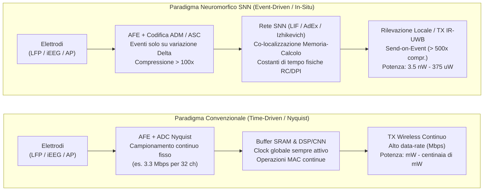

1. **Consumo Energetico Proporzionale all'Attività Biologica (*Activity-Driven Power*):**  
   Poiché i circuiti analogici in sottosoglia e la logica digitale asincrona *clockless* si attivano solo in presenza di spike, durante i lunghi periodi fisiologici di baseline (interictali) il consumo crolla a livelli trascurabili (es. **$1.77\,\mu\text{W}$** su 56 canali in fase pre-ictale su DYNAP-SE2, o **$0.68\,\text{pW}$ statici / $3.50\,\text{nW}$ medi** su NET-TEN).
2. **Corrispondenza delle Costanti di Tempo (*Real-Time Matching* senza Clock né Buffer):**  
   I neuroni CMOS in sottosoglia (come il neurone DPI) hanno costanti di tempo fisiche $\tau = \frac{C U_T}{\kappa I_\tau}$ dell'ordine di **$1\text{–}500\,\text{ms}$**, che coincidono esattamente con le scale temporali dei segnali biologici (EEG, LFP, potenziali d'azione). La rete elabora quindi la storia temporale del segnale direttamente attraverso la carica fisica sui propri condensatori di membrana e sinaptici, **senza bisogno di buffer di memoria per memorizzare finestre passate né di clock di campionamento**.
3. **Elaborazione Locale (*Edge / In-Situ Computing*) e Compressione $>500\times$ per la Telemetria:**  
   Eseguendo lo *spike detection* o la classificazione della crisi direttamente sul chip impiantato, non è più necessario trasmettere il segnale grezzo: si trasmette solo il flag dell'evento rilevato o l'indirizzo dello spike (*send-on-event*), riducendo il traffico dati di **oltre $500$ volte** e abbattendo la potenza del trasmettitore wireless UWB a soli **$4.6\,\mu\text{W}$** (**NeuroSEED**, 2026).
4. **Robustezza Intrinseca al Rumore e alla Deriva di Baseline:**  
   L'integrazione *leaky* di membrana e gli schemi differenziali/valle-picco sugli eventi UP/DOWN filtrano naturalmente il rumore ad alta frequenza non correlato e gli artefatti lenti di movimento o polarizzazione d'elettrodo.

---

## Capitolo 3 — Applicazioni Biomedicali delle SNN nell'Elaborazione di Segnali Biologici

In questo capitolo vengono esaminate in dettaglio le quattro applicazioni biomedicali principali presentate nella letteratura di riferimento (`paperSNN3`, `paperSNN4`, `paperSNN6`, `paperSNN7`), che coprono l'intero spettro dei segnali elettrofisiologici neurali:
1. **Potenziali di Campo Locale (*Local Field Potentials*, LFP)** intracranici da corteccia paraippocampale per la rilevazione a bassissima latenza di crisi epilettiche ed esclusione di scariche interictali e artefatti (**NET-TEN**, *Ronchini et al., 2023*).
2. **Elettroencefalografia da Scalpo (*Scalp EEG*)** non invasiva su dataset clinici pediatrici e adulti (CHB-MIT e Siena) per il monitoraggio *streaming real-time* sub-milliwatt su processore neuromorfico digitale edge (**WaveSense su SynSense Xylo**, *Li et al., 2024*).
3. **Elettroencefalografia Intracranica (*iEEG*)** multicanale (42–62 elettrodi subdurali e di profondità, dataset SWEC-ETHZ) elaborata su processore neuromorfico *mixed-signal* (**DYNAP-SE2**, *Bartels et al., 2025*) per l'estrazione hardware dei cluster di sincronizzazione parziale ictale.
4. **Potenziali d'Azione Extracellulari (*Neural Action Potentials / Spikes*, fino a $5.2\,\text{kHz}$)** acquisiti su 32 canali con multiplexing diretto nel tempo (TDM), conversione adattiva in spike, rilevamento *clockless* valle-picco e telemetria wireless impulsiva IR-UWB (**NeuroSEED**, *Wu et al., 2026*).

---

### 3.1 Rilevamento a Bassissima Latenza di Crisi Epilettiche in Segnali LFP Intracranici: Il Sistema NET-TEN *(Ronchini et al., 2023 — Paper 3)*

#### A. Obiettivo Clinico, Modello Sperimentale *In Vitro* e Dataset
Circa un terzo dei pazienti affetti da epilessia è refrattario ai trattamenti farmacologici. Per questi soggetti, la neurostimolazione cerebrale profonda (*Deep Brain Stimulation*, **DBS**) ad anello chiuso (*closed-loop*) eroga impulsi elettrici terapeutici solo quando viene rilevata un'attività epilettiforme incipiente, riducendo gli effetti collaterali e massimizzando l'efficacia rispetto alla stimolazione continua (*open-loop*). Un rivelatore impiantabile ideale per DBS deve discriminare in tempo reale tra:
* **Attività di baseline sana (`Label = 0`)**;
* **Scariche interictali brevi (`Label = 1`)**, che precedono o accompagnano la patologia ma non costituiscono una crisi clinica prolungata;
* **Eventi ictali (`Label = 2`)**, ossia vere e proprie crisi epilettiche tonico-cloniche che richiedono l'intervento immediato dello stimolatore;
* **Artefatti elettrici (`Artifact`)**, che non devono mai innescare falsi positivi.

Per validare sperimentalmente il chip **NET-TEN** (fabbricato in tecnologia **TSMC 180 nm CMOS**, incapsulato in package QFN48 e montato sulla PCB di test *HERMES*, **Figura 15**), gli autori hanno utilizzato registrazioni di **Local Field Potentials (LFP)** ottenute da fette orizzontali di ippocampo-corteccia (**CTX**, spessore $400\,\mu\text{m}$) prelevate da $n = 10$ topi maschi CD1 (4–8 settimane), perfuse con liquido cerebrospinale artificiale (aCSF a $32\,^\circ\text{C}$) addizionato con il bloccante dei canali del potassio **4-aminopiridina (4AP, $250\,\mu\text{M}$)** per indurre ittogenesi acuta. I segnali sono stati acquisiti tramite una matrice planare di microelettrodi (**MEA $6 \times 10$**, 60 elettrodi in Ti-iR di diametro $30\,\mu\text{m}$, passo $500\,\mu\text{m}$, amplificatore MEA1060, campionati a $f_s = 2\,\text{kHz}$ con filtro passa-basso a $1\,\text{kHz}$). Il dataset comprende **10 tracce da $100\,\text{s}$** dalla corteccia paraippocampale: 6 con solo evento ictale, 3 con evento ictale + scariche interictali, e 1 contenente solo un artefatto elettrico.

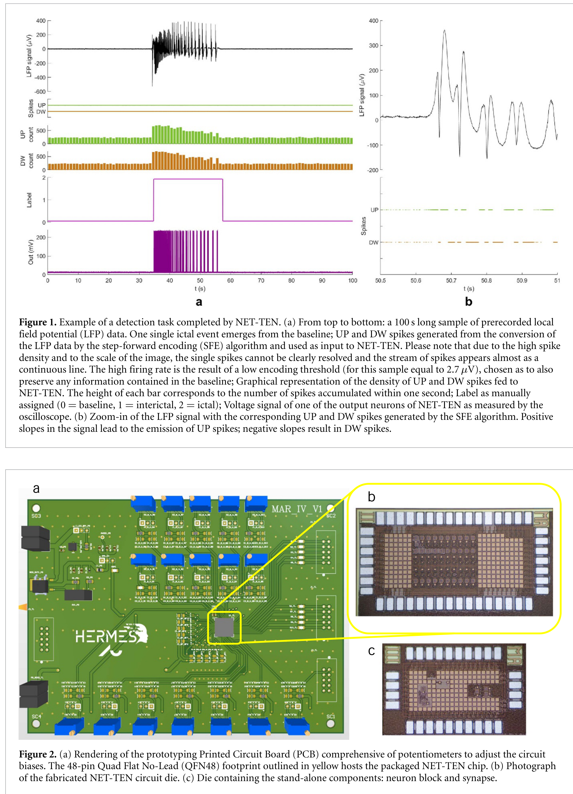
*Figura 15 — Estratta da Ronchini et al. (2023), Fig. 1 e Fig. 2: (In alto) Segnale LFP di 100 s con evento ictale, conversione in spike UP e DW tramite algoritmo SFE (soglia $2.7\,\mu\text{V}$), densità di spike su finestre di 1 s, etichetta manuale (0=baseline, 1=interictal, 2=ictal) e risposta in tensione misurata all'oscilloscopio su un neurone di uscita di NET-TEN. (In basso) PCB di prototipazione HERMES con potenziometri a 25 giri per la regolazione fine dei bias e microfotografia dei die CMOS a 180 nm.*

#### B. Conversione del Segnale LFP in Spike (*Step-Forward Encoding*, SFE) e Topologia della Rete 10–10–10
Il segnale analogico LFP viene convertito in due flussi binari di eventi (**UP** e **DW**) mediante l'algoritmo **Step-Forward Encoding (SFE)** (equivalente algoritmico di un modulatore delta asincrono ADM): ad ogni campione ($2\,\text{kHz}$), se $S(t) > \text{baseline} + \text{threshold}$ viene emesso uno spike `UP` e la baseline viene incrementata di $+\text{threshold}$; se $S(t) < \text{baseline} - \text{threshold}$ viene emesso uno spike `DW` e la baseline viene decrementata di $-\text{threshold}$. La soglia è calibrata in modo che l'OR logico tra UP e DW produca un firing rate medio del $\sim 30\%$ dei time-step ($2.7\,\mu\text{V}$ in Fig. 15). Gli impulsi binari sono convertiti in impulsi fisici di tensione con **ampiezza di picco $200\,\text{mV}$** e larghezza a metà altezza (**FWHM**) di **$130\,\mu\text{s}$** (distanza minima inter-impulso $350\,\mu\text{s}$), inviati al chip tramite generatore di forme d'onda Keysight 33600A.

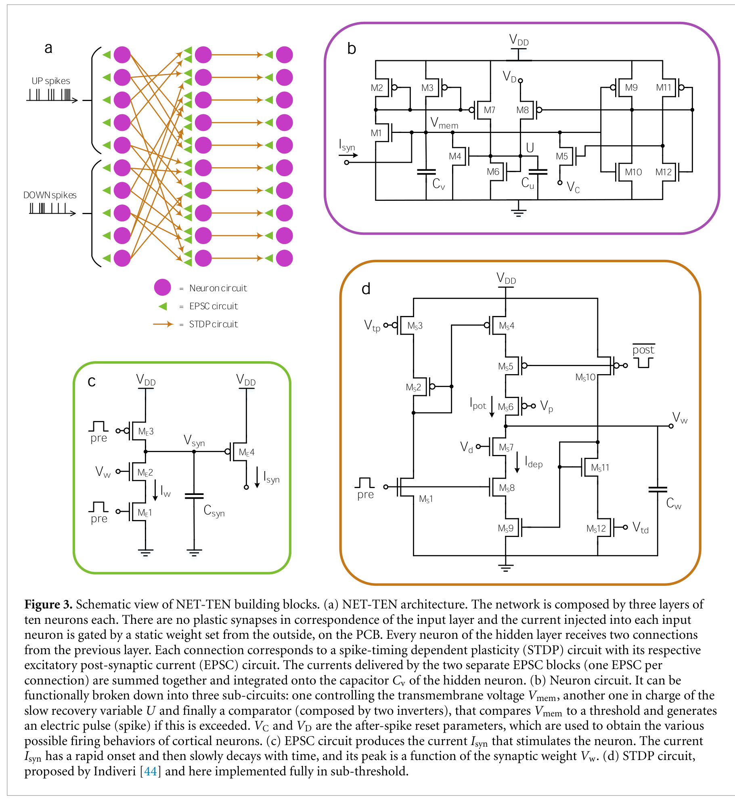
*Figura 16 — Estratta da Ronchini et al. (2023), Fig. 3: (a) Architettura feed-forward a 3 strati (10–10–10 neuroni) di NET-TEN con fan-out pari a 2 tra input e hidden layer e connessione 1-a-1 tra hidden e output layer. (b) Circuito CMOS del neurone di Izhikevich ($M_1\text{–}M_{12}, C_v, C_u$). (c) Circuito sinaptico EPSC ($M_{E1}\text{–}M_{E4}, C_{\text{syn}}$). (d) Circuito di plasticità STDP in sottosoglia ($M_{S1}\text{–}M_{S12}, C_w$).*

Come mostrato in **Figura 16a**, l'architettura di NET-TEN è una SNN *feed-forward* a **3 layer da 10 neuroni ciascuno (30 neuroni di Izhikevich totali)**:
* **Input Layer (10 neuroni + 10 blocchi EPSC a peso statico):** I primi 5 neuroni ricevono il treno di **UP spikes**, gli altri 5 ricevono i **DW spikes**, mediati da 10 circuiti EPSC il cui peso $V_w$ è fissato esternamente su PCB.
* **Hidden Layer (10 neuroni + 20 sinapsi plastiche STDP+EPSC):** Ogni neurone di input proietta esattamente a **2 neuroni hidden (fan-out = 2)** e ogni neurone hidden riceve **2 connessioni (fan-in = 2)**. Le correnti $I_{\text{syn}}$ dei due blocchi EPSC convergenti vengono sommate per KCL sul condensatore $C_v$ del neurone hidden.
* **Output Layer (10 neuroni + 10 sinapsi plastiche STDP+EPSC):** Connesso **1-a-1** con i 10 neuroni dell'hidden layer. In totale il chip integra **30 neuroni di Izhikevich, 40 circuiti EPSC e 30 circuiti STDP** su un'area complessiva di layout di soli **$1.08\,\text{mm}^2$**, alimentati a una tensione ultra-ridotta **$V_{DD} = 250\,\text{mV}$** ($0.25\,\text{V}$).

#### C. Meccanismo Fisico di Filtraggio Spazio-Temporale Senza Training Offline
Una caratteristica ingegneristica fondamentale di NET-TEN è l'**assenza totale di una fase di addestramento offline**:
1. **I neuroni agiscono come filtri passa-alto (*High-Pass Filters*) nel dominio della frequenza di spike:** Poiché i transistor operano in sottosoglia profonda con correnti di perdita, un neurone riesce ad accumulare su $C_v$ carica sufficiente per superare la soglia del comparatore **solo quando gli spike pre-sinaptici arrivano ad alta frequenza ravvicinata** (come accade durante le scariche epilettiformi). Il firing rate di uscita di ciascuno strato è quindi sempre inferiore a quello di ingresso, sopprimendo completamente il rumore di baseline (da cui una **Precision = $0.998$**, quasi totale assenza di falsi positivi durante la baseline).
2. **La STDP agisce come un filtro dinamico a memoria breve:** Poiché la capacità di memorizzazione del peso nel blocco STDP è molto piccola (**$C_w = 206.30\,\text{fF}$**), il peso analogico $V_w$ decade in **decine di millisecondi**. La STDP non "memorizza" pesi statici, ma potenzia dinamicamente in tempo reale le sinapsi attraversate da burst persistenti e correlati (eventi ictali), facilitando la propagazione verso lo strato di uscita.
3. **Effetto del *Device Mismatch* in Sottosoglia:** Sebbene tutti i 30 neuroni condividano gli stessi bias globali su PCB, la dispersione statistica dei transistor a $V_{DD} = 0.25\,\text{V}$ fa sì che **4 canali di uscita su 10 (`Ch6`, `Ch7`, `Ch8` e `Ch10`)** si sintonizzino spontaneamente in modo ottimale per rispondere agli eventi epilettiformi.

#### D. Risultati Sperimentali, Discriminazione Ictale/Interictale/Artefatto e Post-Processing a 2 Contatori
Nelle misure sperimentali sui 10 campioni animali, la risposta grezza del primo spike emesso da NET-TEN mostra una **latenza mediana di appena $56.7\,\text{ms}\ [\text{IQR } 79.1\,\text{ms}]$** per gli eventi ictali (media $110.4\,\text{ms}$) e di **$138.6\,\text{ms}\ [\text{IQR } 39.2\,\text{ms}]$** per gli eventi interictali (Tabella 3.1).

**Tabella 3.1 — Latenza di risposta ictale e interictale (in ms) sui 4 canali informativi di NET-TEN *(Ronchini et al., 2023, Table 1)***

| Sample | Tipologia Traccia | Ictal Ch6 (ms) | Ictal Ch7 (ms) | Ictal Ch8 (ms) | Ictal Ch10 (ms) | Interictal Ch6 (ms) | Interictal Ch7 (ms) | Interictal Ch8 (ms) | Interictal Ch10 (ms) |
| :---: | :--- | :---: | :---: | :---: | :---: | :---: | :---: | :---: | :---: |
| **1** | Ictal | 31.4 | 31.2 | 31.6 | 52.9 | — | — | — | — |
| **2** | Ictal + Interictal | 48.1 | 48.1 | 48.4 | 57.5 | $80.1^*$ | $86.1^*$ | $80.4^*$ | $130.8^*$ |
| **3** | Ictal + Interictal | 104.2 | 104.1 | 104.6 | 874.8 | 138.6 | 138.2 | 138.8 | Non rilevato |
| **4** | Artifact | — | — | — | — | — | — | — | — |
| **5** | Ictal + Interictal | 203.1 | 228.3 | 203.8 | 202.9 | 147.8 | 147.5 | 148.2 | 155.6 |
| **6** | Ictal | 178.9 | 201.9 | 179.3 | 178.6 | — | — | — | — |
| **7** | Ictal | 44.1 | 43.8 | 44.3 | 55.9 | — | — | — | — |
| **8** | Ictal | 43.9 | 43.9 | 44.3 | 62.8 | — | — | — | — |
| **9** | Ictal | 41.7 | 26.1 | 49.7 | 38.4 | — | — | — | — |
| **10** | Ictal | 74.5 | 74.0 | 74.7 | 98.7 | — | — | — | — |
| **Mediana [IQR] per ch.** | | **48.1 [60.3]** | **48.1 [60.3]** | **49.7 [60.3]** | **62.8 [122.7]** | **138.6 [33.9]** | **138.2 [30.7]** | **138.8 [33.9]** | **143.2 [12.4]** |
| **Mediana [IQR] globale** | | \multicolumn{4}{c|}{\textbf{56.7 [79.1] ms}} | \multicolumn{4}{c}{\textbf{138.6 [39.2] ms}} |

Per isolare esclusivamente le crisi **ictali** (che durano decine di secondi e generano una mediana di **$1117.5$ spike**) scartando sia le scariche **interictali** (brevi, mediana di soli **$4.5$ spike**) sia gli **artefatti elettrici** (mediana di $27.5$ spike ma più diluiti all'esordio), gli autori hanno analizzato l'intervallo inter-spike tra il $1^\circ$ e il $3^\circ$ spike ($\text{ISI}_{\text{I}-\text{III}}$) combinato col conteggio degli spike, progettando una logica digitale minimale alimentata a $V_{DD} = 0.3\,\text{V}$ composta da soli **due contatori**:
1. **Filtro Anti-Artefatto (primi 3 spike entro $10\,\text{ms}$):** All'arrivo di uno spike $f$, si verifica che il terzo spike ($f+2$) cada entro **$\text{ISI}_{\text{I}-\text{III}} < 10\,\text{ms}$**. Ciò esclude immediatamente l'artefatto.
2. **Filtro Anti-Interictale (almeno altri 10 spike nei successivi $190\,\text{ms}$):** Si verifica che il **$13^\circ$ spike** complessivo cada entro una finestra totale di **$200\,\text{ms}$** ($10\,\text{ms} + 190\,\text{ms}$) dal primo spike.

In hardware CMOS 180 nm a $0.3\,\text{V}$, questo post-processing richiede un **contatore a 8-bit** (clockato a $1\,\text{kHz}$ per misurare le finestre di $10\,\text{ms}$ e $190\,\text{ms}$, potenza dinamica di soli **$31\,\text{pW}$**) e un **contatore asincrono a 3-bit** (pilotato dagli spike di uscita, che consuma **$11.4\,\text{fJ/spike}$**, ovvero $11.4\,\text{fJ} \times 13 = \mathbf{148.2\,\text{fJ/classificazione}}$). Con questa logica completa, l'artefatto è rigettato al $100\%$, le scariche interictali sono ignorate e le crisi ictali vengono rilevate al $13^\circ$ spike con un **ritardo mediano di soli $229.4\,\text{ms}$ ($0.23\,\text{s}$, pari allo $0.6\%$ della durata media della crisi di $40.45\,\text{s}$)**, con una potenza totale di sistema di **$3.50\,\text{nW} + 31\,\text{pW} = \mathbf{3.53\,\text{nW}}$**!

---

### 3.2 Rilevamento Real-Time Sub-Milliwatt di Epilessia da EEG da Scalpo su Processore Neuromorfico Digitale Edge: WaveSense su SynSense Xylo *(Li et al., 2024 — Paper 4)*

#### A. Obiettivo Biomedicale, Dataset EEG Clinici e Pre-Processing
Mentre NET-TEN opera su segnali LFP intracranici, **Li et al. (2024)** affrontano il monitoraggio continuo indossabile (*wearable edge inference*) su tracciati **EEG da scalpo non invasivi** (banda $1\text{–}80\,\text{Hz}$, campionati a $512\,\text{Hz}$ secondo il sistema internazionale 10-20), validando il sistema su due benchmark clinici:
1. **CHB-MIT Scalp EEG Database (Boston Children's Hospital):** 23 casi da 22 pazienti pediatrici/giovani (1.5–22 anni) con epilessia intrattabile, selezionando i 2 canali bipolari più informativi (**C3–P3** e **C4–P4**).
2. **Siena Scalp EEG Database (Università di Siena):** 14 pazienti adulti (20–71 anni) con registrazioni di lunga durata (145–1408 minuti).

Prima della codifica in spike, il segnale EEG subisce un **pre-processing off-chip** composto da: ri-riferimento alla media comune (*Common Average Reference*), filtro passa-banda $1\text{–}80\,\text{Hz}$, filtro **Notch a $50\,\text{Hz}$**, e **Analisi delle Componenti Indipendenti (ICA)** per rimuovere artefatti oculari (EOG), cardiaci (ECG), muscolari (EMG) e da movimento (**Figura 18**). Il segnale pulito (segmentato in finestre di $5\,\text{s}$) viene convertito da un **codificatore Sigma-Delta ($\Sigma\Delta$)** (Corradi & Indiveri, 2015) in due serie temporali di spike per canale (**UP** e **DOWN**).

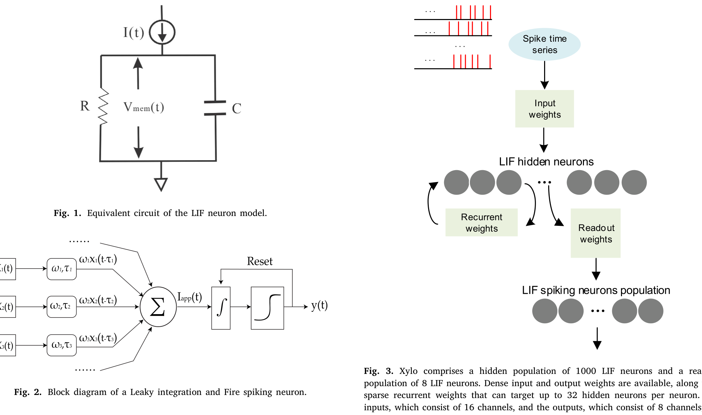
*Figura 17 — Estratta da Li et al. (2024), Fig. 1, 2 e 3: (A sinistra) Circuito elettrico equivalente RC parallelo e schema a blocchi funzionale del neurone LIF. (A destra) Architettura logica dell'ASIC neuromorfico digitale SynSense Xylo (28 nm CMOS), comprendente fino a 16 canali di ingresso, una popolazione nascosta di 1000 neuroni LIF digitali con pesi ricorrenti sparsi (max 32 target/neurone) e una popolazione di readout di 8 neuroni LIF.*

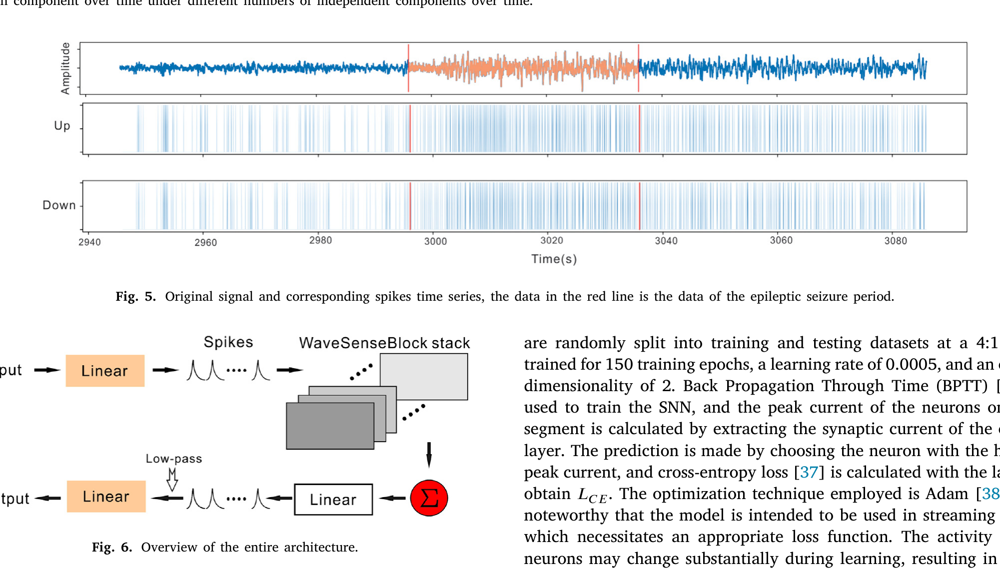
*Figura 18 — Estratta da Li et al. (2024), Fig. 5 e Fig. 6: (In alto) Tracciato EEG originale (con periodo ictale evidenziato in rosso) e corrispondenti serie temporali di spike UP e DOWN generate dal codificatore Sigma-Delta. (In basso) Architettura complessiva della SNN WaveSense basata su blocchi convoluzionali temporali dilatati impilati.*

#### B. Architettura SNN *WaveSense*, Regolarizzazione di Sparsità e Deploy su ASIC SynSense Xylo (28 nm)
La rete SNN adottata è **WaveSense** (ispirata a WaveNet), una rete *feed-forward* composta da blocchi impilati di **convoluzioni temporali dilatate** (*dilated temporal convolutions*), realizzate nelle SNN sfruttando proiezioni sinaptiche multiple con **diverse costanti di tempo di decadimento**. Il modello implementato è estremamente compatto: **soli $2.400$ pesi ($2.4\text{K}$)** totali, 16 neuroni nello strato di readout nascosto, 2 sinapsi nello strato dilatato, costante di tempo di membrana $\tau_{\text{mem}} = 2\,\text{ms}$ ($0.002\,\text{s}$), soglia $V_{\text{th}} = 0.6$ e 2 neuroni di uscita (ictale vs interictale).

L'addestramento avviene off-chip tramite **BPTT (Backpropagation Through Time)** con *surrogate gradient* (ottimizzatore Adam, learning rate $0.0005$, 150 epoche). Per minimizzare il consumo energetico una volta mappata la rete su hardware, alla funzione di costo *Cross-Entropy* ($L_{\text{CE}}$, calcolata sulla corrente sinaptica di picco dei neuroni di uscita) viene sommato un **termine di regolarizzazione dell'attività di firing**:

$$L = L_{\text{CE}} + \sum_{t} \sum_{i} \left( \frac{N_i^t \, \Theta\!\left(N_i^t - l\right)}{T \cdot N_{\text{neurons}}} \right)^2$$

dove $N_i^t$ è il numero di spike emessi dal neurone $i$ nel time-bin $t$, $l$ è la soglia massima tollerata di spike e $\Theta(\cdot)$ è il gradino di Heaviside: qualsiasi attività di firing eccedente $l$ viene penalizzata quadraticamente durante il training. Tramite il framework **Rockpool**, i pesi in virgola mobile vengono poi quantizzati e scalati a **interi a 8-bit ($\pm 128$)** e caricati sull'ASIC **SynSense Xylo**:
* **Specifiche fisiche di Xylo:** Processo **28 nm CMOS**, area del chip **$6.5\,\text{mm}^2$**, frequenza massima di clock **$250\,\text{MHz}$**, memoria integrata **$124\,\text{KB}$ SRAM**, alimentazione **$V_{DD,\text{Core}} = 1.8\,\text{V}$** e **$V_{DD,\text{IO}} = 2.5\,\text{V}$**, decadimento esponenziale realizzato con *bit-shift decay*.

#### C. Prestazioni di Classificazione, Latenza e Consumo Energetico Misurato Real-Time
In modalità *streaming* (passo decisionale di $0.5\,\text{s}$, con filtro anti-falso allarme che conferma l'allarme dopo 4 predizioni consecutive concordi):
* **Accuratezza e Sensibilità:** Sul dataset **CHB-MIT**, il modello ottiene in simulazione **Accuratezza $93.3\%$**, **Sensibilità $90.4\%$**, **Specificità $96.7\%$**, **F1-score $91.2\%$**, e dopo quantizzazione a 8-bit su hardware Xylo mantiene un'**Accuratezza dell'$89.87\%$** (perdita di $\sim 3.43\%$). Sul dataset **Siena Scalp**, ottiene in simulazione **Accuratezza $92.9\%$** (Sensibilità $89.7\%$, Specificità $90.1\%$, F1 $92.3\%$) e su hardware Xylo **$88.62\%$** (con soli $2.4\text{K}$ pesi, contro i $10.8\text{K}\text{–}27.3\text{M}$ pesi delle CNN in letteratura!).
* **Latenza:** Latenza mediana di rilevazione di **$0.5\,\text{s}$** su CHB-MIT e **$0.75\,\text{s}$** su Siena Scalp.
* **Potenza Misurata Real-Time (ADC onboard a $1000\,\text{Hz}$):**
  * **Potenza Core (logica SNN + lettura/scrittura 124 KB SRAM + routing eventi):** media **$287.9\,\mu\text{W}$** (range $280.3\text{–}292.1\,\mu\text{W}$);
  * **Potenza I/O (interfaccia SPI):** media **$87.4\,\mu\text{W}$** (range $80.2\text{–}95.5\,\mu\text{W}$);
  * **Potenza Totale del Chip:** **$375.3\,\mu\text{W}$** ($\sim 550\times$ inferiore alle implementazioni FPGA/GPU e inferiore ai $448\text{–}1589\,\mu\text{W}$ degli ASIC dedicati SVM/ANN).

---

### 3.3 Rilevamento Event-Driven di Crisi Epilettiche da iEEG Umano tramite Sincronizzazione Parziale su Processore Mixed-Signal: DYNAP-SE2 *(Bartels et al., 2025 — Paper 6)*

#### A. Razionale Neurofisiologico (Sincronizzazione Parziale / Stati Chimera) e Setup su DYNAP-SE2
Durante una crisi epilettica focale registrata con elettrodi intracranici (**iEEG**), le popolazioni neurali della zona epilettogena non passano istantaneamente a una sincronia globale perfetta, ma attraversano stati di **sincronizzazione parziale locale (stati Chimera)** caratterizzati da cluster spaziali di canali adiacenti fortemente correlati. **Bartels et al. (2025)** dimostrano come una SNN implementata sui circuiti analogici in sottosoglia del processore multicore **DYNAP-SE2** (**180 nm CMOS**, 4 core da 256 neuroni AdEx = 1024 neuroni, $V_{DD} = 1.8\,\text{V}$, **Figura 21**) possa agire da trasformatore non lineare per amplificare selettivamente queste correlazioni spazio-temporali.

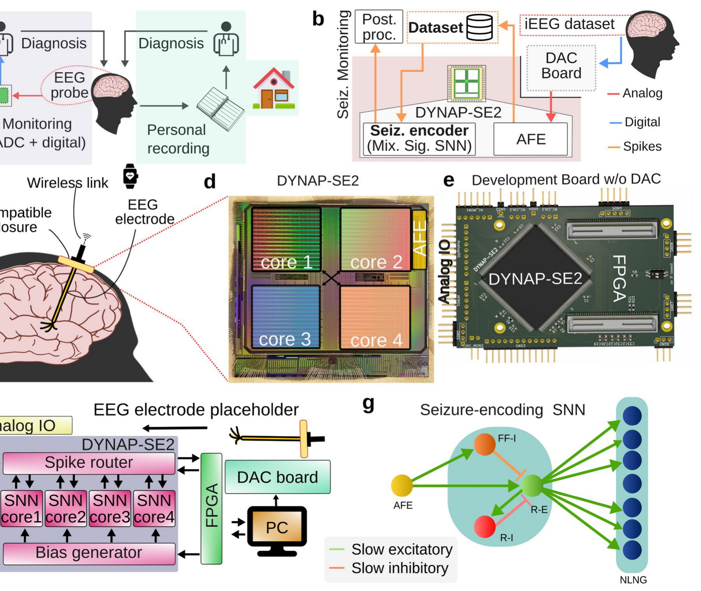
*Figura 21 — Estratta da Bartels et al. (2025), Fig. 1: (a) Approccio convenzionale ospedaliero vs diario paziente. (b, c) Sistema proposto basato su processore mixed-signal DYNAP-SE2 con AFE/ADM integrato e core SNN per dispositivi impiantabili/indossabili. (d, e) Fotografia del die DYNAP-SE2 (4 core SNN + AFE) e scheda di sviluppo con FPGA. (f, g) Diagramma a blocchi del setup sperimentale con scheda DAC a 18 bit e architettura della SNN a due strati (Translation Layer FF-I / R-E / R-I + NLNG Layer).*

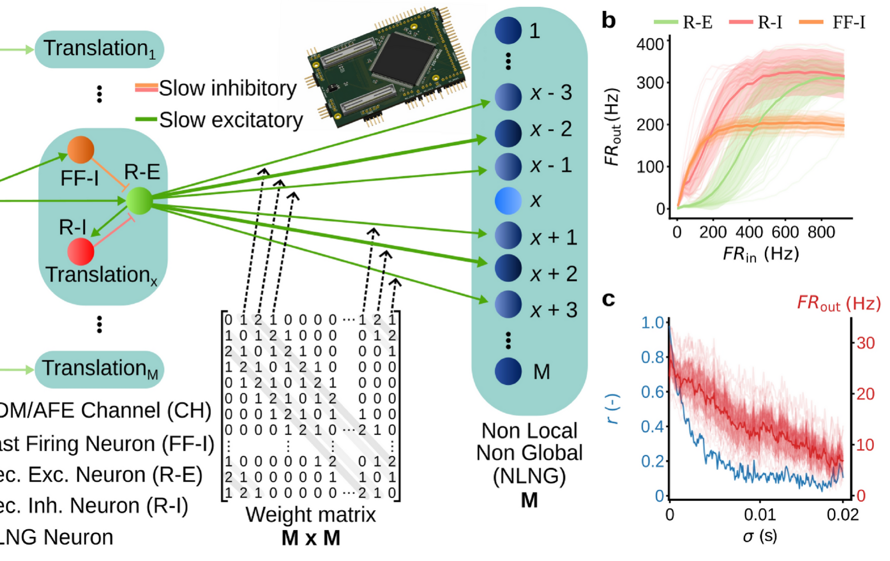
*Figura 22 — Estratta da Bartels et al. (2025), Fig. 3: (a) Architettura dettagliata della SNN on-chip: per ciascuno degli $M$ canali ADM, un Translation Layer con 3 neuroni (FF-I, R-E, R-I) realizza un filtro passa-banda di firing rate, seguito dal layer Non-Local Non-Global (NLNG) con matrice di connettività spaziale `1-2-1-0-1-2-1`. (b) Curva di trasferimento $FR_{\text{out}}$ vs $FR_{\text{in}}$ misurata sul chip che dimostra l'azione passa-banda (200–600 Hz) del neurone R-E. (c) Correlazione di Pearson e risposta del layer NLNG al variare del jitter temporale $\sigma$.*

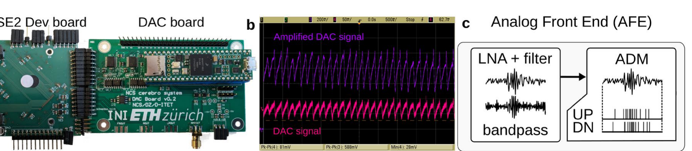
*Figura 23 — Estratta da Bartels et al. (2025), Fig. 6: Schede hardware (DYNAP-SE2 dev board + DAC board AD5781 a 18 bit con Teensy 4.1), tracce all'oscilloscopio del segnale iEEG rigenerato ($\sim 100\,\text{mV}_{\text{pp}}$) e amplificato dall'LNA di +20 dB, e schema a blocchi dell'Analog Front-End (LNA + filtro passa-banda + Asynchronous Delta Modulator UP/DN).*

Lo studio utilizza il database clinico **SWEC-ETHZ iEEG** (Inselspital Berna, campionato a $512\,\text{Hz}$, banda $0.5\text{–}150\,\text{Hz}$), analizzando **10 crisi in 5 pazienti** con epilessia del lobo temporale (TLE) o parietale (PLE) aventi un numero di canali $M \in \{42, 47, 56, 59, 62\}$ ($M < 64$ per rispettare il fan-in massimo di 64 sinapsi CAM per neurone di DYNAP-SE2). I tracciati digitali vengono riconvertiti in segnali fisici analogici da un **DAC a 18-bit (AD5781)** e inviati all'**AFE integrato sul die DYNAP-SE2** (**Figura 23**), composto da un **LNA con guadagno di $20\,\text{dB}$** seguito da un **Asynchronous Delta Modulator (ADM)** che codifica in hardware gli eventi `UP` e `DN`.

#### B. Architettura della SNN Hardware-Aware a 2 Layer (Translation Layer + NLNG Layer)
Per un paziente con $M$ canali iEEG, vengono allocati **$4M$ neuroni AdEx** distribuiti su **3 core fisici distinti** (poiché i generatori di correnti di bias *Coarse/Fine* sono condivisi all'interno di ciascun core, Tabella 3.2):

1. **Layer 1 — Translation Layer ($3M$ neuroni: Filtro Passa-Banda in Frequenza di Firing $200\text{–}600\,\text{Hz}$):**  
   Per ciascun canale $x \in \{1..M\}$ sono istanziati 3 neuroni connessi con sinapsi DPI lente eccitatorie (NMDA-like) e inibitorie ($\text{GABA}_B$-like):
   * **Neurone FF-I (*Fast-Firing Inhibitory*, sul Core 2):** Polarizzato con costante di tempo breve ($I_\tau = 4.528\,\text{nA}$) e alto guadagno ($I_{\text{gain}} = 35.39\,\text{nA}$), risponde rapidamente agli spike ADM saturando a $\sim 180\,\text{Hz}$ per ingressi $>200\,\text{Hz}$ e inibisce il neurone R-E, **tagliando le basse frequenze di firing ($<200\,\text{Hz}$, rumore di baseline)**.
   * **Coppia Bilanciata R-E / R-I (*Recurrent Excitatory / Inhibitory*, sul Core 1):** R-E riceve gli spike ADM ed è accoppiato ricorrentemente con R-I ($I_\tau = 0.628 / 0.667\,\text{nA}$). L'inibizione ricorrente di R-I **sopprime le frequenze eccessive ($>600\,\text{Hz}$)**. Di conseguenza, la risposta di **R-E** (curva verde in **Figura 22b**) è lineare esclusivamente nella finestra **$200\text{–}600\,\text{Hz}$**.
2. **Layer 2 — NLNG (*Non-Local Non-Global*) Encoding Layer ($M$ neuroni sul Core 3):**  
   Ottenuto tramite *Evolutionary Neural Architecture Search* (**ENAS**), connette il neurone R-E del canale $x$ ai 6 neuroni NLNG vicini ($x-3, x-2, x-1$ e $x+1, x+2, x+3$) con molteplicità di pesi sinaptici **`1 - 2 - 1 - 0 - 1 - 2 - 1`** (peso nullo sul canale $x$ stesso!).  
   * **Effetto dinamico:** In fase pre-ictale (ingressi poco correlati), i neuroni NLNG restano sotto i $100\,\text{Hz}$; durante la crisi ictale, l'arrivo sincrono di spike da canali vicini fa superare la soglia ai neuroni NLNG, che balzano a **$>100\,\text{Hz}$** formando **matrici di sincronizzazione $N_{i,j}$ (norma $L_1$ a lag zero con kernel esponenziale $\tau = 1\,\text{ms}$) fortemente clusterizzate**, classificate poi da una **Linear SVM (LSVM)**.

**Tabella 3.2 — Parametri $(C, F)$ del Bias Generator e correnti sottosoglia nei 3 core di DYNAP-SE2 *(Bartels et al., 2025, Tables 3 & 4)***

| Parametro Sinaptico | Formato / Unità | Core 1: R-E / R-I (exc. / inh.) | Core 2: FF-I | Core 3: NLNG |
| :--- | :--- | :---: | :---: | :---: |
| **Costante di tempo ($\tau_{\text{syn}}$)** | Coarse/Fine $(C, F)$ | $(1, 20)\ /\ (1, 30)$ | $(2, 20)$ | $(1, 12)$ |
| **Corrente $I_\tau$** | $\text{nA}$ | $0.628\ /\ 0.667\,\text{nA}$ | $4.528\,\text{nA}$ | $0.597\,\text{nA}$ |
| **Guadagno DPI ($I_{\text{gain}}$)** | Coarse/Fine $(C, F)$ | $(2, 100)\ /\ (2, 100)$ | $(3, 100)$ | $(2, 100)$ |
| **Corrente $I_{\text{gain}}$** | $\text{nA}$ | $4.84\ /\ 4.84\,\text{nA}$ | $35.39\,\text{nA}$ | $4.84\,\text{nA}$ |
| **Peso Sinaptico ($I_w$)** | Coarse/Fine $(C, F)$ | $(3, 128)\ /\ 2\times(3, 128)$ | $(3, 128)$ | $(3, 128)$ |
| **Corrente $I_w$** | $\text{nA}$ | $35.5\ /\ 71.0\,\text{nA}$ | $35.5\,\text{nA}$ | $35.5\,\text{nA}$ |

*(Valori di corrente Coarse $I_p(C_p)$: $C_0 = 0.07\,\text{nA}$, $C_1 = 0.55\,\text{nA}$, $C_2 = 4.45\,\text{nA}$, $C_3 = 35\,\text{nA}$, $C_4 = 280\,\text{nA}$, $C_5 = 2250\,\text{nA}$, con legge $I = I_p(C_p) \cdot \frac{F_p}{256}$).*

#### C. Prestazioni LSVM e Analisi del Consumo Energetico Paziente-per-Paziente
Grazie alla trasformazione eseguita dalla SNN sul chip, la classificazione LSVM migliora significativamente rispetto all'uso diretto degli eventi ADM:
* Con feature di **Sincronizzazione (NLNG SYN)**: Accuratezza media **$71.07 \pm 6.42\%$** (fino a $78.78\%$ su ID1, contro $53.54\% \to 69.76\%$ su ID2), Sensibilità **$63.56\%$** ($+4.7\%$ vs ADM), Specificità **$77.10\%$**, F1-Score **$65.30\%$** ($+5.44\%$ vs ADM), AUC **$73.80\%$**.
* Con feature di **Firing Rate (NLNG FR)**: Accuratezza media **$78.35 \pm 10.95\%$** (fino a $86.04\%$), Sensibilità **$66.71\%$** ($+8.15\%$ rispetto al $58.56\%$ dell'ADM!), Specificità **$85.54\%$**, F1-Score **$69.96\%$**, AUC **$80.91\%$**.

Dal punto di vista energetico (Tabella 3.3), il consumo dinamico medio dell'intera SNN sui 5 pazienti (media $53.2$ canali) è pari a **$149.96\,\mu\text{W}$** (**$2.80\,\mu\text{W/canale}$**), scendendo fino a **$1.77\,\mu\text{W}$ totali ($0.03\,\mu\text{W/canale}$)** durante il periodo pre-ictale quiescente del Paziente 2!

**Tabella 3.3 — Consumo di potenza della SNN su DYNAP-SE2 ($V_{DD}=1.8\,\text{V}$) attraverso le fasi cliniche *(Bartels et al., 2025, Table 5 & 6)***

| Paziente (SWEC ID, Età, Epilessia) | Canali ($M$) | Crisi (Durata s) | Pre-ictal ($\mu\text{W}$) | Seiz-1ª metà ($\mu\text{W}$) | Seiz-2ª metà ($\mu\text{W}$) | Post-ictal ($\mu\text{W}$) | **Potenza Totale ($\mu\text{W}$)** | **Potenza / Canale ($\mu\text{W/ch}$)** |
| :--- | :---: | :--- | :---: | :---: | :---: | :---: | :---: | :---: |
| **Pat 1** (ID2, 19a, TLE) | 42 | Seiz-1 (96 s) | 14.55 | 35.95 | 66.39 | 11.60 | **128.50** | **3.06** |
| **Pat 1** (ID2, 19a, TLE) | 42 | Seiz-2 (260 s) | 3.81 | 62.69 | 30.80 | — | **97.29** | **2.32** |
| **Pat 2** (ID9, 27a, TLE) | 56 | Seiz-1 (104 s) | **1.77** | 25.50 | 32.28 | 7.02 | **66.56** | **1.19** |
| **Pat 2** (ID9, 27a, TLE) | 56 | Seiz-2 (118 s) | 2.78 | 44.50 | 35.99 | 3.17 | **86.45** | **1.54** |
| **Pat 3** (ID1, 24a, TLE) | 47 | Seiz-1 (125 s) | 65.67 | 68.34 | 53.96 | 58.58 | **246.55** | **5.24** |
| **Pat 3** (ID1, 24a, TLE) | 47 | Seiz-2 (70 s) | 49.89 | 64.99 | 43.40 | 47.02 | **205.30** | **4.37** |
| **Pat 4** (ID16, 31a, TLE) | 59 | Seiz-1 (81 s) | 5.68 | 52.73 | 31.37 | 1.25 | **91.03** | **1.54** |
| **Pat 4** (ID16, 31a, TLE) | 59 | Seiz-2 (67 s) | 1.95 | 24.48 | 37.98 | 12.74 | **77.14** | **1.31** |
| **Pat 5** (ID4, 32a, PLE) | 62 | Seiz-1 (160 s) | 108.25 | 64.65 | 65.83 | 58.33 | **297.06** | **4.80** |
| **Pat 5** (ID4, 32a, PLE) | 62 | Seiz-2 (127 s) | 54.69 | 52.99 | 42.47 | 53.54 | **203.69** | **3.28** |
| **MEDIA GLOBALE** | **53.2** | — | — | — | — | — | **149.96 ($\sim 150\,\mu\text{W}$)** | **2.80 $\mu\text{W/ch}$** |

---

### 3.4 Interfaccia Neurale Impiantabile a 32 Canali con Direct Multiplexing, Rilevazione Clockless di Spike e Telemetria Wireless IR-UWB: Il SoC NeuroSEED *(Wu et al., 2026 — Paper 7)*

#### A. Architettura End-to-End del SoC NeuroSEED in TSMC 40 nm CMOS
Mentre i lavori precedenti si concentrano sull'elaborazione di segnali a bassa frequenza (EEG/iEEG/LFP, $<150\text{–}1000\,\text{Hz}$), **NeuroSEED (*Wu et al., 2026*)** realizza un **System-on-Chip (SoC) impiantabile completo a 32 canali** in tecnologia **TSMC 40 nm CMOS** ($V_{DD} = 1.2\,\text{V} / 0.6\,\text{V}$, area totale del die $857\,\mu\text{m} \times 820\,\mu\text{m} = \mathbf{0.70\,\text{mm}^2}$, area attiva **$0.16\,\text{mm}^2$**) progettato per acquisire, comprimere di oltre $500\times$ e trasmettere via radio **potenziali d'azione extracellulari (*Neural Action Potentials / Spikes*, banda fino a $5.2\,\text{kHz}$ per canale)** (**Figura 25**).

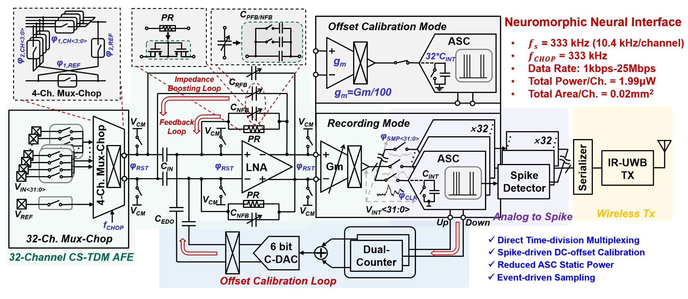
*Figura 25 — Estratta da Wu et al. (2026), Fig. 3: Architettura completa del SoC NeuroSEED a 32 canali: front-end analogico a Time-Division Multiplexing diretto (32-Ch Mux-Chop + CCIA LNA + integratore Gm-C con Windowed Integration Sampling e loop digitale di calibrazione dell'offset DC a 6-bit C-DAC), 32 convertitori Analog-to-Spike (ASC), 32 rivelatori di spike Integrate-and-Fire clockless e trasmettitore wireless impulsivo IR-UWB.*

Il sistema risolve i tre colli di bottiglia storici delle interfacce neurali multicanale impiantabili attraverso quattro blocchi co-progettati:

#### B. Front-End Analogico Direct-Multiplexing (32-Ch TDM AFE) e Loop Digitale di Cancellazione dell'Offset d'Elettrodo (EDO)
1. **Multiplexing Rapido Prima dell'Amplificatore ($N = 32$):**  
   Anziché replicare 32 amplificatori LNA (che occuperebbero troppa area), i 32 elettrodi sono divisi in 8 gruppi collegati a un **4-Ch Mux-Chop** che campiona ciascun canale a $f_{\text{ch}} = 10.4\,\text{kHz}$, portando la frequenza complessiva di multiplexing e di chopping a **$f_s = f_{\text{CHOP}} = 32 \times 10.4\,\text{kHz} = \mathbf{333\,\text{kHz}}$** (tempo di *settling* per canale $T_s = 3\,\mu\text{s}$). Per garantire un errore di settling $\epsilon \le 0.1\%$ (10 bit), la banda dell'LNA deve soddisfare $f_{\text{BW}} \ge \frac{-\ln \epsilon}{2\pi T_s} \approx 0.37\,\text{MHz}$ ed è fissata a **$700\,\text{kHz}$** (ottenendo un *matched spike ratio* $>93\%$ sul dataset simulato di Quiroga et al.).
2. **Primo Stadio CCIA (*Capacitively Coupled Instrumentation Amplifier*) con LNA *Inverter-Based Current-Reuse* (**Figura 26**, in alto):**  
   Il guadagno ad anello chiuso è programmabile tramite il rapporto capacitivo $C_{\text{IN}} / C_{\text{NFB}} = \mathbf{7.3\,\text{pF}} / (\mathbf{147\,\text{fF}} \times \{1, 4, 8\})$ (guadagno complessivo AFE misurato: **$41.2, 45.3, 47.1, 58.3\,\text{dB}$**), con condensatore di feedback positivo $C_{\text{PFB}} = C_{\text{NFB}}$ (*Impedance Boosting Loop*). Il core LNA adotta una topologia **inverter-based current-reuse** in cui le coppie differenziali complementari PMOS e NMOS condividono la stessa corrente di polarizzazione e operano in **debole inversione ($g_m / I_D \approx 26$)** con transistor *thick-oxide*, raddoppiando la transconduttanza efficace e raggiungendo un **Noise Efficiency Factor ($\text{NEF}$) di appena $2.1$** e un rumore riferito all'ingresso (**IRN**) di **$2.9\,\mu\text{V}_{\text{rms}}$** ($1\,\text{Hz}\text{–}1\,\text{kHz}$, densità media $91\,\text{nV}/\sqrt{\text{Hz}}$).
3. **Secondo Stadio Integratore Charge-Sampling $G_m\text{–}C$ con *Windowed Integration Sampling* (WIS, **Figura 26**, in basso):**  
   Durante il demultiplexing verso i 32 canali, integra il segnale sui condensatori $C_{\text{INT}}$ producendo una funzione di trasferimento **$\text{sinc}$** ($\text{sinc}^2$ in potenza) i cui **zeri (notch profondi) cadono esattamente ai multipli interi di $1/T_{\text{SMP}} = f_{\text{CHOP}} = 333\,\text{kHz}$**, abbattendo il ripple di chopping e il rumore fuori banda prima del campionamento. L'equazione di decomposizione del rumore totale all'ingresso del CCIA è:
   $$\overline{v_{n,\text{tot}}^2} = \overline{v_{n,\text{th}}^2} + \overline{v_{n,1/f}^2} + \overline{v_{n,\text{fold}}^2} + \overline{v_{n,\text{mux}}^2}$$
   dove il rumore termico dell'LNA inverter-based scala come $\frac{8kT}{3g_m} f_{\text{BW,AFE}}$ e il condensatore $C_{\text{IN}} = 7.3\,\text{pF}$ fissa un bassissimo pavimento di rumore $kT/C$ sugli switch del multiplexer.
4. **Loop Digitale di Calibrazione dell'Offset DC d'Elettrodo ($\pm 50\,\text{mV}$ EDO):**  
   In un sistema TDM, l'offset elettrochimico tra elettrodi diversi ($\pm 50\,\text{mV}$) si presenta come un'onda a gradini a $333\,\text{kHz}$ che saturerebbe l'LNA. Ogni $4.8\,\text{s}$ (per $0.96\,\text{ms}$), il transconduttore $G_m$ viene commutato in modalità a bassa transconduttanza (**$g_m = G_m / 100$**) e tutti i 32 condensatori $C_{\text{INT}}$ vengono connessi in parallelo, aumentando la costante di tempo $\tau = C_{\text{eff}} / g_m$ di un fattore **$\sim 3200\times$** per isolare il puro offset DC. L'ASC converte questa deriva in impulsi UP/DN accumulati da un **Dual-Counter** a 6-bit che pilota un **C-DAC capacitivo a 6-bit ($C_{\text{EDO}}$)** in retroazione negativa all'ingresso dell'LNA, riducendo l'errore di quantizzazione a $\le 0.78\,\text{mV}$ (residuo di caso peggiore $<16.4\,\text{mV}$, ben entro il margine di saturazione di $\pm 25\,\text{mV}$ a $58.3\,\text{dB}$).

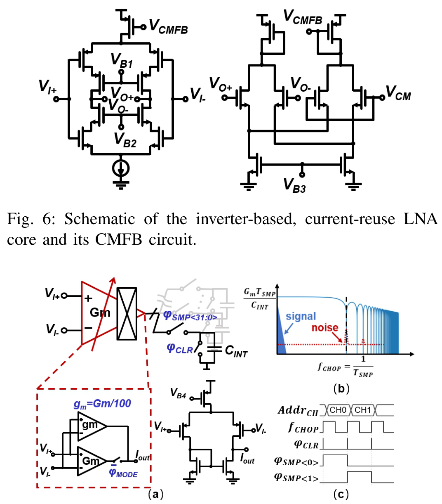
*Figura 26 — Estratta da Wu et al. (2026), Fig. 6 e Fig. 7: (In alto) Schematico a livello transistor del core LNA inverter-based current-reuse e del relativo circuito CMFB. (In basso) Stadio integratore charge-sampling $G_m\text{–}C$ con transconduttore dual-mode ($g_m = G_m/100$), risposta in frequenza sinc con notch a $f_{\text{CHOP}}$ e diagramma temporale.*

#### C. Convertitore Analogico-Spike (ASC), Rilevatore di Spike Clockless Valley-to-Peak e Telemetria IR-UWB
Come illustrato nelle **Figure 27 e 28**, ciascuno dei 32 canali demultiplexati comprende:
1. **ASC (*Analog-to-Spike Converter*, $0.164\,\mu\text{W/ch}$):** Composto da un DAC capacitivo di *signal folding* a 1-bit con condensatori accoppiati **$C_1 = C_2 = 6\,\text{pF}$** e switch NMOS ($W/L = 440\,\text{nm}/220\,\text{nm}$), due comparatori asincroni a 3 stadi con transistor *low-$V_t$* alimentati a $0.6\,\text{V}$ e un **circuito refrattario bio-ispirato** (stadio PMOS con carico NMOS regolabile da $V_{\text{Refra}}$ su $C_L$). Per soddisfare una risoluzione equivalente di $M = 6\,\text{bit}$ a $f_{\text{IN}} = 10\,\text{kHz}$, il ritardo di propagazione del loop è mantenuto a $T_{\min} < 498\,\text{ns}$. Durante la fase di folding, il circuito refrattario applica un **power-gating aggressivo ai comparatori**, azzerandone il consumo statico. L'ASC raggiunge un **SNDR di picco di $47.2\,\text{dB}$ ($\text{ENOB} = 7.6\,\text{bit}$)** a $500\,\text{Hz}$ e una compressione dati **$>100\times$**.
2. **Clockless Spike Detector (*Integrate-and-Fire Valley-to-Peak*, $0.48\,\mu\text{W/ch}$, $0.0007\,\text{mm}^2/\text{ch}$):** Opera senza alcun clock esterno sugli impulsi `UP`/`DN` dell'ASC. Un rivelatore di picchi e valli a flip-flop D (**Figura 28d**) individua un minimo locale (*Valley*), abilitando un contatore digitale che integra gli impulsi `UP` successivi. Se l'escursione relativa valle-picco supera la soglia programmabile `UP_threshold` prima del reset al picco (*Peak*), il neurone digitale *Integrate-and-Fire* dichiara uno **Spike Rilevato (*Fire*)**, portando la compressione dati totale a **$>500\times$** ed eliminando qualsiasi sensibilità al *baseline wander* o all'offset residuo (validato su registrazioni *in-vivo* da radice dorsale L5 di ratto).
3. **Trasmettitore Wireless Event-Triggered IR-UWB (**Figura 29**, a sinistra, $4.6\,\mu\text{W}$ totali):** Rimane spento in *deep sleep* e viene attivato in modalità OOK solo quando viene rilevato uno spike: un *Impulse Generator* (edge-combiner) genera un impulso di abilitazione `En` di soli **$3.2\,\text{ns}$** che accende un oscillatore LC complementare *current-reuse* a **$4.25\,\text{GHz}$** (banda $510\,\text{MHz}$) e un *Digital Power Amplifier* (DPA) inverter-based ($110\,\text{mV}_{\text{pp}}$ su $50\,\Omega$, $\text{PSD} = -42.05\,\text{dBm/MHz}$ conforme alla maschera FCC, $\text{BER} = 10^{-3}$ a $100\,\text{Mbps}$ attraverso $1.5\,\text{cm}$ di tessuto cranico + $3\,\text{cm}$ in aria).

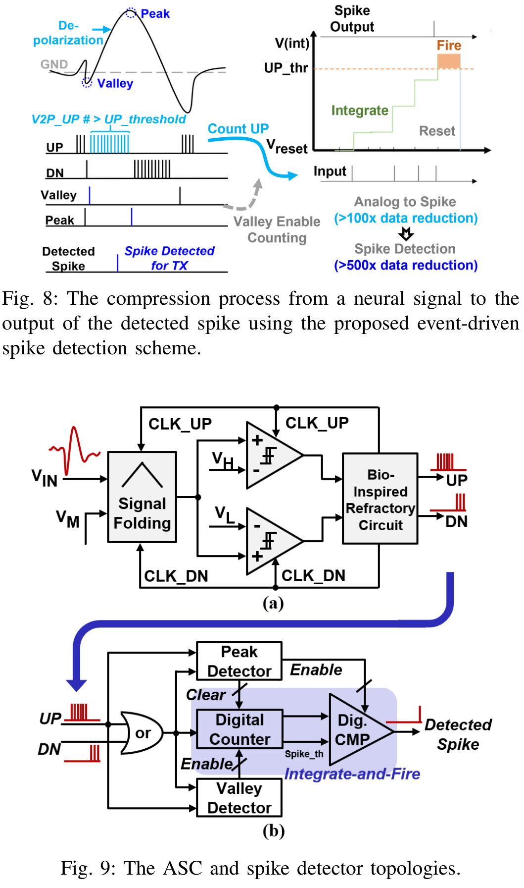
*Figura 27 — Estratta da Wu et al. (2026), Fig. 8 e Fig. 9: Processo di compressione event-driven ($>100\times$ dopo ASC, $>500\times$ dopo Spike Detection) e schemi a blocchi dell'ASC core (Signal Folding, comparatori $V_H/V_L$, circuito refrattario bio-ispirato) e dello Spike Detector clockless Valley-to-Peak.*

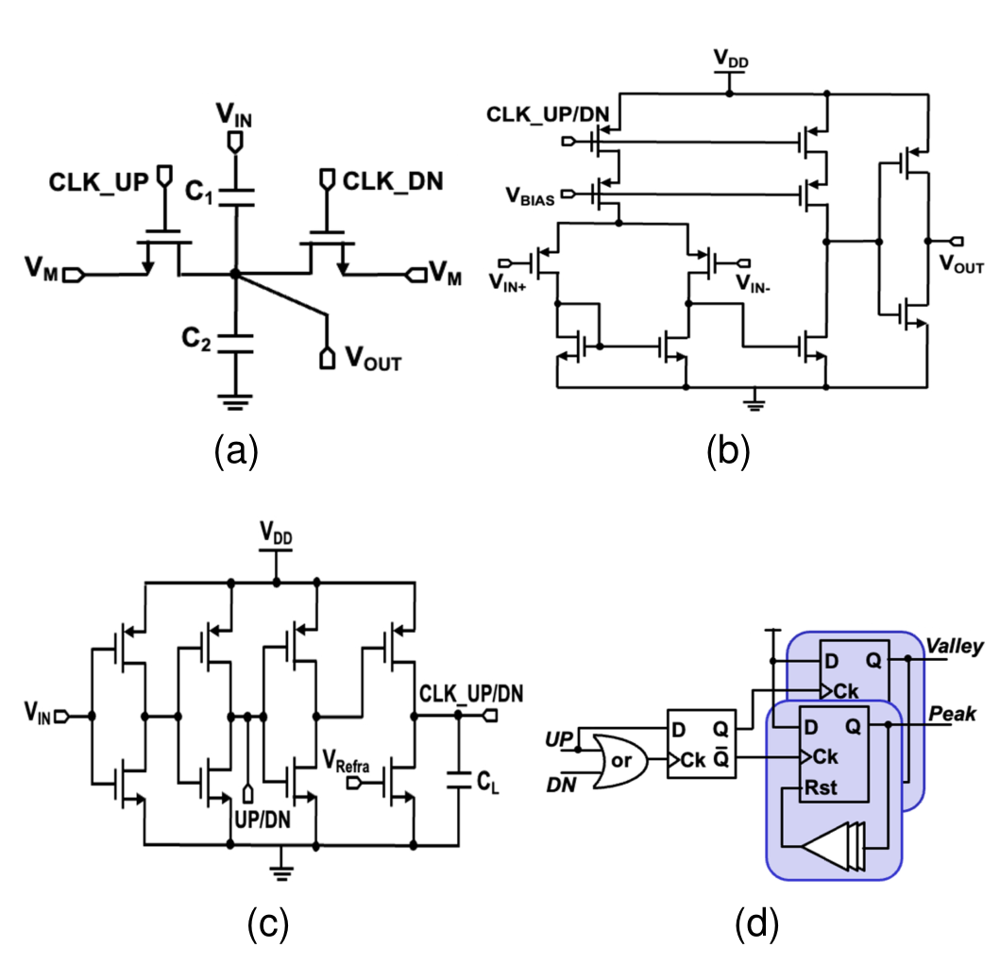
*Figura 28 — Estratta da Wu et al. (2026), Fig. 10: Schemi circuitali di: (a) circuito di signal folding SC-DAC a 1-bit ($C_1, C_2 = 6\,\text{pF}$), (b) comparatore asincrono a 3 stadi con power-gating, (c) circuito refrattario riconfigurabile ($V_{\text{Refra}}, C_L$), (d) rivelatore digitale asincrono di picco e valle.*

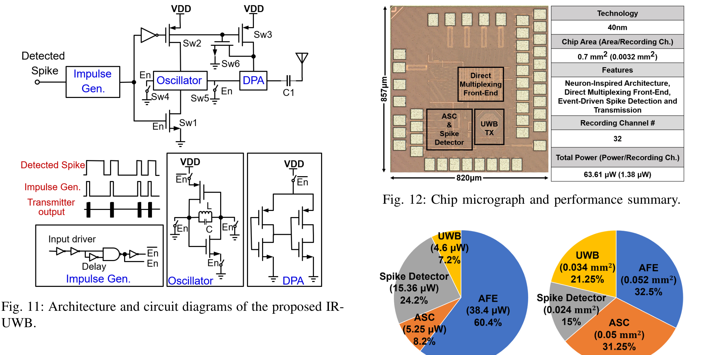
*Figura 29 — Estratta da Wu et al. (2026), Fig. 11, 12 e 13: (A sinistra) Architettura e schemi transistor-level del trasmettitore wireless IR-UWB (Impulse Generator da 3.2 ns, oscillatore LC current-reuse e DPA). (In alto a destra) Micrografia del chip in TSMC 40 nm CMOS ($857\times 820\,\mu\text{m}$) e riepilogo prestazioni. (In basso a destra) Ripartizione percentuale della potenza totale ($63.61\,\mu\text{W}$, $1.99\,\mu\text{W/ch}$) e dell'area attiva ($0.16\,\text{mm}^2$) tra AFE, ASC, Spike Detector e UWB TX.*

---

## Capitolo 4 — Implementazioni Circuitali CMOS di Neuroni e Sinapsi Spiking

Questo capitolo risponde in modo sistematico e analitico alla seconda domanda fondamentale della consegna: ***Come si realizza fisicamente un neurone spiking (e una rete sinaptica) in tecnologia CMOS? Quali sono i blocchi circuitali fondamentali, le equazioni fisiche a livello transistor e le architetture proposte nella letteratura?***

---

### 4.1 Fisica del MOSFET in Sottosoglia (*Weak Inversion*), Principio Translineare e Filtri *Log-Domain* (Tau-Cell, LPF, DPI)

#### A. Il MOSFET in Regime di Inversione Debole (*Sub-threshold / Weak Inversion*)
L'intuizione fondante dell'ingegneria neuromorfica analogica (Mead, 1989; Indiveri et al., 2011) risiede nell'omologia fisica diretta tra il trasporto ionico attraverso le membrane biologiche e il trasporto elettronico in un transistor MOSFET polarizzato in **inversione debole (sottosoglia)**, ovvero con tensione gate-source inferiore alla tensione di soglia ($V_{GS} < V_T$):

* **Trasporto per Diffusione vs Deriva (*Drift*):** Mentre sopra soglia ($V_{GS} > V_T$, *strong inversion*) si forma un canale conduttivo continuo e la corrente è dominata dal moto di **deriva (*drift*)** sotto l'azione del campo elettrico longitudinale (con legge quadratica/lineare rispetto a $V_{GS} - V_T$), in sottosoglia la concentrazione di portatori mobili nel canale è bassissima e il flusso di corrente dalla sorgente (*source*) al pozzo (*drain*) è governato dalla **diffusione termodinamica di Boltzmann** attraverso una barriera di potenziale energetico controllata elettrostaticamente dal gate — esattamente come gli ioni $\text{Na}^+, \text{K}^+, \text{Ca}^{2+}$ diffondono attraverso i canali proteici voltaggio-dipendenti della membrana neuronale.
* **Equazione Fondamentale del MOSFET in Sottosoglia:**  
  Per un transistor nMOS riferito al substrato (bulk), la corrente di drain $I_D$ in regime di sottosoglia vale:
  $$I_D = I_0 \exp\left(\frac{\kappa V_G - V_S}{U_T}\right) \left[ 1 - \exp\left(-\frac{V_D - V_S}{U_T}\right) \right]$$
  dove:
  * **$U_T = \dfrac{k_B T}{q} \approx 25.8\,\text{mV}$** (a $T = 300\,\text{K}$) è la **tensione termica** ($k_B$ costante di Boltzmann, $q$ carica elementare);
  * **$\kappa = \dfrac{C_{\text{ox}}}{C_{\text{ox}} + C_{\text{dep}}} \in [0.6,\, 0.8]$** è il **fattore di pendenza sottosoglia (*subthreshold slope factor*)**, che misura l'efficacia dell'accoppiamento capacitivo tra il gate e il potenziale superficiale del canale rispetto alla capacità di svuotamento $C_{\text{dep}}$;
  * **$I_0 = \mu C_{\text{ox}} \dfrac{W}{L} (\kappa - 1) U_T^2 \exp\left(-\dfrac{\kappa V_{T0}}{U_T}\right)$** è la corrente di zero-bias (*off-current* o *dark current*), dell'ordine dei $\text{fA}\text{–}\text{pA}$.
* **Condizione di Saturazione in Sottosoglia:**  
  Non appena la tensione drain-source supera appena **4 volte la tensione termica** ($V_{DS} = V_D - V_S > 4 U_T \approx 100\,\text{mV}$), il termine $\exp(-V_{DS}/U_T)$ diventa $< 0.018 \ll 1$ e il transistor entra in **saturazione**, comportandosi come un generatore di corrente ideale controllato esponenzialmente da $V_G$ e $V_S$:
  $$I_D = I_0 \exp\left(\frac{\kappa V_G - V_S}{U_T}\right) = I_0 \exp\left(\frac{\kappa V_{GS} + (\kappa - 1)V_{BS}}{U_T}\right)$$
  *(Questa proprietà spiega perché il chip **NET-TEN** riesce a funzionare perfettamente con un'alimentazione totale di appena **$V_{DD} = 250\,\text{mV}$**!).*
* **Massima Efficienza di Transconduttanza ($g_m / I_D$) e Costanti di Tempo Biologiche:**  
  Derivando $I_D$ rispetto a $V_G$, la transconduttanza in sottosoglia è lineare con la corrente di polarizzazione:
  $$g_m = \frac{\partial I_D}{\partial V_G} = \frac{\kappa I_D}{U_T} \implies \frac{g_m}{I_D} = \frac{\kappa}{U_T} \approx 26\text{–}30\,\text{V}^{-1}$$
  Operando con correnti comprese tra **$100\,\text{fA}$ e $10\,\text{nA}$**, la conduttanza equivalente $g_m$ risulta estremamente piccola ($10^{-12}\text{–}10^{-7}\,\text{S}$, corrispondente a resistenze di $10\,\text{M}\Omega\text{–}1\,\text{T}\Omega$). Di conseguenza, accoppiando tali transistor a piccoli condensatori integrati su silicio (**$C \approx 100\,\text{fF} \text{ – } 1\,\text{pF}$**), si ottengono direttamente **costanti di tempo fisiche $\tau = \frac{C}{g_m} = \frac{C U_T}{\kappa I_D}$ comprese tra $0.1\,\text{ms}$ e $1\,\text{s}$**, identiche a quelle dei neuroni e dei recettori sinaptici biologici (AMPA, NMDA, $\text{GABA}_A$, $\text{GABA}_B$) senza ricorrere ad alcun clock digitale!

---

#### B. Il Principio Translineare e i Tre Filtri *Log-Domain* di Conduttanza Sinaptica e Membrana
La dinamica temporale del primo ordine di una conduttanza sinaptica o di una membrana passiva (Destexhe et al., 1998; Indiveri et al., 2011, Sez. 3.1) è espressa dall'equazione differenziale lineare:

$$\tau \frac{dy}{dt} = -y + x$$

Nei circuiti **current-mode log-domain** (Frey, 1993; Tomazou et al., 1990), la variabile di stato fisica $y$ è rappresentata da una **corrente in sottosoglia** $I_{\text{syn}}$ (o $I_{\text{mem}}$), mentre la tensione $V_{\text{syn}}$ sul nodo capacitivo $C_{\text{syn}}$ è una compressione logaritmica della corrente ($V_{\text{syn}} \propto \frac{U_T}{\kappa} \ln(I_{\text{syn}}/I_0)$). Sfruttando il **principio translineare di Gilbert (1975)** (secondo cui lungo un anello chiuso di giunzioni esponenziali la somma delle tensioni gate-source in senso orario uguaglia quella in senso antiorario, il che equivale all'uguaglianza dei prodotti delle correnti nei rami pari e dispari), un'equazione differenziale non lineare nella tensione $V_{\text{syn}}$ su $C_{\text{syn}}$ si trasforma esattamente in un'equazione differenziale **lineare nella corrente di uscita $I_{\text{syn}}$**.

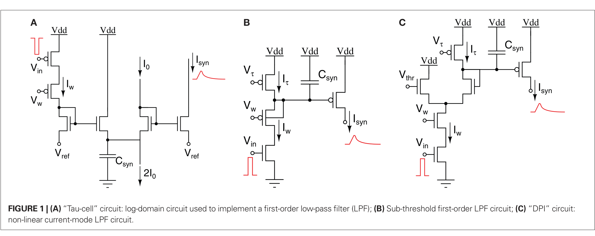
*Figura 1 — Estratta da Indiveri et al. (2011), Fig. 1: Confronto tra i tre circuiti log-domain passa-basso (LPF) del primo ordine per l'integrazione temporale di impulsi di tensione (spike): (A) Circuito "Tau-Cell"; (B) Filtro LPF del primo ordine in sottosoglia (Arthur & Boahen); (C) Circuito "DPI" (Differential Pair Integrator, Bartolozzi & Indiveri, 2007).*

Come illustrato in **Figura 1**, l'evoluzione di questi integratori comprende tre topologie:

1. **Circuito *Tau-Cell* (Figura 1A — Edwards & Cauwenberghs, 2000; van Schaik & Jin, 2003):**  
   Utilizza un anello translineare completo con tensione di riferimento $V_{\text{ref}}$ e generatori di corrente $I_0$ e $2I_0$ che fissano la costante di tempo $\tau$ sulla capacità $C_{\text{syn}}$, mentre l'impulso pre-sinaptico $V_{\text{in}}$ modula una corrente $I_w$ (controllata da $V_w$) per generare la corrente post-sinaptica $I_{\text{syn}}$.
2. **Filtro LPF Sottosoglia Semplificato (Figura 1B — Arthur & Boahen, 2004, 2007):**  
   Riduce il circuito a 4 transistor e una capacità $C_{\text{syn}}$ riferita a $V_{dd}$. All'arrivo di uno spike negativo su $V_{\text{in}}$, il ramo di ingresso estrae da $C_{\text{syn}}$ una corrente di peso $I_w$ (fissata dal bias $V_w$), abbassando la tensione sul condensatore e facendo crescere esponenzialmente la corrente di uscita $I_{\text{syn}}$ del pFET di destra. Al termine dello spike, il transistor di leak polarizzato da $V_\tau$ (corrente $I_\tau$) ricarica linearmente $C_{\text{syn}}$ verso $V_{dd}$, producendo un decadimento esponenziale di $I_{\text{syn}}$ nel tempo. Tuttavia, in questa topologia l'ampiezza massima raggiungibile da $I_{\text{syn}}$ dipende simultaneamente sia da $V_w$ sia da $V_\tau$.
3. **Il Circuito DPI (*Differential Pair Integrator*, Figura 1C — Bartolozzi & Indiveri, 2007):**  
   Sostituisce il singolo transistor di iniezione con una **coppia differenziale nMOS operante in configurazione di retroazione negativa**: un ramo della coppia differenziale ha il gate polarizzato da una tensione di soglia accordabile **$V_{\text{thr}}$**, mentre l'altro ramo ha il gate collegato al nodo capacitivo $V_{\text{syn}}$ (e il drain collegato anch'esso a $C_{\text{syn}}$). La corrente di coda (*tail current*) della coppia è pari a $I_w = I_0 e^{\kappa V_w / U_T}$ durante lo spike $V_{\text{in}}$.
   * **Derivazione Analitica dell'Equazione del DPI:**  
     Detta $V_{\text{syn}}$ la tensione sul condensatore $C_{\text{syn}}$, la corrente di uscita del pMOS di lettura (col source a $V_{dd}$) vale:
     $$I_{\text{syn}} = I_0 \exp\left(\frac{\kappa (V_{dd} - V_{\text{syn}})}{U_T}\right) \implies \frac{dI_{\text{syn}}}{dt} = -\frac{\kappa I_{\text{syn}}}{U_T} \frac{dV_{\text{syn}}}{dt}$$
     Per la legge di Kirchhoff sul condensatore $C_{\text{syn}}$, si ha $C_{\text{syn}} \frac{dV_{\text{syn}}}{dt} = I_\tau - I_{\text{dp}}$, dove $I_\tau$ è la corrente di carica di leak e $I_{\text{dp}}$ è la corrente del ramo destro della coppia differenziale:
     $$I_{\text{dp}} = \frac{I_w}{1 + \exp\left(\frac{\kappa (V_{\text{syn}} - V_{\text{thr}})}{U_T}\right)} = \frac{I_w}{1 + \frac{I_{\text{thr}}}{I_{\text{syn}}}}, \qquad \text{con } I_{\text{thr}} \triangleq I_0 \exp\left(\frac{\kappa (V_{dd} - V_{\text{thr}})}{U_T}\right)$$
     Sostituendo $\frac{dV_{\text{syn}}}{dt}$ nell'espressione di $\frac{dI_{\text{syn}}}{dt}$ e definendo la costante di tempo **$\tau \triangleq \dfrac{C_{\text{syn}} U_T}{\kappa I_\tau}$**, si ottiene l'equazione esatta del circuito DPI:
     $$\tau \frac{dI_{\text{syn}}}{dt} + I_{\text{syn}} = \frac{I_w \, I_{\text{syn}}}{I_\tau \left(1 + \frac{I_{\text{thr}}}{I_{\text{syn}}}\right)}$$
     Nel regime operativo lineare in cui $I_{\text{syn}} \ll I_{\text{thr}}$ (oppure $I_{\text{syn}} \gg I_{\text{thr}}$ con guadagno virtuale $I_{\text{thr}}/I_\tau$), l'equazione si riduce a un **filtro passa-basso lineare del primo ordine nel dominio delle correnti** il cui guadagno di trasferimento può essere modulato indipendentemente dalla costante di tempo $\tau$ tramite il terzo parametro di controllo **$V_{\text{thr}}$** (utilizzato per l'omeostasi sinaptica e la plasticità intrinseca).

---

### 4.2 I Blocchi Funzionali del Neurone al Silicio e Analisi Transistor-per-Transistor delle Topologie in Letteratura *(Indiveri et al., 2011 — Paper 1)*

Come sintetizzato nella Tabella 1 di *Indiveri et al. (2011)*, qualsiasi neurone spiking integrato su silicio (*Silicon Neuron*, **SiN**) è scomponibile in **quattro blocchi computazionali fondamentali**:
1. **Stadio di Integrazione Temporale e Conduttanza di Ingresso (*Conductance / Input Stage*):** Converte le correnti sinaptiche nella variabile di stato di membrana ($V_{\text{mem}}$ o $I_{\text{mem}}$) introducendo una perdita (*leak*).
2. **Stadio di Generazione dello Spike e Retroazione Positiva (*Spike-Event Generation & Positive Feedback*):** Rileva il superamento della soglia e innesca un *run-away* rigenerativo (analogo all'apertura dei canali $\text{Na}^+$) che commuta rapidamente l'uscita digitale per il bus AER.
3. **Stadio di Reset e Periodo Refrattario (*Refractory Period & Reset Mechanism*):** Emula l'apertura ritardata dei canali $\text{K}^+$ scaricando la membrana a $V_{\text{reset}}$ e bloccandola per un tempo $T_R$ regolabile (tipicamente tramite *starved inverters* e una capacità $C_R$ o $C_K$).
4. **Stadio di Adattamento della Frequenza di Sparo (*Spike-Frequency Adaptation*, SFA, o Soglia Adattativa):** Introduce una seconda variabile di stato lenta ($I_g$, $U$ o $\Theta$) che riduce la frequenza di firing durante una stimolazione prolungata.

Analizziamo ora nel dettaglio **transistor-per-transistor** ciascuna delle architetture circuitali fondamentali presentate in *Indiveri et al. (2011)*.

---

#### 4.2.1 Circuito *Axon-Hillock* *(Mead, 1989 — Figura 2)*

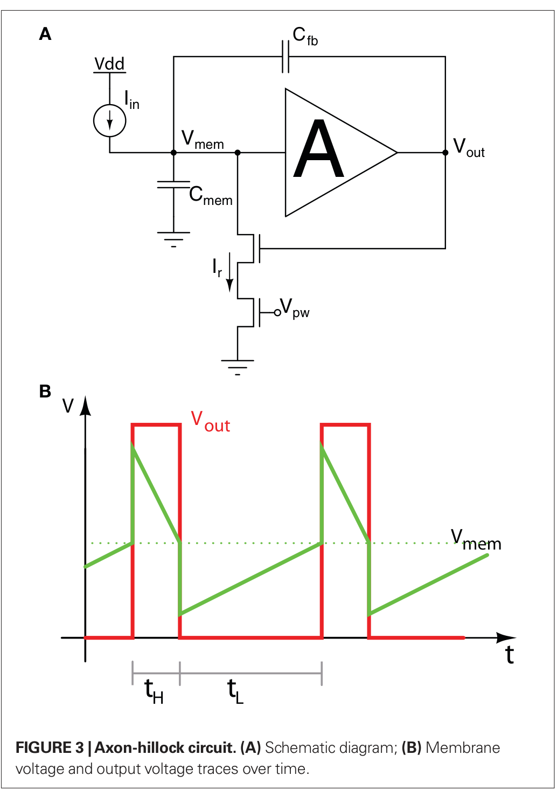
*Figura 2 — Estratta da Indiveri et al. (2011), Fig. 3: Circuito Axon-Hillock (Mead, 1989). (A) Schema elettrico con capacità di membrana $C_{\text{mem}}$, amplificatore non invertente $A$ (due inverter CMOS in cascata), capacità di retroazione positiva $C_{\text{fb}}$ e ramo nMOS di reset con corrente $I_r(V_{\text{pw}})$. (B) Tracce temporali di $V_{\text{mem}}$ (verde) e $V_{\text{out}}$ (rosso).*

Il circuito **Axon-Hillock** (**Figura 2**) è il capostipite storico dei neuroni neuromorfici:
* **Ruolo dei Componenti:**
  * **$C_{\text{mem}}$:** Capacità di membrana che integra la corrente d'ingresso $I_{\text{in}}$.
  * **Blocco $A$:** Doppio inverter CMOS in cascata (amplificatore ad alto guadagno non invertente) con tensione di soglia di commutazione $V_{\text{inv}}$.
  * **$C_{\text{fb}}$:** Capacità di feedback positivo collegata tra l'uscita $V_{\text{out}}$ e il nodo $V_{\text{mem}}$, che forma un partitore capacitivo con $C_{\text{mem}}$.
  * ** due transistor nMOS in serie sul ramo di scarica ($I_r$):** Il transistor superiore funge da interruttore abilitato da $V_{\text{out}}$, mentre il transistor inferiore (polarizzato in sottosoglia dal bias **$V_{\text{pw}}$**) fissa la corrente di reset $I_r$ che controlla la durata dell'impulso (*pulse width*, $t_H$).
* **Funzionamento fisico nel tempo:**
  1. Inizialmente $V_{\text{out}} = 0\,\text{V}$ e lo switch di reset è spento. La corrente $I_{\text{in}}$ carica linearmente la capacità totale vista al nodo di membrana: $V_{\text{mem}}(t)$ sale con pendenza $\frac{I_{\text{in}}}{C_{\text{mem}} + C_{\text{fb}}}$.
  2. Quando $V_{\text{mem}}$ raggiunge la soglia di commutazione $V_{\text{inv}}$ del primo inverter, $V_{\text{out}}$ sale verso $V_{dd}$. Tramite l'accoppiamento capacitivo $C_{\text{fb}}$, l'innalzamento di $V_{\text{out}}$ viene retroazionato positivamente su $V_{\text{mem}}$, producendo un salto istantaneo di tensione verso l'alto:
     $$\Delta V_{\text{mem}} = \frac{C_{\text{fb}}}{C_{\text{mem}} + C_{\text{fb}}} V_{dd}$$
  3. Con $V_{\text{out}} = V_{dd}$, lo switch nMOS di reset si accende e sottrae la corrente $I_r$ (con $I_r > I_{\text{in}}$). $V_{\text{mem}}$ scende linearmente per un tempo $t_H \approx \frac{C_{\text{fb}} V_{dd}}{I_r - I_{\text{in}}}$ finché ritorna a $V_{\text{inv}}$.
  4. A questo punto l'amplificatore $A$ commuta a $0\,\text{V}$ e il partitore capacitivo abbassa istantaneamente $V_{\text{mem}}$ di $-\Delta V_{\text{mem}}$ al valore di reset $V_{\text{inv}} - \Delta V_{\text{mem}}$, dando inizio all'intervallo inter-spike $t_L \approx \frac{C_{\text{fb}} V_{dd}}{I_{\text{in}}}$.
* **Pregi e Difetti:** Poiché l'ampiezza del ciclo di isteresi $\Delta V_{\text{mem}}$ dipende dal **rapporto tra due capacità ($C_{\text{fb}}/C_{\text{mem}}$)** anziché dai parametri dei transistor, il circuito gode di un **eccellente matching tra neuroni diversi**. Tuttavia, quando $I_{\text{in}}$ è molto piccola, $V_{\text{mem}}$ attraversa lentamente la regione di soglia $V_{\text{inv}}$ mantenendo entrambi i transistor pMOS e nMOS del primo inverter contemporaneamente accesi, causando una **forte dissipazione di potenza statica/di corto circuito ($\sim \mu\text{W}$)**.

---

#### 4.2.2 Neurone I&F a Comparatore di Tensione e *Starved Inverters* *(van Schaik, 2001 — Figura 3)*

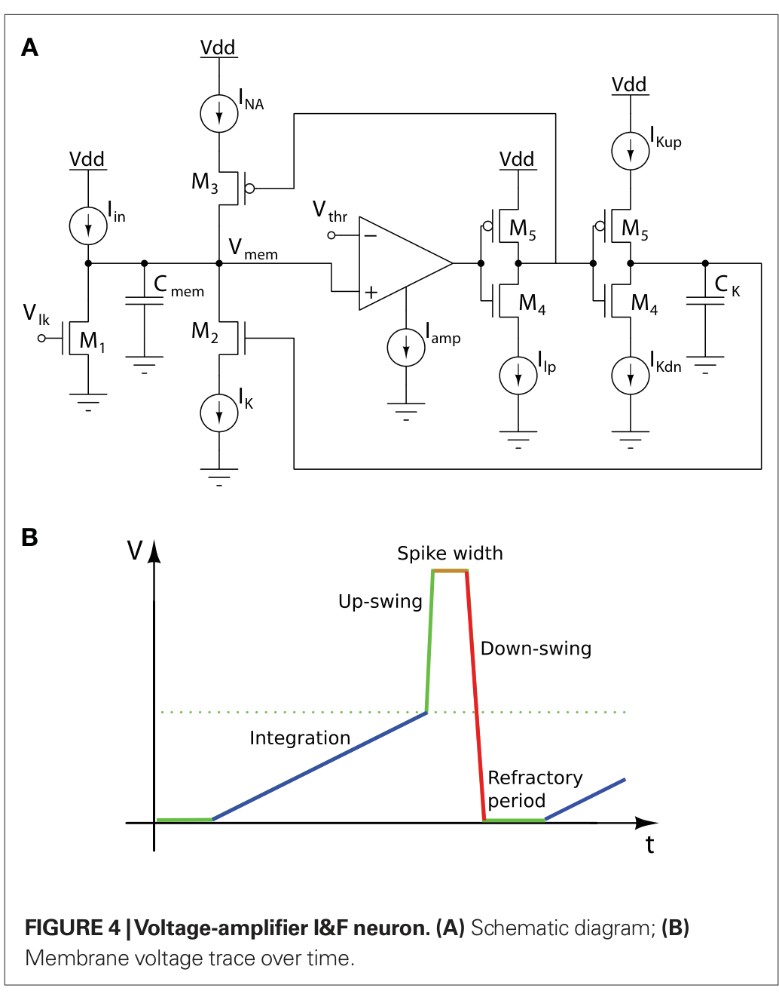
*Figura 3 — Estratta da Indiveri et al. (2011), Fig. 4: Neurone I&F basato su amplificatore di tensione (van Schaik, 2001). (A) Schema elettrico con leak $M_1(V_{\text{lk}})$, comparatore OTA a 5 transistor ($V_{\text{thr}}, I_{\text{amp}}$), correnti $I_{\text{Na}}$ ($M_3$) e $I_{\text{K}}$ ($M_2$) e due starved inverters ($M_4, M_5$) con capacità del potassio $C_K$. (B) Fasi dell'azione potenziale: Integration, Up-swing, Spike width, Down-swing e Refractory period.*

Per ottenere un controllo esplicito e indipendente della soglia di sparo $V_{\text{thr}}$, della larghezza dello spike e del periodo refrattario, **van Schaik (2001)** ha proposto il circuito di **Figura 3**:
* **$M_1$ (nMOS, gate a $V_{\text{lk}}$):** Implementa la conduttanza passiva di leak in parallelo a $C_{\text{mem}}$.
* **Comparatore (OTA a 5 transistor polarizzato da $I_{\text{amp}}$):** Confronta direttamente $V_{\text{mem}}$ (ingresso $+$) con una tensione di soglia regolabile esternamente **$V_{\text{thr}}$** (ingresso $-$).
* **Generazione dell'Upswing ($\text{Na}^+$) tramite Primo Inverter ($M_4, M_5$ limitato da $I_{\text{lp}}$) e $M_3$:** Quando $V_{\text{mem}} > V_{\text{thr}}$, l'uscita dell'OTA sale a $V_{dd}$ e l'uscita del primo inverter scende a $0\,\text{V}$, accendendo lo switch pMOS **$M_3$** che inietta la forte **corrente di Sodio $I_{\text{Na}}$** su $C_{\text{mem}}$, generando il fronte di salita rapido (*Up-swing*).
* **Controllo dello *Spike Width* e del Periodo Refrattario ($\text{K}^+$) tramite Secondo *Starved Inverter*, $C_K$ e $M_2$:**  
  Contemporaneamente, l'uscita bassa del primo inverter pilota un secondo *starved inverter* ($M_5$ pMOS limitato dalla corrente **$I_{\text{Kup}}$**, $M_4$ nMOS limitato dalla corrente **$I_{\text{Kdn}}$**) che carica la capacità del potassio **$C_K$** con rampa proporzionale a $I_{\text{Kup}}$:
  * Il tempo impiegato dalla tensione su $C_K$ per raggiungere la soglia di accensione dell'nMOS **$M_2$** è inversamente proporzionale a **$I_{\text{Kup}}$**, che quindi **governa direttamente lo *Spike Width***.
  * Una volta acceso **$M_2$**, la **corrente di Potassio $I_{\text{K}}$** scarica rapidamente $C_{\text{mem}}$ sotto $V_{\text{thr}}$ (*Down-swing*).
  * Non appena $V_{\text{mem}} < V_{\text{thr}}$, l'OTA commuta, $M_3$ ($I_{\text{Na}}$) si spegne e il secondo *starved inverter* inizia a scaricare lentamente $C_K$ attraverso la piccola corrente **$I_{\text{Kdn}}$**: finché la tensione su $C_K$ mantiene acceso $M_2$, il neurone non può essere eccitato da correnti $I_{\text{in}} < I_{\text{K}}$. Pertanto **$I_{\text{Kdn}}$ controlla indipendentemente il periodo refrattario**.

---

#### 4.2.3 Neuroni Basati su Conduttanza (*Conductance-Based*): Talamico, H–H Translineare, H–H BiCMOS SiGe e Accelerato $\times 10^4$

*Indiveri et al. (2011)* analizzano quattro implementazioni di modelli biofisici basati su conduttanza:
1. **Neurone Talamico di Relè a Due Compartimenti (Hynna & Boahen, 2009 — Fig. 8 di Paper 1):** Utilizza il circuito termodinamico a 2 transistor ($M_1, M_2$ di Fig. 2A di Paper 1) per implementare il canale del Calcio a bassa soglia ($I_T$) in un compartimento dendritico connesso tramite un diodo pMOS ($M_2$) a un compartimento somatico *Axon-Hillock*, riproducendo sia il firing *tonico* sia il *bursting* da rimbalzo post-inibitorio.
2. **Neurone Hodgkin–Huxley Sottosoglia Translineare (Yu & Cauwenberghs, 2010a — Fig. 9 di Paper 1):** Implementa 4 neuroni H–H e 12 sinapsi usando filtri *Tau-Cell* per le cinetiche di $m, h, n$, profili sigmoidali programmabili su spline a 7 punti tramite DAC on-chip, e moltiplicatori translineari in corrente a cascata per calcolare esattamente i prodotti $m^3 h \bar{g}_{\text{Na}}$ e $n^4 \bar{g}_{\text{K}}$.
3. **Neurone Hodgkin–Huxley Sopra Soglia in SiGe BiCMOS (Renaud et al., 2007; Saighi et al., 2011 — Fig. 15 di Paper 1):** Realizzato in processo BiCMOS SiGe $0.35\,\mu\text{m}$ e $0.8\,\mu\text{m}$ con coppie differenziali bipolari BJT ($Q_1\text{–}Q_4, Q_{11}\text{–}Q_{12}$) in *voltage-mode* per l'interfacciamento *real-time* diretto con neuroni biologici in *patch-clamp dinamico*.
4. **Neurone a Conduttanza Controllata in Corrente a Tempo Accelerato ($\times 10^4\text{–}10^5$, Schemmel et al., 2006 — Figura 8):**

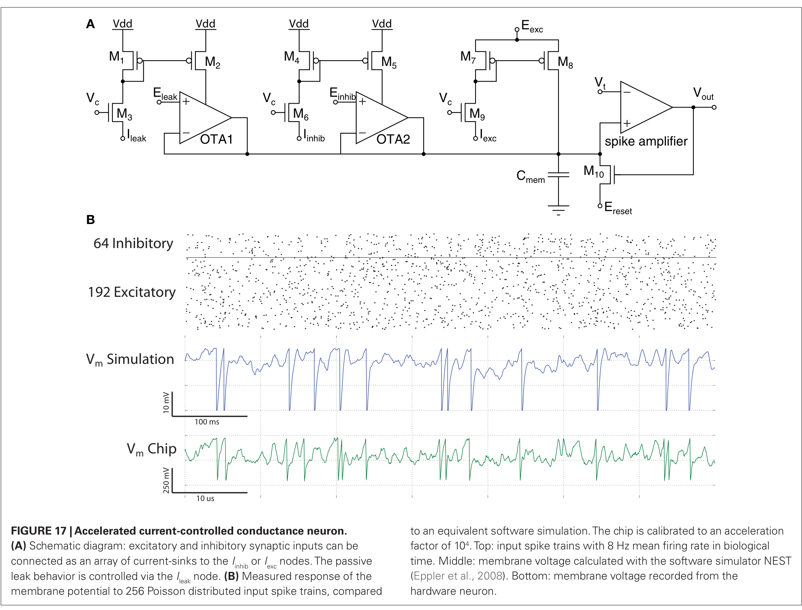
*Figura 8 — Estratta da Indiveri et al. (2011), Fig. 17: Neurone a conduttanza a tempo accelerato ($\times 10^4$, Schemmel et al., 2006) parte di un chip da 100k sinapsi. (A) Schema elettrico con specchi di corrente pMOS, cascode nMOS $M_3, M_6, M_9$, amplificatori OTA1 (leak verso $E_{\text{leak}}$) e OTA2 (inibizione verso $E_{\text{inhib}}$), specchio veloce $M_7\text{–}M_8$ per l'eccitazione ($E_{\text{exc}}$) e comparatore di spike con switch di reset $M_{10}$ ($E_{\text{reset}}$). (B) Confronto tra la traccia misurata sul chip ($10\,\mu\text{s/div}$) e la simulazione numerica sul simulatore software NEST ($100\,\text{ms/div}$).*

Come mostrato in **Figura 8**, questo circuito opera in **forte inversione (*strong inversion*)** comprimendo il tempo biologico di un fattore **$10^4\text{–}10^5$** ($1\,\text{ms}$ biologico $\to 10\,\text{ns}$ su silicio): i nodi di somma delle correnti sinaptiche ($I_{\text{leak}}, I_{\text{inhib}}, I_{\text{exc}}$) sono mantenuti a bassa impedenza dai transistor cascode $M_3, M_6, M_9$ (polarizzati da $V_c$). Le conduttanze di leak e inibitoria sono realizzate da due amplificatori a transconduttanza (`OTA1` e `OTA2`) verso i potenziali di inversione $E_{\text{leak}}$ ed $E_{\text{inhib}}$, mentre la conduttanza eccitatoria (che deve rispondere con *rise-time* $<10\,\text{ns}$ erogando fino a $10\,\mu\text{A}$ per sinapsi) evita l'uso di un OTA impiegando direttamente uno specchio di corrente veloce a canale minimo **$M_7\text{–}M_8$** col source collegato a $E_{\text{exc}}$.

---

#### 4.2.4 Neuroni I&F Compatti a Basso Consumo (*Octopus Retina* e *DVS Differencing Neuron*)

Per abbattere la corrente di corto circuito del circuito *Axon-Hillock* durante l'attraversamento lento della soglia:
* **L'*Octopus Retina Neuron* (Culurciello et al., 2003 — Fig. 10 di Paper 1)** introduce due innovazioni fondamentali riprese poi nel neurone DPI e in ROLLS: (1) usa **retroazione positiva in corrente** (specchi di corrente pMOS/nMOS che riutilizzano la corrente di corto circuito del primo inverter per iniettarla in $C_{\text{mem}}$, accelerando di $\sim 100\times$ la transizione a soglia); (2) durante la generazione dello spike **disconnette temporaneamente $C_{\text{mem}}$** dall'ingresso dell'inverter, riducendo la potenza durante lo spike di $\sim 25\times$ e raggiungendo un'energia per spike **$< 4\,\text{pJ/spike}$** in tecnologia CMOS $0.6\,\mu\text{m}$.
* **Il Neurone Differenziatore ON–OFF del Sensore Visivo Dinamico DVS (Lichtsteiner et al., 2008 — Fig. 11 di Paper 1)** precede i due comparatori di soglia (`AON` e `AOFF`) con un amplificatore invertente a capacità commutate ($A_1 = -C_1/C_2 \approx -20$) dotato di switch di reset refrattario pMOS $M_{\text{ref}}$: il condensatore serie $C_1$ blocca completamente l'offset DC del fotorecettore logaritmico e il guadagno capacitivo riduce il mismatch di soglia dei comparatori da $20\,\text{mV}$ a solo **$1\,\text{mV}$ riferito all'ingresso** ($\sim 2\%$ di contrasto su una matrice di $128\times 128$ pixel).

---

#### 4.2.5 Il Neurone *Tau-Cell* *(van Schaik et al., 2010 — Figura 4)*

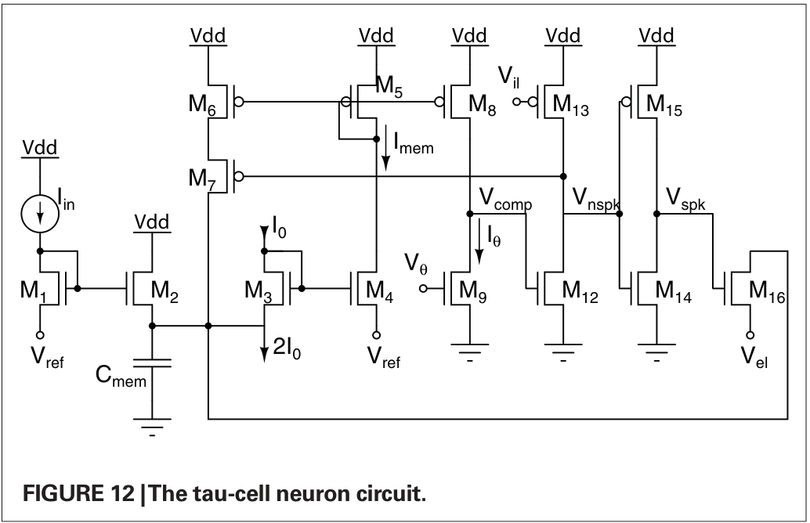
*Figura 4 — Estratta da Indiveri et al. (2011), Fig. 12: Schema elettrico completo a livello transistor ($M_1\text{–}M_{16}, C_{\text{mem}}$) del neurone log-domain Tau-Cell.*

Il neurone **Tau-Cell** (**Figura 4**) trasforma il filtro *log-domain* di Figura 1A in un neurone spiking completo utilizzando 16 transistor ($M_1\text{–}M_{16}$):
* **Integrazione Leaky Log-Domain ($M_1, M_2, M_3, M_4$ nMOS, $M_6, M_7$ pMOS, $C_{\text{mem}}, V_{\text{ref}}, I_0, 2I_0$):** La corrente d'ingresso $I_{\text{in}}$ (iniettata sul source di $M_1$) viene integrata producendo la corrente di stato di membrana $I_{\text{mem}}$ nel ramo di $M_4$.
* **Comparazione di Corrente ($M_5, M_8, M_9$):** Lo specchio pMOS $M_5\text{–}M_8$ copia $I_{\text{mem}}$ sul nodo $V_{\text{comp}}$, dove si confronta con la corrente di soglia $I_\theta$ fissata dall'nMOS $M_9$ (gate a $V_\theta$).
* **Starved Inverter, Feedback Positivo e Reset ($M_{12}\text{–}M_{16}$):** Quando $I_{\text{mem}} > I_\theta$, l'inverter limitato in corrente ($M_{12}, M_{13}$ con bias $V_{il}$) abbassa il nodo $V_{\text{nspk}}$, attivando il feedback positivo tramite $M_7$ e facendo salire l'uscita del secondo inverter ($M_{14}, M_{15}$) a $V_{\text{spk}} = V_{dd}$. Con un lieve ritardo di propagazione, $V_{\text{spk}}$ accende l'nMOS di reset **$M_{16}$** che porta il nodo capacitivo $C_{\text{mem}}$ al potenziale di reset **$V_{\text{el}}$**, terminando lo spike.

---

#### 4.2.6 Il Neurone *Log-Domain LPF* (LLN) a Feedback Positivo Cubico *(Arthur & Boahen, 2004, 2007 — Figura 5)*

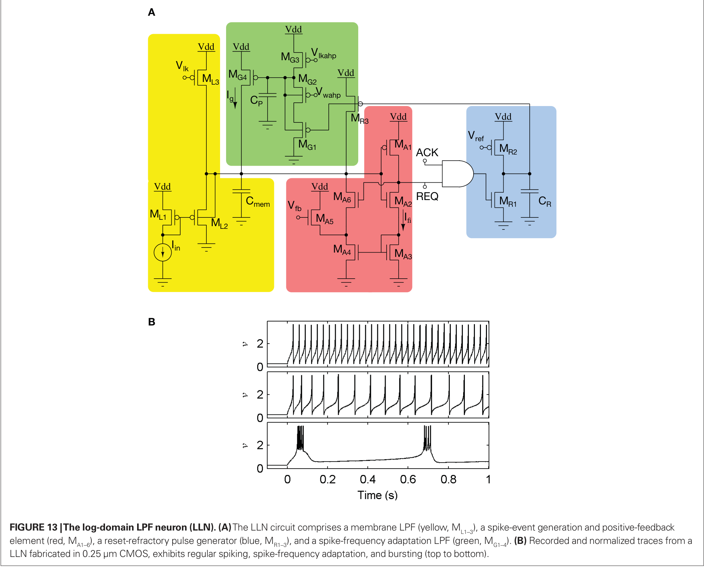
*Figura 5 — Estratta da Indiveri et al. (2011), Fig. 13: Il neurone Log-Domain LPF (LLN). (A) Schema elettrico suddiviso in 4 blocchi funzionali: filtro LPF di membrana (giallo, $M_{L1\text{–}3}, C_{\text{mem}}$), generatore di spike con feedback positivo cubico translineare (rosso, $M_{A1\text{–}6}$), generatore di impulso refrattario/reset (blu, $M_{R1\text{–}3}, C_R$) e filtro LPF di adattamento di frequenza (verde, $M_{G1\text{–}4}, C_P$). (B) Tracce sperimentali misurate su chip CMOS $0.25\,\mu\text{m}$: regular spiking, spike-frequency adaptation e bursting.*

Come mostrato in **Figura 5**, il neurone **LLN** (che dissipa appena **$50\text{–}1000\,\text{nW}$** in CMOS $0.25\,\mu\text{m}$) accoppia due filtri *log-domain* del tipo di Figura 1B con un anello translineare cubico, implementando esattamente il sistema dinamico dell'**Equazione (1)**:

$$\begin{cases}
\tau \dfrac{dv}{dt} = -v(1 + g) + v_\infty + \dfrac{v^3}{3} \\
\tau_g \dfrac{dg}{dt} = -g + g_{\max} r(t)
\end{cases}$$

* **Blocco Giallo ($M_{L1}\text{–}M_{L3}, C_{\text{mem}}$):** Filtro LPF di membrana con corrente di leak fissata da $V_{\text{lk}}$ su $M_{L3}$.
* **Blocco Rosso ($M_{A1}\text{–}M_{A6}$):** Il pMOS $M_{A1}$ legge la tensione su $C_{\text{mem}}$ generando una corrente proporzionale a $v$. L'anello translineare formato dagli nMOS $M_{A2}, M_{A3}, M_{A4}$ e dai pMOS $M_{A5}, M_{A6}$ (polarizzati da $V_{\text{fb}}$) eleva al cubo tale corrente e reinietta nel nodo di membrana una corrente di feedback positivo **$I_{\text{fb}} \propto \frac{v^3}{3}$**. Quando $\frac{v^3}{3} > v$, la derivata $\frac{dv}{dt}$ esplode positivamente generando la richiesta di spike `REQ`.
* **Blocco Blu ($M_{R1}\text{–}M_{R3}, C_R$):** All'arrivo dell'acknowledge `ACK`, genera l'impulso di reset $r(t)$ di durata $T_R$ regolata da $V_{\text{ref}}$ su $M_{R2}$, accendendo il pMOS $M_{R3}$ che tira $C_{\text{mem}}$ a $V_{dd}$ (azzerando $v$).
* **Blocco Verde ($M_{G1}\text{–}M_{G4}, C_P$):** Ad ogni impulso $r(t)$, $M_{G1}$ scarica parzialmente $C_P$ attraverso $M_{G2}$ ($V_{\text{wahp}} \to g_{\max}$), mentre $M_{G3}$ ($V_{\text{lkahp}} \to \tau_g$) lo ricarica lentamente; il pMOS $M_{G4}$ inietta la corrente adattativa $I_g \propto g$ sul nodo di membrana, moltiplicando il termine di decadimento $-v(1+g)$.

---

#### 4.2.7 Il Neurone DPI (*Adaptive Exponential I&F* in Modalità Corrente) *(Livi & Indiveri, 2009; Indiveri et al., 2010 — Figura 6)*

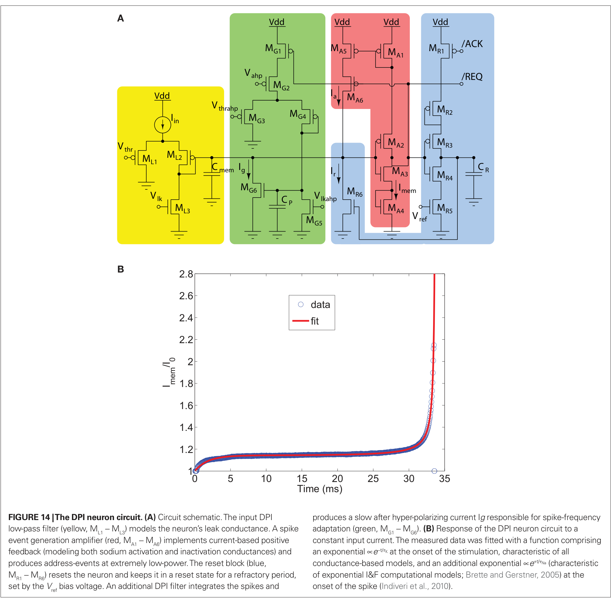
*Figura 6 — Estratta da Indiveri et al. (2011), Fig. 14: Il circuito del neurone DPI (AdEx in modalità corrente). (A) Schema elettrico a 21 transistor e 3 condensatori ($C_{\text{mem}}, C_P, C_R$) suddiviso in 4 blocchi: filtro DPI di ingresso/leak (giallo, $M_{L1\text{–}3}$), filtro DPI di adattamento SFA (verde, $M_{G1\text{–}6}$), amplificatore di generazione spike con feedback positivo esponenziale (rosso, $M_{A1\text{–}6}$) e blocco di reset/periodo refrattario (blu, $M_{R1\text{–}6}$). (B) Risposta misurata della corrente di membrana $I_{\text{mem}}/I_0$ a un gradino di corrente e fit analitico con doppio esponenziale ($\propto e^{-t/\tau_K}$ all'onset dello stimolo e $\propto e^{+t/\tau_{\text{Na}}}$ all'innesco dello spike).*

Il **Neurone DPI** (**Figura 6**) sostituisce i filtri LPF semplici del neurone LLN con due circuiti **DPI** (Figura 1C) e un generatore di spike a feedback positivo esponenziale, realizzando con **21 transistor e 3 capacità** il modello **Adaptive Exponential Integrate-and-Fire (AdEx)** di Brette & Gerstner (2005):

$$\begin{cases}
\tau \dfrac{dI_{\text{mem}}}{dt} = -I_{\text{mem}} \left(1 + \dfrac{I_g}{I_\tau}\right) + I_{\text{mem}\infty} + f(I_{\text{mem}}) \\
\tau_g \dfrac{dI_g}{dt} = -I_g + I_{g\max} r(t)
\end{cases}$$

con parametri fisici governati dalle tensioni di bias in sottosoglia:
$$\tau = \frac{C_{\text{mem}} U_T}{\kappa I_\tau}, \quad \tau_g = \frac{C_P U_T}{\kappa I_{\tau g}}, \quad I_{\text{mem}\infty} = \frac{I_{\text{in}}}{I_\tau} I_0 e^{\frac{\kappa}{U_T} V_{\text{thr}}}, \quad I_{g\max} = \frac{I_{MG2}}{I_{\tau g}} I_0 e^{\frac{\kappa}{U_T} V_{\text{thrahp}}}, \quad I_\tau = I_0 e^{\frac{\kappa}{U_T} V_{\text{lk}}}, \quad I_{\tau g} = I_0 e^{\frac{\kappa}{U_T} V_{\text{lkahp}}}$$

* **Analisi Transistor-per-Transistor dei 4 Blocchi di Figura 6A:**
  1. **Blocco Giallo — DPI di Membrana e Leak ($M_{L1}\text{–}M_{L3}, C_{\text{mem}}$):**  
     La corrente sinaptica totale $I_{\text{in}}$ alimenta la coppia differenziale nMOS **$M_{L1}\text{–}M_{L2}$** (con gate di $M_{L1}$ polarizzato da $V_{\text{thr}}$ e gate di $M_{L2}$ collegato al nodo di membrana $C_{\text{mem}}$). L'nMOS **$M_{L3}$** (polarizzato da $V_{\text{lk}}$) sottrae la corrente di leak $I_\tau$ da $C_{\text{mem}}$.
  2. **Blocco Rosso — Generazione Spike e Feedback Positivo Esponenziale ($M_{A1}\text{–}M_{A6}$):**  
     L'nMOS **$M_{A4}$** (col gate collegato a $C_{\text{mem}}$) converte esponenzialmente la tensione su $C_{\text{mem}}$ nella corrente sottosoglia di membrana $I_{\text{mem}}$. Quando $I_{\text{mem}}$ supera la corrente di soglia del pMOS **$M_{A1}$**, la tensione sul drain di $M_{A1}/M_{A3}$ scende, accendendo l'inverter successivo ($M_{A2}$ pMOS, $M_{A3}$ nMOS) e lo specchio di corrente pMOS **$M_{A5}\text{–}M_{A6}$**. Il transistor **$M_{A6}$** reinietta su $C_{\text{mem}}$ una corrente di feedback positivo **$I_a = f(I_{\text{mem}})$** che cresce **esponenzialmente** con $I_{\text{mem}}$, generando l'impennata dello spike (fit rosso in Figura 6B) con dissipazione di potenza minima e attivando la linea `/REQ`.
  3. **Blocco Blu — Reset e Periodo Refrattario ($M_{R1}\text{–}M_{R6}, C_R$):**  
     All'arrivo del segnale di handshaking `/ACK` sul gate del pMOS **$M_{R1}$**, il nodo della capacità di refrattarietà **$C_R$** viene caricato a $V_{dd}$. Al termine dello spike, $C_R$ si scarica lentamente attraverso il ramo *starved inverter* formato da **$M_{R2}, M_{R3}, M_{R4}, M_{R5}$** con velocità fissata dalla tensione di bias **$V_{\text{ref}}$** sul gate di $M_{R5}$. Finché la tensione su $C_R$ resta alta, l'nMOS di reset **$M_{R6}$** rimane acceso e scarica $C_{\text{mem}}$ con una forte corrente $I_r$, mantenendo il neurone bloccato per tutto il periodo refrattario.
  4. **Blocco Verde — DPI di Spike-Frequency Adaptation ($M_{G1}\text{–}M_{G6}, C_P$):**  
     Ad ogni spike emesso, il pMOS **$M_{G1}$** si accende e inietta la corrente fissata da **$M_{G2}$** ($V_{\text{ahp}}$) nella coppia differenziale pMOS **$M_{G3}\text{–}M_{G4}$** (soglia $V_{\text{thrahp}}$ su $M_{G3}$, gate di $M_{G4}$ collegato alla capacità di adattamento **$C_P$**). L'nMOS **$M_{G5}$** ($V_{\text{lkahp}}$) scarica lentamente $C_P$ con costante di tempo $\tau_g$, mentre l'nMOS di uscita **$M_{G6}$** converte la tensione su $C_P$ nella corrente iperpolarizzante lenta **$I_g$**, sottraendola direttamente da $C_{\text{mem}}$ in parallelo a $M_{L3}$.

---

#### 4.2.8 Il Neurone Quadratico di Izhikevich in CMOS *(Wijekoon & Dudek, 2008 — Figura 7; Ronchini et al., 2023 — Figura 16b)*

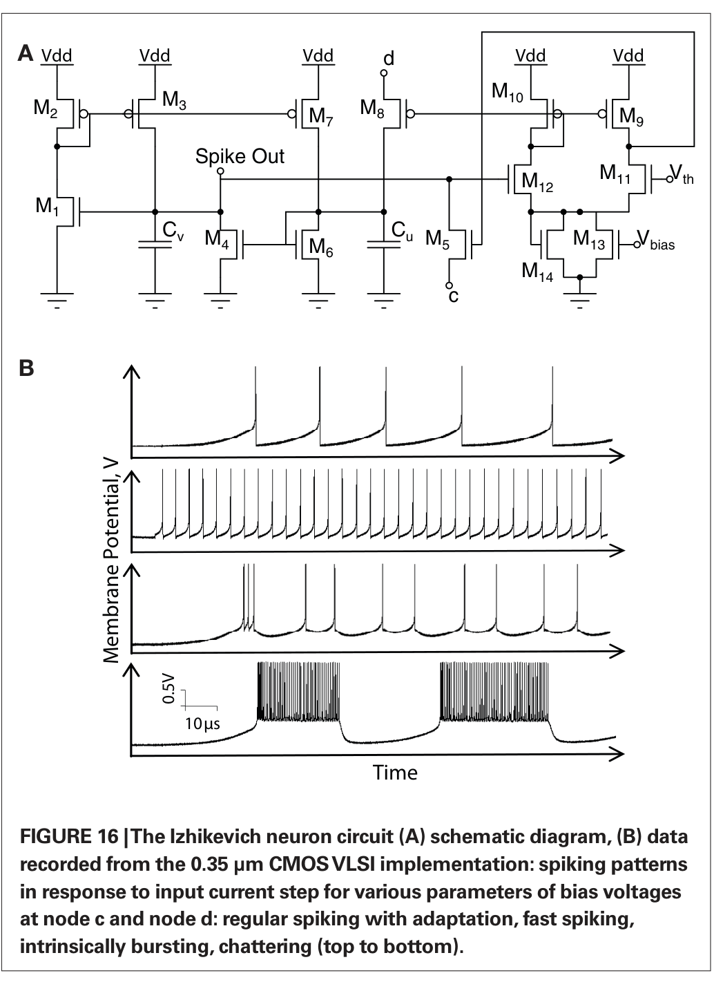
*Figura 7 — Estratta da Indiveri et al. (2011), Fig. 16: Neurone di Izhikevich in CMOS $0.35\,\mu\text{m}$ (Wijekoon & Dudek, 2008). (A) Schema elettrico a 14 transistor ($M_1\text{–}M_{14}$) e due capacità ($C_v$ per il potenziale di membrana $V$ e $C_u$ per la variabile lenta $U$). (B) Pattern di firing registrati dal chip variando le tensioni di bias ai nodi $c$ e $d$: regular spiking con adattamento, fast spiking, intrinsically bursting e chattering.*

Il circuito di **Figura 7A** (e la sua versione in sottosoglia a 12 transistor $M_1\text{–}M_{12}$ a $V_{DD}=0.25\,\text{V}$ impiegata in **NET-TEN**, **Figura 16b**, área $1476.84\,\mu\text{m}^2$, $C_v = 76.86\,\text{fF}$, $C_u = 614.88\,\text{fF}$) implementa direttamente la coppia di equazioni differenziali di Izhikevich:
* **Circuito della Variabile Veloce $V_{\text{mem}}$ ($M_1\text{–}M_5, C_v$):**  
  Il condensatore $C_v$ integra la corrente sinaptica $I_{\text{syn}}$. L'nMOS **$M_1$** (col gate collegato a $V_{\text{mem}}$ su $C_v$) genera una corrente di drain non lineare (quadratica in forte inversione / esponenziale in debole inversione) che viene specchiata dallo specchio di corrente pMOS **$M_2\text{–}M_3$** e reiniettata positivamente su $C_v$ (implementando il termine rigenerativo $+0.04 V_{\text{mem}}^2 + 5V_{\text{mem}}$). L'nMOS **$M_4$** ha il gate pilotato dalla tensione $U$ sul condensatore lento $C_u$ e sottrae da $C_v$ la corrente di recupero $-U$.
* **Circuito della Variabile Lenta di Recupero $U$ ($M_1, M_2, M_6\text{–}M_8, C_u$):**  
  Un secondo pMOS **$M_7$** (accoppiato a specchio con $M_2$) inietta in $C_u$ una corrente proporzionale a $I_{M1}(V_{\text{mem}})$ (termine $+a b V_{\text{mem}}$), mentre l'nMOS connesso a diodo **$M_6$** scarica $C_u$ verso massa con una corrente dipendente da $U$ stessa (termine $-a U$). Poiché $C_u \approx 8 C_v$ e $(W/L)_{M_7} < (W/L)_{M_3}$, la dinamica di $U$ è molto più lenta di quella di $V_{\text{mem}}$.
* **Comparatore e Reset Post-Spike ai Nodi $c$ e $d$ ($M_5, M_8, M_9\text{–}M_{14}$):**  
  Quando $V_{\text{mem}}$ supera la soglia del comparatore ($M_9\text{–}M_{14}$ in Fig. 7A, oppure i due inverter in cascata $M_9\text{–}M_{10}$ e $M_{11}\text{–}M_{12}$ in Fig. 16b di NET-TEN):
  1. L'impulso positivo d'uscita accende lo switch nMOS **$M_5$**, che scarica istantaneamente $C_v$ alla tensione di bias **`c`** ($V_C$, parametro $c$: $V_{\text{mem}} \leftarrow c$).
  2. L'impulso complementare negativo accende lo switch pMOS **$M_8$**, che inietta un pacchetto di carica dalla tensione di bias **`d`** ($V_D$) nel condensatore $C_u$ (parametro $d$: $U \leftarrow U + d$).

---

#### 4.2.9 Il Neurone *Switched-Capacitor* di Mihalas–Niebur *(Folowosele et al., 2009 — Figura 9)*

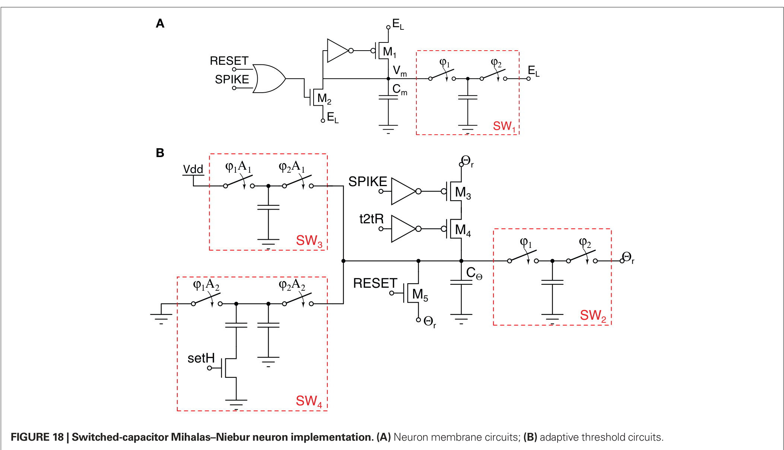
*Figura 9 — Estratta da Indiveri et al. (2011), Fig. 18: Implementazione Switched-Capacitor (S-C) del neurone a soglia adattativa di Mihalas–Niebur (Folowosele et al., 2009a). (A) Circuito di membrana ($C_m$, resistore S-C di leak $\text{SW}_1$ pilotato da $\phi_1, \phi_2$, e switch di reset $M_1, M_2$ verso $E_L$). (B) Circuito della soglia adattativa ($C_\Theta$, blocchi S-C $\text{SW}_2, \text{SW}_3, \text{SW}_4$ e switch di aggiornamento $M_3, M_4, M_5$ verso $\Theta_r$).*

Per eliminare alla radice la sensibilità al mismatch dei transistor in sottosoglia, **Folowosele et al. (2009a,b)** (**Figura 9**) hanno implementato il modello di Mihalas–Niebur sostituendo i transistor di leak con **resistori a capacità commutate (*Switched-Capacitor*, S-C)**: un piccolo condensatore $C_{\text{sw}}$ commutato tra due nodi da due fasi di clock non sovrapposte ($\phi_1, \phi_2$ a frequenza $f_{\text{clk}}$) trasferisce una carica $\Delta Q = C_{\text{sw}} \Delta V$ per ciclo, realizzando una conduttanza equivalente altamente precisa e accordabile via frequenza:
$$G_{\text{eq}} = f_{\text{clk}} C_{\text{sw}} \implies \tau_m = \frac{C_m}{f_{\text{clk}} C_{\text{sw}}}$$
Il blocco `SW1` realizza il leak di membrana verso $E_L$, mentre i blocchi `SW2`, `SW3`, `SW4` accoppiano linearmente la soglia $\Theta$ (su $C_\Theta$) a $V_m$, permettendo di riprodurre 10 pattern di spiking corticali senza alcuno sforzo di calibrazione analogica (a fronte però della necessità di distribuire molteplici fasi di clock a ogni neurone).
*(Completa la rassegna di Paper 1 il neurone a pacchetti di carica calibrati digitalmente a 5-bit tramite **Digi-MOS** di Serrano-Gotarredona et al., 2006 — Fig. 20 di Paper 1, e il neurone interamente digitale a 18-bit di Camuñas Mesa et al., 2008 — Fig. 21 di Paper 1).*

---

### 4.3 Architettura e Circuiti Transistor-Level del Processore Neuromorfico ROLLS *(Qiao et al., 2015 — Paper 2)*

#### 4.3.1 Architettura del Chip e Distribuzione dell'Area Silicea
Il processore **ROLLS (*Reconfigurable On-line Learning Spiking Neuromorphic Processor*, Qiao et al., 2015)** rappresenta la realizzazione completa su larga scala VLSI dei principi di progettazione *sub-threshold current-mode* esposti in *Indiveri et al. (2011)*. Fabbricato in un processo standard **180 nm CMOS 1P6M** (1 Poly, 6 Metal), occupa un'area di die di **$51.4\,\text{mm}^2$**, integra circa **$12.2\,\text{milioni}$ di transistor** e dissipa una potenza media di **$\approx 4\,\text{mW}$** in condizioni operative tipiche (**Figura 10**).

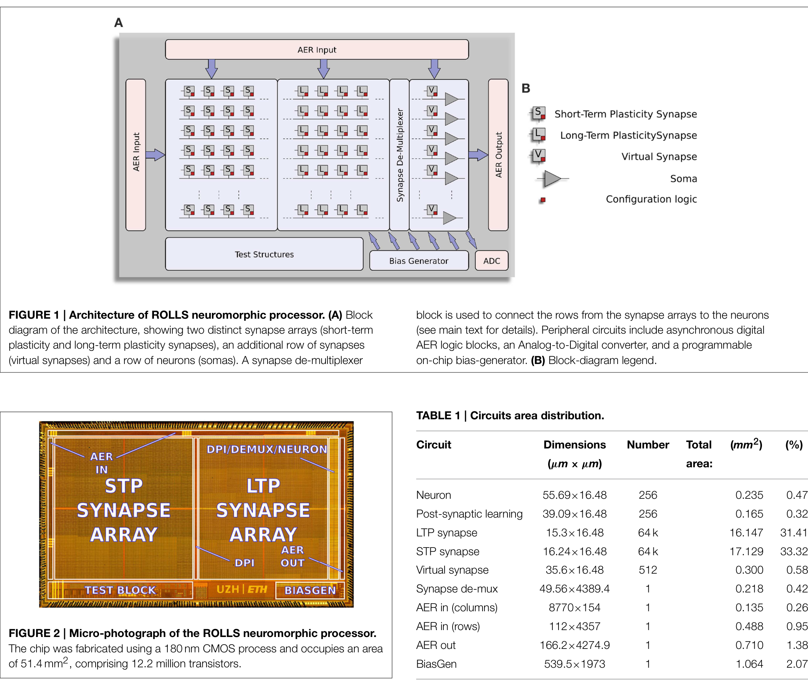
*Figura 10 — Estratta da Qiao et al. (2015), Fig. 1, Fig. 2 e Table 1: (In alto) Diagramma a blocchi dell'architettura di ROLLS: matrice di $256\times 256$ sinapsi programmabili a breve termine (STP), matrice di $256\times 256$ sinapsi plastiche bistabili a lungo termine (LTP), fila di $256\times 2$ sinapsi virtuali, Synapse De-Multiplexer, fila di 256 somi AdEx, periferiche asincrone AER Input/Output, Bias Generator e ADC. (In basso a sinistra) Microfotografia del die in CMOS 180 nm ($51.4\,\text{mm}^2$). (In basso a destra) Tabella ufficiale della distribuzione dell'area silicea.*

L'architettura co-localizza memoria e calcolo (*in-memory computing* non-von Neumann) mediante:
* **$256 \times 1$ Neuroni al Silicio (Soma AdEx):** ciascuno affiancato dal proprio circuito post-sinaptico di apprendimento (*stop-learning* basato sul Calcio) e da circuiti di *synaptic scaling* omeostatico.
* **$256 \times 256 = 65\,536$ ($64\text{K}$) Sinapsi di Apprendimento a Lungo Termine (LTP):** implementano l'algoritmo bistabile *spike-driven* di Brader, Senn & Fusi (2007). Tutte le 256 sinapsi di una riga sommano le proprie correnti d'uscita in **un unico filtro lineare DPI eccitatorio per riga**, polarizzato con tecnica *shifted-source biasing* per raggiungere costanti di tempo di **centinaia di millisecondi (dinamica NMDA)**.
* **$256 \times 256 = 65\,536$ ($64\text{K}$) Sinapsi Programmabili a Breve Termine (STP):** ciascuna dotata di peso digitale a **2-bit** (4 livelli), **1-bit di polarità Eccitatoria/Inibitoria (`E/I`)** e circuito analogico di **Short-Term Depression (STD)**. Ogni riga condivide **due integratori DPI di riga** (uno eccitatorio **AMPA** e uno inibitorio **GABA**) con capacità da $1\,\text{pF}$ e costanti di tempo di decine di millisecondi.
* **$256 \times 2 = 512$ Sinapsi Virtuali:** 2 filtri DPI per neurone per l'iniezione di stimoli esterni in *time-multiplexing*.
* **Synapse De-Multiplexer:** matrice di commutazione statica che di default assegna 1 riga da 512 sinapsi (256 LTP + 256 STP) a ciascuno dei 256 neuroni, ma può essere riconfigurata per aggregare più righe sinaptiche su un numero inferiore di neuroni (fino a connettere tutte le $128\text{K}$ sinapsi a **1 singolo neurone**, disconnettendo gli altri 255).

Come documentato nella **Tabella 1 di Figura 10**, l'analisi della ripartizione dell'area di silicio rivela un dato architetturale di fondamentale importanza:
* I **256 somi neuronali** ($55.69 \times 16.48\,\mu\text{m}^2$ ciascuno) occupano complessivamente appena **$0.235\,\text{mm}^2$, pari allo $0.47\%$ dell'area del chip** (e i 256 circuiti post-sinaptici di apprendimento occupano $0.165\,\text{mm}^2$, lo $0.32\%$).
* Al contrario, le **$64\text{K}$ sinapsi LTP** ($15.3 \times 16.48\,\mu\text{m}^2$, totale **$16.147\,\text{mm}^2 = 31.41\%$**) e le **$64\text{K}$ sinapsi STP** ($16.24 \times 16.48\,\mu\text{m}^2$, totale **$17.129\,\text{mm}^2 = 33.32\%$**) assorbono da sole il **$64.73\%$ dell'intero die ($33.276\,\text{mm}^2$)**, ovvero **oltre $140$ volte l'area dei somi neuronali**!

---

#### 4.3.2 Analisi Transistor-per-Transistor del Soma AdEx in ROLLS (`NMDA`, `LEAK`, `AHP`, `Na+`, `K+`)

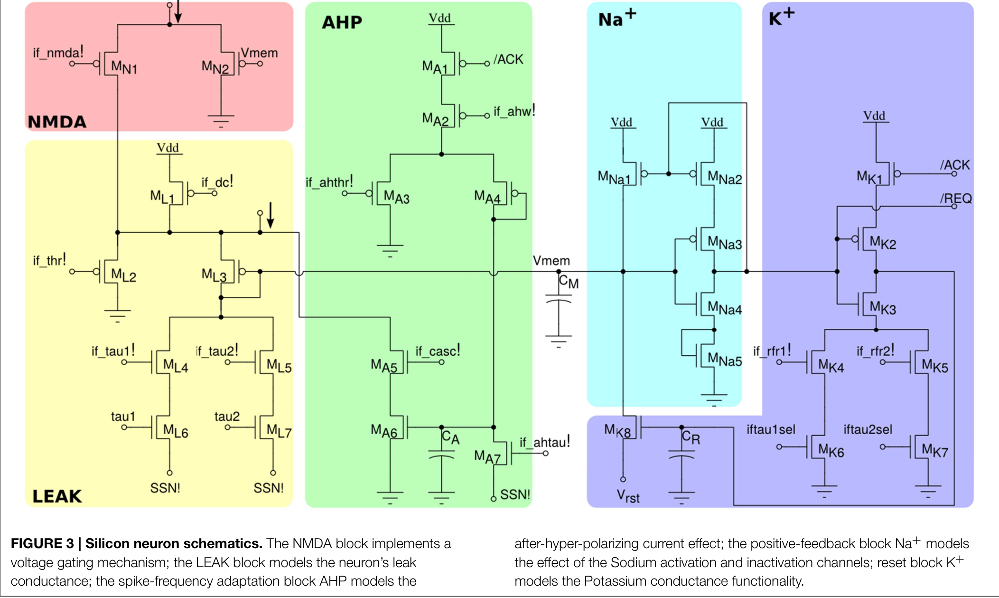
*Figura 11 — Estratta da Qiao et al. (2015), Fig. 3: Schema elettrico completo a livello transistor del neurone al silicio AdEx integrato in ROLLS, suddiviso in 5 blocchi funzionali: `NMDA` (rosa, $M_{N1\text{–}N2}$), `LEAK` (giallo, $M_{L1\text{–}L7}, C_M$), `AHP` (verde, $M_{A1\text{–}A7}, C_A$), `Na+` (azzurro, $M_{Na1\text{–}Na5}$) e `K+` (blu, $M_{K1\text{–}K8}, C_R$).*

Lo schema elettrico completo del soma integrato in ROLLS (**Figura 11**) evolve il neurone DPI di Indiveri (Figura 6) introducendo **5 blocchi funzionali** controllati da 13 bias globali (generati dal *BiasGen* on-chip e contrassegnati dal punto esclamativo `!`) e da 2 latch digitali locali che permettono di selezionare tra due costanti di tempo di leak e due periodi refrattari (4 popolazioni neuronali distinte):

1. **Blocco `NMDA` — *Voltage-Gating* Sinaptico ($M_{N1}, M_{N2}$, in alto a sinistra, rosa):**  
   Riceve la corrente post-sinaptica lenta dal DPI di riga della matrice LTP. La coppia differenziale nMOS **$M_{N1}\text{–}M_{N2}$** confronta il potenziale di membrana **`Vmem`** (sul gate di $M_{N2}$) con la soglia di sblocco del magnesio **`if_nmda!`** (sul gate di $M_{N1}$): solo quando il neurone post-sinaptico è sufficientemente depolarizzato ($V_{\text{mem}} > \text{if\_nmda!}$), la corrente fluisce nel ramo di $M_{N2}$ e viene specchiata dallo specchio pMOS superiore dentro il nodo di membrana `Vmem`.
2. **Blocco `LEAK` — DPI di Membrana con *Shifted-Source Biasing* e Doppia Costante di Tempo ($M_{L1}\text{–}M_{L7}, C_M$, in basso a sinistra, giallo):**  
   * **$M_{L1}$ (pMOS, gate a `if_dc!`):** Inietta una corrente di stimolazione costante regolabile.
   * **$M_{L2}, M_{L3}$ (coppia differenziale nMOS del DPI):** Il gate di $M_{L2}$ è polarizzato dalla soglia **`if_thr!`**, il gate di $M_{L3}$ è collegato a **`Vmem`** sulla capacità di membrana **$C_M$**.
   * **$M_{L4}, M_{L5}$ (nMOS di leak) e $M_{L6}, M_{L7}$ (switch di selezione):** Il latch digitale locale (`tau1` / `tau2`) seleziona se scaricare il nodo tramite $M_{L4}$ (bias **`if_tau1!`**) oppure tramite $M_{L5}$ (bias **`if_tau2!`**).
   * **Accorgimenti progettuali contro il Mismatch e per Costanti di Tempo Lunghe:** I terminali di source di $M_{L6}$ e $M_{L7}$ sono connessi al potenziale rialzato **`SSN!`** (*Shifted-Source Biasing*, Fig. 7C di Paper 1) per raggiungere correnti sub-pA e costanti di tempo $\tau_m$ fino a centinaia di ms. Inoltre, i transistor critici di leak $M_{L4}$ e $M_{L5}$ sono sovradimensionati a **$W / L = 2\,\mu\text{m} / 4\,\mu\text{m}$** per minimizzare il mismatch di Pelgrom.
3. **Blocco `AHP` — *Spike-Frequency Adaptation* DPI ($M_{A1}\text{–}M_{A7}, C_A$, al centro, verde):**  
   Ad ogni spike confermato da **`/ACK`** (gate del pMOS **$M_{A1}$**), il pMOS **$M_{A2}$** (**`if_ahw!`**) inietta un impulso di carica nella coppia differenziale pMOS **$M_{A3}\text{–}M_{A4}$** (soglia **`if_ahthr!`** su $M_{A3}$, capacità di adattamento **$C_A$** sul gate di $M_{A4}$). L'nMOS **$M_{A7}$** (gate a **`if_ahtau!`**, source a **`SSN!`**) scarica lentamente $C_A$, mentre l'nMOS **$M_{A6}$** (in serie al cascode **$M_{A5}$** polarizzato da **`if_casc!`**) sottrae da `Vmem` la corrente iperpolarizzante lenta $I_g$.
4. **Blocco `Na+` — Feedback Positivo Esponenziale ($M_{Na1}\text{–}M_{Na5}$, centro-destra, azzurro):**  
   L'nMOS **$M_{Na4}$** (col gate collegato a `Vmem`) è posto in serie a **$M_{Na3}$** e allo switch di inattivazione **$M_{Na5}$** (controllato in opposizione di fase dalla capacità di refrattarietà $C_R$). Quando `Vmem` sale, la corrente di drain di $M_{Na3}/M_{Na4}$ abbassa il nodo di richiesta **`/REQ`** e viene specchiata dallo specchio pMOS **$M_{Na1}\text{–}M_{Na2}$**, che reinietta esponenzialmente corrente in `Vmem`. Per abbattere la variabilità della soglia di sparo, i transistor sono dimensionati a **$(W/L)_{M_{Na3}} = 4\,\mu\text{m}/0.4\,\mu\text{m}$** e **$(W/L)_{M_{Na4}} = 1\,\mu\text{m}/4\,\mu\text{m}$**, ottenendo un **mismatch medio della curva $f\text{–}I$ su tutti i 256 neuroni del chip pari a solo il $9.4\%$**!
5. **Blocco `K+` — Reset Regolabile e Doppia Refrattarietà ($M_{K1}\text{–}M_{K8}, C_R$, a destra, blu):**  
   All'arrivo di **`/ACK`** su **$M_{K1}$**, lo *starved inverter* (**$M_{K2}, M_{K3}$**) carica la capacità **$C_R$**, che si scarica poi attraverso **$M_{K4}$** (**`if_rfr1!`**) o **$M_{K5}$** (**`if_rfr2!`**), selezionati dagli switch **$M_{K6}, M_{K7}$** (`iftau1sel` / `iftau2sel`). Finché $C_R$ è alta, l'nMOS di reset **$M_{K8}$** (col source collegato al potenziale di reset accordabile **`Vrst`**) mantiene `Vmem` inchiodato a **`Vrst`** e spegne $M_{Na5}$.

---

#### 4.3.3 Circuiti Post-Sinaptici di Apprendimento (*Stop-Learning* del Calcio e Circuiti *Winner-Take-All*)

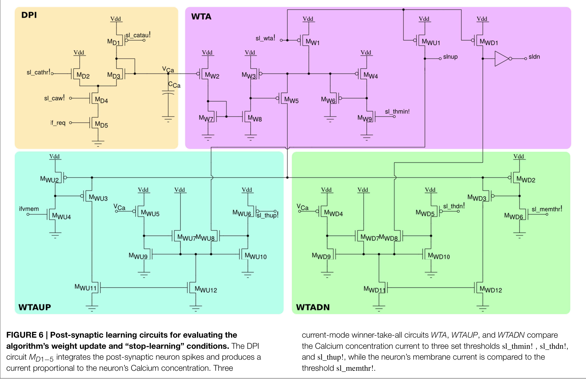
*Figura 12 — Estratta da Qiao et al. (2015), Fig. 6: Circuiti post-sinaptici di apprendimento per la valutazione dell'aggiornamento del peso e delle condizioni di "stop-learning" basate sulla concentrazione di Calcio: blocco `DPI` del Calcio ($M_{D1\text{–}D5}, C_{\text{Ca}}$) e tre circuiti Winner-Take-All in modalità corrente `WTA` ($M_{W1\text{–}W9}$), `WTAUP` ($M_{WU1\text{–}WU12}$) e `WTADN` ($M_{WD1\text{–}WD12}$).*

Come mostrato in **Figura 12**, per implementare le condizioni dell'algoritmo di Brader et al. (2007):
$$\begin{cases}
w_i \leftarrow w_i + \Delta w^+ & \text{se } V_{\text{mem}}(t_{\text{pre}}) > \theta_{\text{mem}} \;\land\; \theta_1 < Ca(t_{\text{pre}}) < \theta_3 \\
w_i \leftarrow w_i - \Delta w^- & \text{se } V_{\text{mem}}(t_{\text{pre}}) < \theta_{\text{mem}} \;\land\; \theta_1 < Ca(t_{\text{pre}}) < \theta_2
\end{cases}$$
ogni neurone integra i propri spike post-sinaptici (**`if_req`**) tramite il **blocco `DPI` del Calcio ($M_{D1}\text{–}M_{D5}, C_{\text{Ca}}$)**: la tensione risultante **`Vca`** su $C_{\text{Ca}}$ pilota i gate dei transistor pMOS nei tre comparatori **Winner-Take-All (WTA) in corrente**:
* **`WTA` ($M_{W1}\text{–}M_{W9}$):** confronta la corrente di Calcio ($M_{W2}$) con la soglia inferiore $\theta_1$ (**`sl_thmin!`** su $M_{W9}$), abilitando i pull-up $M_{WU1}$ e $M_{WD1}$ solo se $Ca > \theta_1$.
* **`WTAUP` ($M_{WU1}\text{–}M_{WU12}$):** confronta $Ca$ ($M_{WU5}$) con la soglia superiore $\theta_3$ (**`sl_thup!`** su $M_{WU6}$) e la corrente di membrana **`ifvmem`** ($M_{WU4}$) con $\theta_{\text{mem}}$ ($M_{WU2}\text{–}M_{WU3}$), attivando il segnale digitale di potenziamento **`slnup`**.
* **`WTADN` ($M_{WD1}\text{–}M_{WD12}$):** confronta $Ca$ ($M_{WD4}$) con la soglia $\theta_2$ (**`sl_thdn!`** su $M_{WD5}$) e la corrente di membrana con $\theta_{\text{mem}}$ (**`sl_memthr!`** su $M_{WD6}$), attivando il segnale digitale di depressione **`sldn`**.

---

#### 4.3.4 Sinapsi Plastica Bistabile a Lungo Termine (LTP: blocchi `SET`, `JUMP`, `BIST`, `CC`)

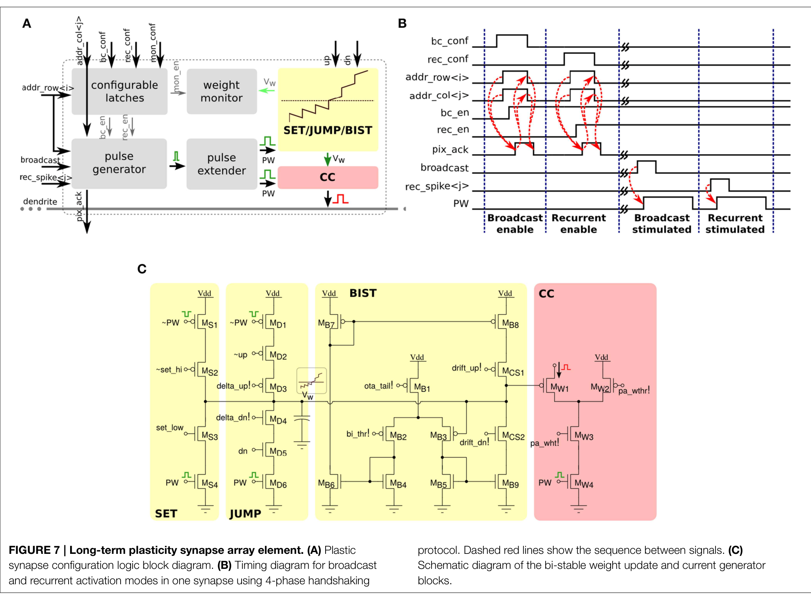
*Figura 13 — Estratta da Qiao et al. (2015), Fig. 7: Elemento della matrice sinaptica a lungo termine (LTP) di ROLLS. (A) Diagramma a blocchi della logica asincrona locale (3 latch configurabili `bc_en`, `rec_en`, `mon_en`, pulse generator e pulse extender). (B) Diagramma temporale del protocollo handshaking a 4 fasi per le modalità broadcast e ricorrente. (C) Schema elettrico a livello transistor dei 4 blocchi analogici connessi al nodo capacitivo del peso interno $V_w$: `SET` ($M_{S1\text{–}S4}$), `JUMP` ($M_{D1\text{–}D6}$), `BIST` ($M_{B1\text{–}B9}, M_{CS1\text{–}CS2}$) e `CC` ($M_{W1\text{–}W4}$).*

In ciascuna delle $64\text{K}$ celle LTP (**Figura 13C**), il peso interno è rappresentato dalla tensione analogica **$V_w$** sul condensatore di peso, su cui agiscono quattro blocchi a transistor:
1. **Blocco `SET` ($M_{S1}\text{–}M_{S4}$):** Permette di inizializzare dall'esterno via AER lo stato binario del peso caricando $V_w \to V_{dd}$ (`~set_hi` e `~PW` sui pMOS $M_{S1}, M_{S2}$) o scaricandolo a massa (`set_low` e `PW` sugli nMOS $M_{S3}, M_{S4}$).
2. **Blocco `JUMP` ($M_{D1}\text{–}M_{D6}$):** All'arrivo dell'impulso pre-sinaptico esteso **`PW`** / **`~PW`**, se il segnale post-sinaptico **`~up`** (copia invertita di `slnup`) è attivo basso, i pMOS **$M_{D1}, M_{D2}, M_{D3}$** iniettano su $V_w$ un gradino positivo $+\Delta w^+$ regolato da **`delta_up!`**; se invece **`dn`** (`sldn`) è attivo alto, gli nMOS **$M_{D4}, M_{D5}, M_{D6}$** sottraggono un gradino $-\Delta w^-$ regolato da **`delta_dn!`**.
3. **Blocco `BIST` ($M_{B1}\text{–}M_{B9}, M_{CS1}, M_{CS2}$):** Implementa il drift bistabile continuo $\frac{dw_i}{dt} = \pm C_{\text{drift}}$. È un amplificatore a transconduttanza *wide-range* (coppia differenziale pMOS **$M_{B2}\text{–}M_{B3}$** polarizzata da **$M_{B1}$** `ota_tail!` e specchi **$M_{B4}\text{–}M_{B9}$**) collegato in **retroazione positiva** sul nodo $V_w$ stesso, con correnti di uscita limitate dai transistor di *current-starving* **$M_{CS1}$** (pMOS, bias **`drift_up!`**) e **$M_{CS2}$** (nMOS, bias **`drift_dn!`**): se $V_w > \text{bi\_thr!}$ (gate di $M_{B2}$), l'OTA spinge lentamente $V_w$ verso il rail positivo $V_{dd}$; se $V_w < \text{bi\_thr!}$, lo spinge verso massa, rendendo il peso immune al leakage a lungo termine!
4. **Blocco `CC` — *Current Converter* ($M_{W1}\text{–}M_{W4}$):** Durante l'impulso pre-sinaptico `PW` ($M_{W4}$), la coppia differenziale nMOS **$M_{W1}\text{–}M_{W2}$** confronta $V_w$ con la soglia **`pa_wthr!`** ed eroga verso il filtro DPI di riga una corrente EPSC con ampiezza massima fissata da **`pa_wht!`** ($M_{W3}$).

---

#### 4.3.5 Sinapsi Programmabile a Breve Termine (STP: DAC a 2 bit, `STD`, `ECC`, `ICC`) e Circuiti EPSC/STDP di NET-TEN

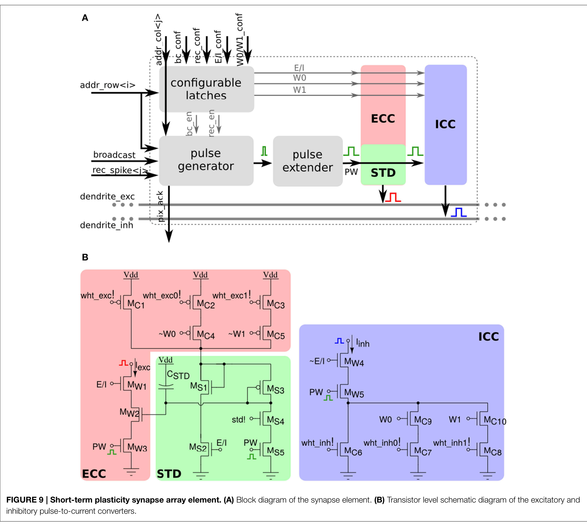
*Figura 14 — Estratta da Qiao et al. (2015), Fig. 9: Elemento della matrice sinaptica a breve termine (STP) di ROLLS. (A) Diagramma a blocchi con latch configurabili per il peso a 2 bit (`W0`, `W1`), polarità `E/I` e attivazione `bc_en`/`rec_en`. (B) Schema elettrico a livello transistor del DAC eccitatorio a 2 bit ($M_{C1\text{–}C5}$), convertitore eccitatorio `ECC` ($M_{W1\text{–}W3}$), circuito di Short-Term Depression `STD` ($M_{S1\text{–}S5}, C_{\text{STD}}$) e convertitore inibitorio `ICC` ($M_{W4\text{–}W5}, M_{C6\text{–}C10}$).*

Nelle $64\text{K}$ sinapsi STP di ROLLS (**Figura 14B**):
* **DAC di Corrente a 2-bit Eccitatorio ($M_{C1}\text{–}M_{C5}$) e Inibitorio (`ICC`, $M_{W4}\text{–}M_{W5}, M_{C6}\text{–}M_{C10}$):** I bit `W0` e `W1` attivano i rami binari pesati (`wht_exc0!`, `wht_exc1!` per `E/I = 1`; `wht_inh0!`, `wht_inh1!` per `E/I = 0`) generando 4 livelli discreti di corrente sinaptica $I_{\text{exc}}$ o $I_{\text{inh}}$.
* **Circuito `STD` — *Short-Term Depression* ($M_{S1}\text{–}M_{S5}, C_{\text{STD}}$):** A riposo, il condensatore $C_{\text{STD}}$ si carica attraverso il pMOS connesso a diodo **$M_{S3}$** in modo che la tensione di gate del pMOS di uscita **$M_{W2}$** (nel blocco `ECC`) eguagli quella di $M_{S1}$. Ad ogni impulso pre-sinaptico `PW` sul gate di **$M_{S5}$**, il transistor **$M_{S4}$** (polarizzato da **`std!`**) sottrae un pacchetto di carica da $C_{\text{STD}}$, riducendo transitoriamente l'ampiezza degli impulsi $I_{\text{exc}}$ successivi finché $C_{\text{STD}}$ non recupera lentamente attraverso il diodo $M_{S3}$.

##### Confronto con i Circuiti Sinaptici EPSC e STDP di NET-TEN *(Ronchini et al., 2023 — Figura 16c,d)*
Nel chip **NET-TEN** (**Figura 16c,d**), progettato per operare a $V_{DD} = 250\,\text{mV}$ con area minima:
* **Il circuito EPSC (Figura 16c, 4 transistor $M_{E1}\text{–}M_{E4} + C_{\text{syn}}$, area $462.09\,\mu\text{m}^2$)** è una versione ultra-compatta del filtro LPF sottosoglia: durante l'impulso positivo `pre`, l'nMOS $M_{E1}$ si accende e il pMOS $M_{E3}$ si spegne, scaricando $C_{\text{syn}}$ con una corrente regolata dal peso $V_w$ sul gate di $M_{E2}$; il pMOS d'uscita $M_{E4}$ converte esponenzialmente $V_{\text{syn}}$ in $I_{\text{syn}}$ (picco $486.39\,\text{pA}$ per $V_w = 200\,\text{mV}$); al termine dell'impulso `pre`, $M_{E3}$ si riaccende e ricarica lentamente $C_{\text{syn}}$ verso $V_{DD}$ con costante di tempo $\tau = 212.83\,\mu\text{s}$.
* **Il circuito STDP in sottosoglia (Figura 16d, 12 transistor $M_{S1}\text{–}M_{S12} + C_w = 206.30\,\text{fF}$, area $1054.75\,\mu\text{m}^2$)** costruisce due tracce esponenziali temporali: una traccia pre-sinaptica nel ramo sinistro ($M_{S1}\text{–}M_{S3}$, costante di tempo $\tau_+$ regolata da $V_{tp}$ su $M_{S3}$) che viene campionata all'arrivo dell'impulso negativo `post` su $M_{S5}$ per iniettare la corrente di potenziamento $I_{\text{pot}}$ (regolata da $V_p$ su $M_{S6}$) in $C_w$; e una traccia post-sinaptica nel ramo destro ($M_{S10}\text{–}M_{S12}$, costante di tempo $\tau_-$ regolata da $V_{td}$ su $M_{S12}$) campionata all'arrivo dell'impulso positivo `pre` su $M_{S8}$ per sottrarre la corrente di depressione $I_{\text{dep}}$ (regolata da $V_d$ su $M_{S7}$) da $C_w$.

---

### 4.4 Architetture Multi-Core Scalabili, Routing Asincrono QDI e Memorie Eterogenee Ibride CAM/SRAM: DYNAPs / DYNAP-SE *(Moradi et al., 2018 — Paper 5)*

#### 4.4.1 Ottimizzazione Analitica della Memoria di Routing Tag-Based a Due Stadi
In un processore singolo-core a crossbar pieno come ROLLS ($N \times N$ sinapsi fisiche), l'area delle sinapsi cresce quadraticamente ($\mathcal{O}(N^2)$), impedendo di scalare a migliaia di neuroni. D'altra parte, nelle architetture digitali pure (come IBM TrueNorth o SpiNNaker) che usano memorie SRAM centralizzate con routing *point-to-point*, per una rete di $N$ neuroni con fan-out $F$ ciascun neurone richiede $F \log_2(N)$ bit di memoria (es. per $N = 2^{20} \approx 10^6$ e $F = 2^{13} \approx 8192$, servirebbero **$160\,\text{kbit/neurone}$**!).

**Moradi et al. (2018)** risolvono questo problema ispirandosi alla connettività modulare della corteccia cerebrale (cluster locali densamente connessi + poche proiezioni a lungo raggio): i neuroni vengono suddivisi in **$N/C$ cluster (core)** da **$C$ neuroni ciascuno** ($C = 256$ in DYNAP-SE), combinando **due stadi di routing con memorie eterogenee (SRAM + CAM)**:
1. **Stadio 1 (*Point-to-Point Source Routing* tramite SRAM nei router R1):** Ogni neurone sorgente invia il proprio evento (contenente un identificativo locale o *tag* scelto tra $K$ tag possibili nel cluster) a un numero ridotto di **$F/M$ core di destinazione**. La memoria SRAM sorgente richiesta per neurone è:
   $$\text{MEM}_S = \frac{F}{M} \left[\log_2(K) + \log_2\!\left(\frac{N}{C}\right)\right] = \frac{F}{M} \log_2\!\left(\frac{KN}{C}\right)$$
2. **Stadio 2 (*Local Broadcast Destination Routing* tramite CAM nelle sinapsi):** Il core di destinazione effettua il **broadcast** del tag a tutti i suoi $C$ neuroni; all'interno del core, in media **$M$ neuroni** ($M \le C$) hanno memorizzato quel tag nelle proprie celle **CAM (Content-Addressable Memory)** e ricevono lo spike. La memoria CAM target per neurone vale:
   $$\text{MEM}_T = \frac{KM}{C} \log_2(K)$$

Definendo il rapporto di flessibilità $\alpha = K/C$, la **memoria totale per neurone** è:
$$\text{MEM}(M) = \text{MEM}_S + \text{MEM}_T = \frac{F}{M} \log_2(\alpha N) + \alpha M \log_2(\alpha C)$$
Uguagliando a zero la derivata rispetto a $M$ ($\frac{\partial \text{MEM}}{\partial M} = 0$), si trova il **fan-out locale ottimo $M^*$** e la **memoria minima assoluta per neurone** (per $\alpha = 1$, ossia $K = C$):

$$M^* = \sqrt{F \frac{\log_2(N)}{\log_2(C)}} \implies \mathbf{\text{MEM}_{\min} = 2 \sqrt{F \log_2(C) \log_2(N)}}$$

> [!TIP]
> **Impatto Quantitativo dell'Architettura Ibrida SRAM + CAM di DYNAPs:**  
> Per una rete corticale di $N = 2^{20}$ neuroni ($1\,\text{M}$) con fan-out $F = 2^{13}$ ($8192$) e cluster di $C = 256$ neuroni, la formula di Moradi et al. riduce la memoria necessaria da **$160\,\text{kbit/neurone}$** a **meno di $1.2\,\text{kbit/neurone}$** (un risparmio superiore a **$130\times$**!), garantendo inoltre uno **scaling strettamente lineare** della memoria con la dimensione delle reti convoluzionali (contro lo scaling quadratico di IBM TrueNorth mostrato in Fig. 13 di Paper 5).

---

#### 4.4.2 Architettura del Nodo Computazionale, Sintesi Asincrona QDI e Routing Gerarchico R1–R2–R3

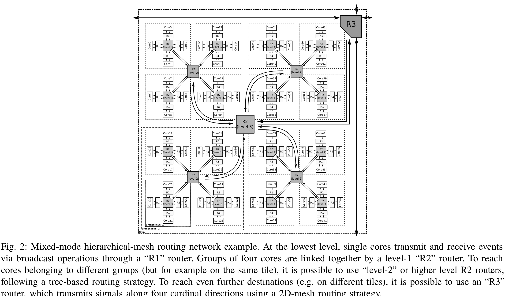
*Figura 19 — Estratta da Moradi et al. (2018), Fig. 2: Rete di routing gerarchica ibrida (Mixed-mode hierarchical-mesh) di DYNAPs: i singoli core trasmettono e ricevono eventi in broadcast tramite un router locale **R1**; gruppi di 4 core sono interconnessi da router ad albero **R2** (livelli 1, 2, 3) per bassa latenza locale, mentre il traffico globale inter-chip su griglia bidimensionale è gestito dai router 2D-mesh **R3**.*

Il chip prototipo **DYNAP-SE** (fabbricato in CMOS **$0.18\,\mu\text{m}$ 1P6M**, area die **$43.79\,\text{mm}^2$**, area core **$38.5\,\text{mm}^2$**, alimentazione core da **$1.3\,\text{V}$ a $1.8\,\text{V}$**) integra **4 core da 256 neuroni = 1024 neuroni totali**. Come illustrato nelle **Figure 19, 20 e 24**:
* **Il Singolo Nodo Computazionale (Figura 20, in alto, e Figura 24):**  
  Ciascuno dei 256 nodi di un core co-localizza:
  * **64 parole di memoria mista:** ciascuna formata da **10-bit CAM** (per il matching asincrono del tag sorgente, fan-in = 64) + **2-bit SRAM** (per selezionare il tipo di recettore sinaptico);
  * **64 Pulse Generators (PG), 64 Pulse Extenders (PE) e 64 Pulse Decoders (DEC):** estendono l'impulso di match e lo indirizzano verso uno dei **4 filtri analogici DPI dedicati per neurone**:
    1. `FEPSP` (*Fast Excitatory* — tipo **AMPA**);
    2. `SEPSP` (*Slow Excitatory* — tipo **NMDA** con *voltage-gating*);
    3. `FIPSP` (*Subtractive Inhibitory* — tipo **$\text{GABA}_B$**);
    4. `SIPSP` (*Shunting Inhibitory* — tipo **$\text{GABA}_A$**);
  * **1 Soma Analogico AdExp-I&F** e **1 blocco di Handshaking (HS)**.
* **Infrastruttura di Routing Digitale Asincrono QDI (R1, R2, R3 — Figura 19):**  
  Progettata senza alcun clock globale tramite sintesi formale di Martin (*Communicating Hardware Processes* CHP $\to$ *Handshaking Expansion* HSE a 4 fasi con codifica **dual-rail** $\to$ *Production Rules* CMOS con **C-elements di Muller**):
  * **Router R1 (1 per core):** Contiene un *Memory Address Loop* e una **SRAM asincrona da $20\,\text{kbit}$** ($1024 \times 20\,\text{bit}$). Quando un neurone spara, il loop legge fino a 4 parole SRAM da 20 bit (ciascuna contenente: `10-bit Tag` + `6-bit relative XY chip address` $\Delta X, \text{sign}X, \Delta Y, \text{sign}Y$ + `4-bit Core ID`), consentendo un fan-out massimo di **$4\text{k}$ ($4096$) neuroni post-sinaptici**.
  * **Router R2 (Albero Intra-Chip):** Collega i 4 router R1 del chip; se $\Delta X = 0 \land \Delta Y = 0$, smista l'evento direttamente al core locale tramite alberi *Controlled-Split* (`SPT`), altrimenti lo invia a R3.
  * **Router R3 (2D-Mesh Inter-Chip XY):** Gestisce il routing relativo XY senza tabelle di routing attraverso le 4 porte cardinali (`North`, `South`, `East`, `West`) con una latenza intrinseca di soli **$2.5\,\text{ns}$** (latenza totale *chip-to-chip* inclusi i pad pari a **$15.4\,\text{ns}$**, throughput **$400\,\text{Mevents/s}$**).

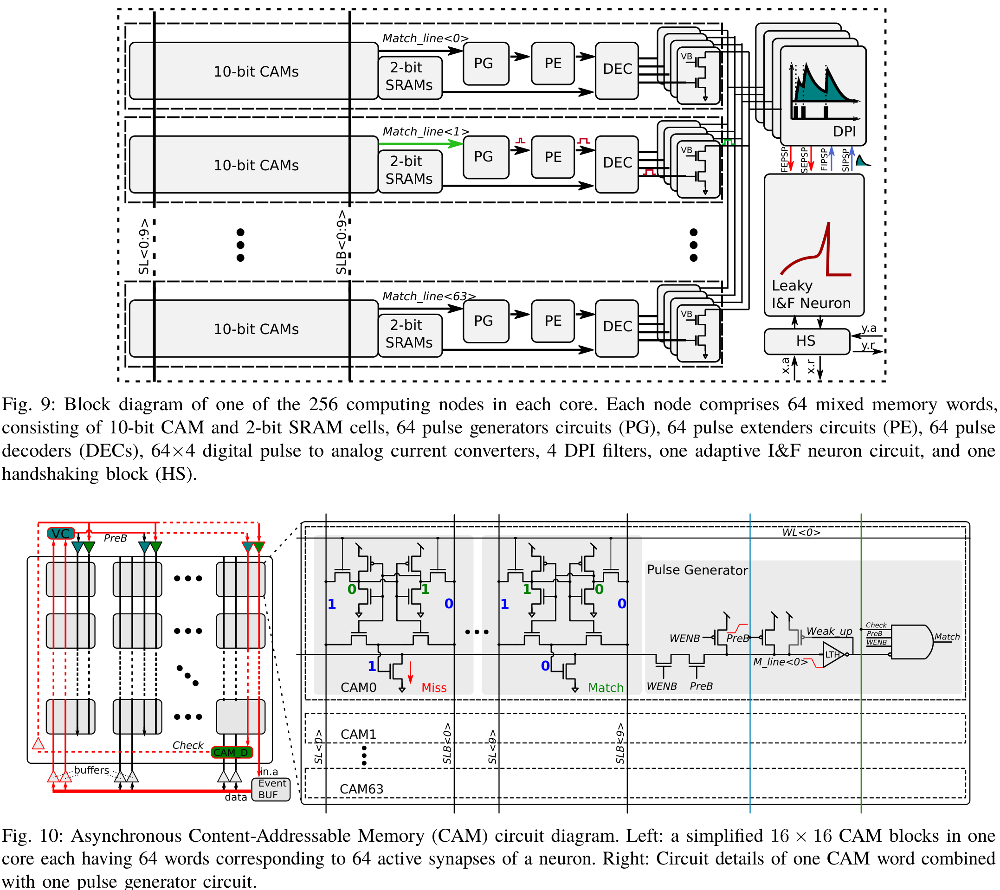
*Figura 20 — Estratta da Moradi et al. (2018), Fig. 9 e Fig. 10: (In alto) Diagramma a blocchi di uno dei 256 nodi computazionali di un core DYNAP-SE (64 parole miste da 10-bit CAM + 2-bit SRAM, 64 PG, 64 PE, 64 DEC, 4 filtri sinaptici DPI [FEPSP, SEPSP, FIPSP, SIPSP], 1 soma AdEx e blocco HS). (In basso) Circuito della memoria CAM asincrona: a sinistra, organizzazione della matrice $16\times 16$ nel core con `Event BUF`, `Validity Check (VC)` e cella dummy `CAM_D`; a destra, schematico transistor-level della cella CAM a 9 transistor (9T NOR-type) con inverter a bassa soglia `LTH`, pull-up `Weak_up` e Pulse Generator.*

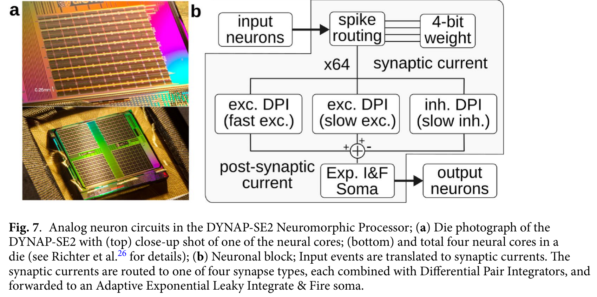
*Figura 24 — Estratta da Bartels et al. (2025), Fig. 7: Micrografia del die DYNAP-SE2 con zoom su un core neurale e schema a blocchi del compartimento neuronale analogico (routing per 64 sinapsi, peso a 4-bit, 4 blocchi DPI [fast exc, slow exc, slow inh, fast inh] sommati nel soma Exp. I&F).*

---

#### 4.4.3 Circuito della Memoria CAM Asincrona a 9 Transistor (9T NOR-type) e Invarianza Spaziale del *Pulse-Width*

Il circuito più critico per l'efficienza di DYNAP-SE è la **memoria CAM asincrona a 9 transistor (9T NOR-type)** mostrata in **Figura 20 (in basso a destra)**:
* **Cella 9T NOR-type e *Match-Line* Pre-Caricata Alta:**  
  Ogni bit della parola CAM da 10 bit utilizza una cella SRAM di memorizzazione accoppiata a transistor di confronto di tipo NOR collegati alla linea comune `M_line<0>`. Durante lo stato neutro delle search-lines (`SL = 0, SLB = 0`), il blocco *Validity Check* (`VC`, posto nell'angolo in alto a destra del core) mantiene `PreB = 0`, pre-caricando tutte le $64 \times 256 = 16\,384$ `M_line` del core a $V_{dd}$. All'arrivo di un evento, `PreB` passa a $1$: qualsiasi bit non corrispondente (*miss*) accende il proprio ramo nMOS scaricando `M_line` a massa; solo le parole con tutti i 10 bit in *match* mantengono `M_line` alta. Un **inverter a bassa soglia (`LTH`)** con un **pMOS di pull-up debole (`Weak_up`)** in retroazione compensa la corrente di leakage sottosoglia dei 10 rami NOR spenti, evitando falsi *miss*.
* **Cella Dummy `CAM_D` e Cancellazione Esatta del Mismatch Spaziale di Ritardo:**  
  Poiché l'impulso `Match` generato dalla CAM pilota i convertitori di corrente analogici, una variazione della sua larghezza temporale $\Delta t_{\text{pulse}}$ tra il primo e l'ultimo neurone del core introdurrebbe un grave errore sistematico sui pesi sinaptici. Per evitarlo senza appesantire ogni cella con logica QDI, nell'angolo opposto a `VC` (in basso a destra) è inserita una **parola CAM dummy (`CAM_D`)** cablata per avere sempre **un solo bit su 10 in stato di *miss* (*worst-case miss*, scarica più lenta possibile)**. Quando `CAM_D` completa la scarica, asserisce il segnale globale `Check = 1`. Sia `PreB` (che determina il fronte di discesa $t_{dx}$ dell'impulso di match) sia `Check` (che determina il fronte di salita $t_{ux}$) vengono propagati attraverso catene di buffer identiche nella **stessa direzione spaziale (dall'alto a sinistra verso il basso a destra)**. Di conseguenza, per una generica sinapsi $\text{CAM}_x$ i ritardi di propagazione spaziale $t_{d1x}$ e $t_{d2x}$ si elidono esattamente:
  $$\Delta t_{\text{pulse},x} = t_{dx} - t_{ux} = \left(t_{\text{pre}} + t_{d2x}\right) - \left(t_{\text{ck}} + t_{d1x}\right) \approx t_{\text{pre}} - t_{\text{ck}}$$
  garantendo una larghezza d'impulso **costante e invariante rispetto alla posizione fisica del neurone sul die** (tempo totale di broadcast + search pari a soli **$27\,\text{ns}$**)!

---

## Capitolo 5 — Confronto Multiparametrico Globale e Analisi dei Compromessi (Trade-off)

In conformità alle richieste della traccia d'esame, questo capitolo mette a confronto in modo sistematico tutte le implementazioni di neuroni al silicio e tutti i sistemi/processori neuromorfici esaminati nei 7 articoli scientifici secondo i sette parametri ingegneristici chiave: **tensione di alimentazione ($V_{DD}$), consumo statico, potenza dinamica/totale, energia per spike, area silicea, frequenza di firing (e costanti di tempo) e variabilità dei parametri (*device mismatch*)**.

---

### 5.1 Confronto Sinottico delle Topologie di Neuroni al Silicio (SiN)

La **Tabella 5.1** sintetizza e confronta le principali topologie circuitali di neuroni spiking analizzate nel Capitolo 4 (integrando la Tabella 2 di *Indiveri et al., 2011* con i dati quantitativi estratti da *Qiao et al., 2015*, *Ronchini et al., 2023* e *Wu et al., 2026*).

**Tabella 5.1 — Confronto multiparametrico delle topologie circuitali CMOS di neuroni spiking**

| Topologia Circuito Neurone (Riferimento) | Regime Operativo e Stile Circuitale | Modello Matematico Implementato | Nodo CMOS / $V_{DD}$ Tipica | Componenti del Soma (Transistor + Cap.) | Potenza / Energia per Spike | Area del Singolo Soma | Scala Temporale e Firing Rate | Sensibilità al Mismatch e Compromessi Principali |
| :--- | :--- | :--- | :--- | :--- | :--- | :--- | :--- | :--- |
| **Axon-Hillock** *(Mead, 1989)* | Sub-threshold, Voltage-mode, asincrono | Basic I&F (non-leaky o con leak) | $0.6\text{–}2\,\mu\text{m}$ / $3.3\text{–}5\,\text{V}$ | $\sim 6\text{–}8\,\text{MOS} + 2\,\text{Cap}$ ($C_{\text{mem}}, C_{\text{fb}}$) | $\sim \mu\text{W}$ (alta corrente di corto circuito) | Molto compatta | Real-time ($\text{Hz}\text{–}\text{kHz}$) | **Basso mismatch** (dipende da $C_{\text{fb}}/C_{\text{mem}}$), ma **alto consumo** per ingressi lenti sulla soglia dell'inverter. |
| **Voltage-Amplifier I&F** *(van Schaik, 2001)* | Sub-threshold, Voltage-mode, asincrono | Leaky I&F con $V_{\text{thr}}$, $I_{\text{Na}}$, $I_{\text{K}}$ e refrattarietà | $0.5\text{–}0.8\,\mu\text{m}$ | $\sim 18\,\text{MOS} + 2\,\text{Cap}$ ($C_{\text{mem}}, C_K$) | $\sim 100\,\text{nW}\text{–}\mu\text{W}$ | Media | Real-time ($\text{Hz}\text{–}\text{kHz}$) | Controllo indipendente di $V_{\text{thr}}$, *spike width* ($I_{\text{Kup}}$) e refrattarietà ($I_{\text{Kdn}}$); consumo statico dell'OTA. |
| **Thalamic Relay 2-Comp.** *(Hynna & Boahen, 2009)* | Sub-threshold, Termodinamico, Voltage/Log | Conduttanza a 2 compartimenti (canale $\text{Ca}^{2+}$ $I_T$) | $0.25\text{–}0.5\,\mu\text{m}$ | $\sim 15\,\text{MOS} + 3\,\text{Cap}$ | Basso consumo ($\text{nW}$) | Compatta | Real-time (Tonic & Burst) | Riproduce fedelmente gating sigmoidale $u_\infty(V)$ e $\tau_u(V)$ a campana con soli 2 MOS; soggetto a mismatch sub-threshold. |
| **Sub-threshold H–H** *(Yu & Cauwenberghs, 2010a)* | Sub-threshold, Current-mode Log-domain | Hodgkin–Huxley completo ($m^3 h, n^4$) | $0.5\,\mu\text{m}$ / $3.3\,\text{V}$ | Moltiplicatori translineari + Tau-cells + DAC spline | $\sim \mu\text{W}$ | **Grande** (non compatto: 4 neuroni/chip) | Real-time scalabile tramite bias | Altissimo realismo biofisico e programmabilità a 7 punti spline, ma area proibitiva per grandi matrici. |
| **Octopus Retina I&F** *(Culurciello et al., 2003)* | Sub-threshold, Feedback in corrente | Basic I&F ultra-low-power | $0.6\,\mu\text{m}$ / $3.0\,\text{V}$ | $\sim 12\,\text{MOS} + 1\text{–}2\,\text{Cap}$ | **$< 4\,\text{pJ/spike}$** | Molto compatta | Real-time (fino a $\text{kHz}$) | Feedback positivo in corrente ($\times 100$ velocità) + disconnessione di $C_{\text{mem}}$ ($\div 25$ potenza); assenza di adattamento. |
| **DVS Differencing SiN** *(Lichtsteiner et al., 2008)* | Sub-threshold + Cap-feedback | Basic ON/OFF Differencing I&F | $0.35\,\mu\text{m}$ / $3.3\,\text{V}$ | Fotorecettore + Amp $C_1/C_2 + 2$ comp. | $\sim 100\,\text{nW/pixel}$ | $40 \times 40\,\mu\text{m}^2$ | Real-time (fino a $>1\,\text{kHz}$) | **Mismatch bassissimo** ($1\,\text{mV}$ eq., $2\%$ contrasto) grazie al blocco DC su $C_1$ e guadagno $-C_1/C_2 = -20$. |
| **Tau-Cell Neuron** *(van Schaik et al., 2010)* | Sub-threshold, Current-mode Log-domain | Leaky I&F in modalità corrente | $0.35\text{–}0.5\,\mu\text{m}$ | $16\,\text{MOS}$ ($M_1\text{–}M_{16}$) $+ 1\,\text{Cap}$ ($C_{\text{mem}}$) | Basso consumo ($\text{nW}$) | Compatta e modulare | Real-time ($\text{Hz}\text{–}\text{kHz}$) | Lineare nelle correnti; sensibile al mismatch sugli specchi di corrente e riferimenti $V_{\text{ref}}$. |
| **Log-Domain LPF (LLN)** *(Arthur & Boahen, 2007)* | Sub-threshold, Current-mode Log-domain | Modello a 2 variabili con feedback cubico ($v^3/3$) | $0.25\,\mu\text{m}$ | $16\,\text{MOS} + 3\,\text{Cap}$ ($C_{\text{mem}}, C_P, C_R$) | **$50\text{–}1000\,\text{nW}$** | Compatta | Real-time (RS, SFA, Bursting) | Pochi transistor e ricco repertorio dinamico; guadagno e costante di tempo accoppiati nel filtro LPF semplice. |
| **DPI Neuron (AdEx)** *(Indiveri 2010; ROLLS 2015; DYNAP-SE 2018)* | Sub-threshold, Current-mode Log-domain (DPI) | **Adaptive Exponential I&F (AdEx)** + NMDA gating | $180\,\text{nm}$ / **$1.3\text{–}1.8\,\text{V}$** | $21\,\text{MOS}$ (base) / **$29\,\text{MOS}$** (in ROLLS) $+ 3\,\text{Cap}$ | **$260\,\text{pJ/spike}$** (@ $1.3\,\text{V}$) / **$883\,\text{pJ/spike}$** (@ $1.8\,\text{V}$) | **$918\,\mu\text{m}^2$** ($55.69 \times 16.48\,\mu\text{m}^2$ in ROLLS) | Real-time ($\tau \in [0.1\,\text{ms}, 500\,\text{ms}]$, firing $0\text{–}600\,\text{Hz}$) | Grado di libertà extra $V_{\text{thr}}$; con *sizing* $W/L = 2/4\,\mu\text{m}$ e $1/4\,\mu\text{m}$ riduce il mismatch $f\text{–}I$ al **$9.4\%$** (ROLLS) / CV $20\text{–}30\%$ sui bias (DYNAP-SE2). |
| **Izhikevich Above-Thr.** *(Wijekoon & Dudek, 2008)* | **Strong inversion**, Voltage-mode | Izhikevich 2D quadratico ($V, U$) | $0.35\,\mu\text{m}$ / $3.3\,\text{V}$ | $14\,\text{MOS}$ ($M_1\text{–}M_{14}$) $+ 2\,\text{Cap}$ ($C_v, C_u$) | **$< 10\,\text{pJ/spike}$** | Molto compatta | **Tempo accelerato ($\times 10^4$)** ($\sim \text{MHz}$) | Bassissima energia/spike e alta velocità, ma costanti di tempo $\times 10^4$ più veloci della biologia (inadatto al *real-time* diretto senza rallentamento). |
| **Izhikevich Sub-Thr. (NET-TEN)** *(Ronchini et al., 2023)* | **Sub-threshold ultra-low-$V_{DD}$**, Voltage-mode | Izhikevich 2D ($V_{\text{mem}}, U$) | $180\,\text{nm}$ / **$0.25\,\text{V}$ ($250\,\text{mV}$)** | $12\,\text{MOS}$ ($M_1\text{–}M_{12}$) $+ 2\,\text{Cap}$ ($C_v=76.9\,\text{fF}, C_u=614.9\,\text{fF}$) | **$0.68\,\text{pW}$ statici** / **$3.50\,\text{nW}$** (intera rete 30 neuroni!) | **$1476.84\,\mu\text{m}^2$** | Real-time ($\text{Hz}\text{–}\text{centinaia di Hz}$) | Consumo paragonabile al neurone biologico ($0.5\text{–}4\,\text{nW}$); l'elevato mismatch a $0.25\,\text{V}$ rende informativi 4 canali di uscita su 10. |
| **BiCMOS SiGe H–H** *(Saighi et al., 2011)* | Bipolar / Above-threshold, Voltage-mode | Hodgkin–Huxley esatto | $0.35 / 0.8\,\mu\text{m}$ SiGe BiCMOS | Moltiplicatori BJT + condensatori esterni/grandi | $\sim \text{mW}$ | Grande (non compatto) | Real-time | Elevata precisione e ripetibilità per esperimenti bio-ibridi *patch-clamp*, ma alto consumo e area. |
| **Accelerated Conductance** *(Schemmel et al., 2006)* | **Strong inversion**, Voltage-mode (OTA) | Leaky I&F basato su conduttanza | $180\,\text{nm}$ / $1.8\,\text{V}$ | $10\,\text{MOS} + 2\,\text{OTA} + \text{Spike Amp} + C_{\text{mem}}$ | $\sim \text{mW}$ (correnti fino a $10\text{–}500\,\mu\text{A}$) | Media | **Tempo accelerato ($\times 10^4\text{–}10^5$)** ($10\,\text{ns}$ rise time) | Eccellente riproducibilità rispetto al simulatore software NEST, ma alte correnti e incompatibilità col tempo reale biologico. |
| **Switched-Capacitor M–N** *(Folowosele et al., 2009)* | **Switched-Capacitor** a tempo discreto ($\phi_1, \phi_2$) | Mihalas–Niebur (soglia adattativa $\Theta$) | $0.35 / 0.5\,\mu\text{m}$ | $5\,\text{MOS} + 4\,\text{blocchi S-C} + C_m, C_\Theta$ | Basso/Medio | Compatta e modulare | Tempo discreto (controllato da $f_{\text{clk}}$) | **Altissima immunità al mismatch** (dipende da rapporti capacitivi e clock), riproduce 10 pattern senza tuning; richiede distribuzione di fasi di clock. |
| **Charge-Packet Calibrated** *(Serrano-Gotarredona, 2006)* | Impulsato ($100\,\text{ns}$) + calibrazione **Digi-MOS 5-bit** | Basic Leaky I&F | $0.35\,\mu\text{m}$ | Specchi impulsati + DAC 5-bit | Basso | $90 \times 90\,\mu\text{m}^2$ ($8100\,\mu\text{m}^2$) | Real-time / Event-driven | Precisione effettiva dei pesi di 3 bit + segno grazie alla calibrazione locale Digi-MOS; richiede impulso periodico globale per il leak. |
| **Digital / Clockless I&F** *(Xylo 2024; NeuroSEED 2026)* | **All-Digital** sincrono (Xylo) o **Clockless** asincrono (NeuroSEED) | LIF digitale (Xylo) / Valley-to-Peak I&F (NeuroSEED) | $28\,\text{nm}$ ($1.8\,\text{V}$) / $40\,\text{nm}$ ($0.6\text{–}1.2\,\text{V}$) | Registri, contatori e comparatori digitali | **$0.48\,\mu\text{W/ch}$** (Spike Det. NeuroSEED) | **$700\,\mu\text{m}^2$** ($0.0007\,\text{mm}^2$ in 40 nm) | Real-time streaming / Event-driven | **Zero mismatch analogico**, perfettamente scalabile nei nodi avanzati (28–40 nm), immune al baseline wander. |

---

### 5.2 Confronto Multiparametrico Completo dei Processori e Sistemi Neuromorfici Analizzati (7 Articoli)

La **Tabella 5.2** confronta in dettaglio tutti e 7 i lavori della bibliografia d'esame, mettendo in luce l'evoluzione tecnologica dai circuiti fondamentali fino ai SoC biomedicali impiantabili completi del 2023–2026.

**Tabella 5.2 — Confronto multiparametrico globale dei 7 articoli scientifici analizzati**

| Parametro / Metrica | **1. Indiveri et al. (2011)** *(Frontiers Neurosci.)* | **2. ROLLS — Qiao et al. (2015)** *(Frontiers Neurosci.)* | **3. NET-TEN — Ronchini et al. (2023)** *(J. Neural Eng.)* | **4. WaveSense su Xylo — Li et al. (2024)** *(Comput. Biol. Med.)* | **5. DYNAPs / DYNAP-SE — Moradi et al. (2018)** *(IEEE TBioCAS)* | **6. Seizure SNN su DYNAP-SE2 — Bartels et al. (2025)** *(Sci. Reports)* | **7. NeuroSEED SoC — Wu et al. (2026)** *(IEEE JETCAS)* |
| :--- | :--- | :--- | :--- | :--- | :--- | :--- | :--- |
| **Tipologia di Sistema e Paradigma** | Rassegna di circuiti SiN analogici (sub/above-thr.), S-C e digitali | Processore neuromorfico mixed-signal con learning on-line | Rete SNN analogica in sottosoglia + post-proc. digitale 2 contatori | Processore ASIC SNN **all-digital** edge per inferenza streaming | Processore multi-core mixed-signal con memorie eterogenee CAM/SRAM | Sistema mixed-signal (AFE+ADM + SNN a 2 layer) su DYNAP-SE2 | **SoC impiantabile completo a 32 ch** (TDM AFE + ASC + I&F Det. + UWB TX) |
| **Applicazione e Segnale Biologico** | Emulazione biofisica corticale, retine DVS, protesi neurali | Working memory (attrattori) e classificazione visione DVS | **Rilevazione crisi epilettiche (Ictal vs Interictal/Artifact) in LFP** (topo CTX) | **Rilevazione crisi epilettiche real-time in Scalp EEG** (CHB-MIT, Siena) | Riconoscimento pattern rapidi (CNN su Poker-DVS) e reti multi-chip | **Rilevazione crisi epilettiche in iEEG umano** (SWEC-ETHZ, 42–62 ch) | **Spike detection intracorticale/periferico e telemetria wireless** (ratto L5) |
| **Tecnologia CMOS** | $0.8\,\mu\text{m} \to 180\,\text{nm}$ CMOS / BiCMOS SiGe | **180 nm CMOS** (1P6M, $\sim 12.2\text{M}$ MOS) | **180 nm TSMC CMOS** (full-custom sub-threshold) | **28 nm CMOS** | **180 nm CMOS** (1P6M) | **180 nm CMOS** (DYNAP-SE2 con AFE integrato) | **40 nm TSMC CMOS** (transistor thick-oxide e low-$V_t$) |
| **Architettura Neuroni e Sinapsi** | H–H, Tau-cell, LLN, **DPI (AdEx)**, Izhikevich, Mihalas–Niebur | **256 neuroni AdEx**, $64\text{K}$ LTP bistabili + $64\text{K}$ STP (2-bit + STD) + 512 virtuali | **30 neuroni Izhikevich** (3 layer $10\text{–}10\text{–}10$, fan-out 2), **40 EPSC**, **30 STDP** | **1000 hidden LIF** + **8 readout LIF** digitali (modello: **2.4K pesi** a 8-bit, 16 readout) | **4 core $\times$ 256 = 1024 neuroni AdEx**, $64\text{K}$ CAM (fan-in 64) + $4\text{K}$ SRAM (fan-out $4\text{k}$), 4 DPI/soma | **$4M$ neuroni AdEx su 3 core**: Translation Layer ($3M$: FF-I, R-E, R-I) + NLNG Layer ($M$, `1-2-1-0-1-2-1`) | **32 ch TDM AFE + 32 ASC + 32 Clockless I&F Valley-to-Peak Detectors** |
| **Tensione di Alimentazione ($V_{DD}$)** | $1.0\,\text{V} \text{ – } 5.0\,\text{V}$ | **$1.8\,\text{V}$** | **$0.25\,\text{V}$ ($250\,\text{mV}$)** per SNN; **$0.30\,\text{V}$** per contatori digitali | **$1.8\,\text{V}$ (Core)** / **$2.5\,\text{V}$ (I/O SPI)** | **$1.3\,\text{V} \text{ – } 1.8\,\text{V}$ (Core)** / **$1.8\text{–}3.3\,\text{V}$ (I/O)** | **$1.8\,\text{V}$** | **$1.2\,\text{V}$** (AFE/UWB) / **$0.6\,\text{V}$** (ASC/logica low-$V_t$) |
| **Consumo Statico** | Sub-pA / nW in sottosoglia; $\mu\text{W}\text{–}\text{mW}$ sopra soglia | Basso (correnti di bias sub-threshold pA–nA) | **$0.68\,\text{pW}$** (intera rete SNN a riposo!) | Dominato da leakage SRAM 124 KB e bias digitale | Decine di $\mu\text{W}$ a $0\,\text{Hz}$ (Fig. 11) | Minimo nei periodi silenti (**$1.77\,\mu\text{W}$** su 56 ch in pre-ictal Pat. 2) | Comparatori ASC **power-gated** (zero statico in folding); UWB in *deep sleep* |
| **Potenza Dinamica e Totale** | $50\text{–}1000\,\text{nW}$ (LLN); $\sim \mu\text{W}$ (DPI) | **$\approx 4\,\text{mW}$** (attività tipica di rete) | **$3.50\,\text{nW}$** (SNN) $+ \mathbf{31\,\text{pW}}$ (cnt 8b) $= \mathbf{3.53\,\text{nW}}$ totali | **$287.9\,\mu\text{W}$ (Core)** $+ \mathbf{87.4\,\mu\text{W}}$ **(I/O)** $= \mathbf{375.3\,\mu\text{W}}$ totali | **$1.4\,\text{mW}$** (@ $1.3\,\text{V}$, 1024 neuroni a $100\,\text{Hz}$) / **$4.75\,\text{mW}$** (@ $1.8\,\text{V}$) | **Media $149.96\,\mu\text{W}$** ($66.6\text{–}297.1\,\mu\text{W}$, pari a **$2.80\,\mu\text{W/ch}$**) per la SNN | **$63.61\,\mu\text{W}$ totali** (**$1.99\,\mu\text{W/ch}$**): AFE $38.4\,\mu\text{W}$, Det. $15.36\,\mu\text{W}$, ASC $5.25\,\mu\text{W}$, UWB $4.6\,\mu\text{W}$ |
| **Energia per Spike / Operazione** | **$< 4\,\text{pJ/spike}$** (Octopus); **$< 10\,\text{pJ/spike}$** (Izhikevich $0.35\,\mu\text{m}$) | $\sim \text{ centinaia di pJ/spike}$ | **$11.4\,\text{fJ/spike}$** (cnt 3b) $\implies \mathbf{148.2\,\text{fJ/classificazione}}$ (13 spike) | Minimizzata via regolarizzatore di attività nella Loss e *bit-shift decay* | @ $1.3 / 1.8\,\text{V}$: Soma **$260 / 883\,\text{pJ}$**, PE **$26 / 324\,\text{pJ}$**, En **$507 / 883\,\text{pJ}$**, Broadcast CAM **$2.2 / 6.84\,\text{nJ}$**, Route **$78 / 360\,\text{pJ}$**, Hop **$17\,\text{pJ}$** | @ $1.8\,\text{V}$: Input **$1207\,\text{pJ}$** ($883$ soma $+ 324$ PE); Output **$8083\,\text{pJ}$** ($883$ En $+ 6840$ Br $+ 360$ Rt) $= \mathbf{9.29\,\text{nJ/evento}}$ | TX UWB: **$17.16\,\text{pJ/bit}$** (@ $25\,\text{Mbps}$ continuo), **$0.78\,\text{nJ/tx-bit}$** (spike-gated); FoM AFE **$0.265\,\text{nW/Hz}$** |
| **Area di Silicio (Totale e Blocchi)** | Da $40\times 40\,\mu\text{m}^2$ (DVS) a $100\times 100\,\mu\text{m}^2$ (digitale) | **$51.4\,\text{mm}^2$** (Soma $918\,\mu\text{m}^2$ [$0.47\%$]; Sinapsi LTP+STP $33.28\,\text{mm}^2$ [$64.7\%$]) | **$1.08\,\text{mm}^2$** (Soma $1476.8\,\mu\text{m}^2$, EPSC $462.1\,\mu\text{m}^2$, STDP $1054.8\,\mu\text{m}^2$) | **$6.5\,\text{mm}^2$** (include 124 KB SRAM) | **$43.79\,\text{mm}^2$ die** ($38.5\,\text{mm}^2$ core: Memorie $31.7\%$, PE/DEC $25.2\%$, Neuroni+DPI $22.8\%$, Router $9.7\%$) | **$77.2\,\text{mm}^2$** (die DYNAP-SE2 completo di 4 core + AFE) | **$0.70\,\text{mm}^2$ die** (**$0.16\,\text{mm}^2$ attivi**: AFE $32.5\%$, ASC $31.25\%$, UWB $21.25\%$, Spike Det. $15\%$ [$700\,\mu\text{m}^2\text{/ch}$]) |
| **Frequenza di Firing e Costanti di Tempo** | Real-time ($\text{Hz}\text{–}\text{kHz}$) o Accelerato ($\times 10^4\text{–}10^5$) | Real-time: firing **$0\text{–}150\,\text{Hz}$** (attrattori $15\text{–}81\,\text{Hz}$), $\tau \sim 10\text{–}500\,\text{ms}$ | Real-time: $\tau_{\text{EPSC}} = 212.83\,\mu\text{s}$ ($I_{\text{peak}} = 486.4\,\text{pA}$), $\text{ISI}_{\text{I}-\text{II}} = 4.3\,\text{ms}$ in crisi | Clock max **$250\,\text{MHz}$**; $\tau_{\text{mem}} = 2\,\text{ms}$, finestra streaming $0.5\,\text{s}$ | Real-time: firing **$0\text{–}100+\,\text{Hz}$**, broadcast time **$27\,\text{ns}$** ($38\,\text{Meps/core}$) | Real-time: Translation Layer passa-banda **$200\text{–}600\,\text{Hz}$**; NLNG $>100\,\text{Hz}$ in crisi | Campionamento $10.4\,\text{kHz/ch}$ ($f_{\text{CHOP}} = 333\,\text{kHz}$), banda **$5.2\,\text{kHz/ch}$**, $T_{\min,\text{ASC}} < 498\,\text{ns}$ |
| **Variabilità / Mismatch e Mitigazione** | 7 tecniche (cap-ratio, guadagno AC, Digi-MOS 5b, S-C, sizing, plasticità) | **Mismatch $f\text{–}I = 9.4\%$** grazie a sizing $M_{L4,5}=2/4\,\mu\text{m}$ e $M_{Na4}=1/4\,\mu\text{m}$ + bistabilità | Ottimizzazione **Monte Carlo** ($C_v, C_u$) + basso fan-out (2); **4 canali su 10 informativi** per mismatch a $0.25\,\text{V}$ | **Assente** (logica digitale), ma **perdita del $3.4\text{–}4.3\%$ di accuratezza per quantizzazione a 8-bit** | Cella **CAM_D dummy** annulla il mismatch spaziale di $\Delta t_{\text{pulse}}$; pooling di 64 neuroni/classe nella CNN | **$\text{CV} = 20\text{–}30\%$ sui bias** in sottosoglia; mitigato con pesi fissi, ridondanza ($\times 10$ sinapsi) e topologia NLNG | Matching capacitivo $C_1=C_2=6\,\text{pF}$ nell'ASC + **Digital DC-Servo Loop a 6-bit C-DAC** (residuo $<16.4\,\text{mV}$) + rilevazione relativa valle-picco |
| **Prestazioni Biomedicali e Latenza** | — | Classificazione real-time Caltech-101 e working memory | **Precision = $0.998$**, **Latenza mediana = $56.7\,\text{ms}$** (grezza) / **$229.4\,\text{ms}$** (ictal-only, $100\%$ rigetto artefatti) | **CHB-MIT: Acc. $93.3\%$ ($89.87\%$ H/W), Latenza $0.5\,\text{s}$**; **Siena: Acc. $92.9\%$ ($88.62\%$ H/W), Latenza $0.75\,\text{s}$** | **100% accuratezza** su Poker-DVS CNN con **latenza $< 30\,\text{ms}$** | **LSVM NLNG FR: Acc. $78.35\%$, AUC $80.91\%$** (+$8.15\%$ Sens. vs ADM); estrazione cluster sincronizzati | **$\text{IRN} = 2.9\,\mu\text{V}_{\text{rms}}$, $\text{NEF} = 2.1$**, ASC $\text{ENOB} = 7.6\,\text{b}$, **Compressione $>500\times$**, link UWB $100\,\text{Mbps}$ attraverso $1.5\,\text{cm}$ cranio |

---

### 5.3 Analisi Fisica del *Device Mismatch* in Sottosoglia (Legge di Pelgrom) e Strategie di Mitigazione

Uno degli aspetti più critici emersi dal confronto tra i 7 articoli riguarda la **variabilità dei parametri (*device mismatch*)** nei circuiti analogici CMOS in sottosoglia.

#### A. Derivazione Analitica dell'Amplificazione Esponenziale del Mismatch in Sottosoglia
Secondo la **Legge di Pelgrom (Pelgrom et al., 1989)**, due transistor adiacenti nominalmente identici di larghezza $W$ e lunghezza di canale $L$ presentano una variazione casuale della tensione di soglia $\Delta V_T$ (dovuta alle fluttuazioni stocastiche di drogaggio nel canale) con deviazione standard inversamente proporzionale alla radice quadrata dell'area attiva $W \cdot L$:

$$\sigma(\Delta V_T) = \frac{A_{V_T}}{\sqrt{W \cdot L}}$$

dove $A_{V_T}$ è la costante tecnologica di Pelgrom (tipicamente $\sim 3\text{–}5\,\text{mV}\cdot\mu\text{m}$ in un nodo a $180\,\text{nm}$).
* **In Forte Inversione (*Strong Inversion*):** Poiché $I_D = \frac{1}{2}\mu C_{\text{ox}}\frac{W}{L}(V_{GS} - V_T)^2$, la variazione relativa di corrente vale:
  $$\left(\frac{\sigma(\Delta I_D)}{I_D}\right)_{\text{strong}} = \frac{2 \, \sigma(\Delta V_T)}{V_{GS} - V_T}$$
  che può essere ridotta aumentando la tensione di overdrive $(V_{GS} - V_T)$.
* **In Debole Inversione (*Sub-threshold / Weak Inversion*):** Poiché la corrente dipende **esponenzialmente** da $V_T$ secondo $I_D \propto \exp\left(-\frac{\kappa V_T}{U_T}\right)$, una piccola deviazione $\Delta V_T$ viene divisa per la piccolissima tensione termica $U_T \approx 25.8\,\text{mV}$:
  $$\frac{I_{D1}}{I_{D2}} = \exp\left(-\frac{\kappa \Delta V_T}{U_T}\right) \implies \left(\frac{\sigma(\Delta I_D)}{I_D}\right)_{\text{sub-thr}} \approx \frac{\kappa}{U_T} \sigma(\Delta V_T) = \frac{\kappa}{U_T} \frac{A_{V_T}}{\sqrt{W \cdot L}}$$
  Poiché $\frac{\kappa}{U_T} \approx 28\,\text{V}^{-1}$, una dispersione $\sigma(\Delta V_T)$ di soli $8\,\text{mV}$ su un transistor di area minima produce un **Coefficiente di Variazione ($\text{CV} = \sigma/\mu$) della corrente pari al $22\text{–}30\%$** — esattamente il valore sperimentale **$\text{CV} = 20\text{–}30\%$** misurato sulle correnti di bias di **DYNAP-SE2** in *Bartels et al. (2025)*!

#### B. Sintesi delle Strategie Circuitali e Architetturali di Mitigazione nei 7 Articoli
I lavori analizzati dimostrano come superare questo limite fisico su tre livelli:
1. **A Livello di Dimensionamento Fisico (*Transistor Sizing* e Simulazione Monte Carlo):**  
   In **ROLLS** (*Qiao et al., 2015*), aumentando selettivamente l'area $W \cdot L$ dei soli transistor che fissano la costante di tempo di leak ($M_{L4}, M_{L5}$ con $W/L = 2\,\mu\text{m}/4\,\mu\text{m}$) e la soglia di innesco del Sodio ($M_{Na4}$ con $W/L = 1\,\mu\text{m}/4\,\mu\text{m}$ e $M_{Na3}$ con $W/L = 4\,\mu\text{m}/0.4\,\mu\text{m}$), il mismatch della curva $f\text{–}I$ sull'intero array di 256 neuroni scende al **$9.4\%$**. In **NET-TEN** (*Ronchini et al., 2023*), i condensatori $C_v = 76.86\,\text{fF}$ e $C_u = 614.88\,\text{fF}$ sono dimensionati via Monte Carlo.
2. **A Livello di Topologia Circuitale (Rapporti Capacitivi, Calibrazione Digi-MOS, Switched-Capacitor e Cella Dummy `CAM_D`):**  
   * Sfruttare il matching superiore dei condensatori integrati rispetto ai MOSFET: nel circuito **Axon-Hillock** ($C_{\text{fb}}/C_{\text{mem}}$), nel sensore **DVS** (guadagno $-C_1/C_2 = -20$ che riduce il mismatch a $1\,\text{mV}$), nel circuito **Switched-Capacitor di Mihalas–Niebur**, e nel DAC di *signal folding* dell'**ASC di NeuroSEED** ($C_1 = C_2 = 6\,\text{pF}$).
   * Calibrazione digitale locale tramite **Digi-MOS a 5-bit** (*Indiveri et al., 2011*, Fig. 7A) o tramite **Digital DC-Servo Loop con C-DAC a 6-bit** (**NeuroSEED**, *Wu et al., 2026*).
   * Compensazione geometrica dei ritardi di propagazione tramite la cella dummy **`CAM_D`** in **DYNAP-SE** (*Moradi et al., 2018*), che rende la durata dell'impulso sinaptico $\Delta t_{\text{pulse},x}$ invariante rispetto alle coordinate spaziali nel core.
3. **A Livello di Rete e Apprendimento (Bistabilità, Ridondanza di Popolazione e Architetture ENAS):**  
   * Nelle sinapsi **LTP di ROLLS**, il circuito bistabile `BIST` attira i pesi verso due attrattori stabili ($V_{dd}$ o $\text{GND}$), rendendoli immuni alla deriva.
   * Nella CNN di **DYNAP-SE** e nel classificatore di **ROLLS**, l'uscita è codificata da popolazioni ridondanti di **64 neuroni per classe** (*ensemble averaging*), dove le fluttuazioni stocastiche individuali si cancellano statisticamente.
   * In **DYNAP-SE2** (*Bartels et al., 2025*), il mismatch del $20\text{–}30\%$ viene aggirato usando pesi unitari con **molteplicità di connessioni fisiche in parallelo** (10 sinapsi per connessione nel *Translation Layer*) e la topologia spaziale `1-2-1-0-1-2-1` del layer **NLNG**.

---

## Capitolo 6 — Discussione Critica Conclusiva: Il Vero Bilancio Energetico nei Sistemi Biomedicali Impiantabili

Affrontiamo infine la domanda critica conclusiva posta dalla traccia:

> ***«Le SNN offrono un vantaggio energetico concreto per i sistemi biomedicali impiantabili oppure il consumo dei circuiti di acquisizione, delle sinapsi, della memoria e delle interconnessioni può ridimensionare il beneficio ottenuto con neuroni ultra-low-power?»***

L'analisi incrociata dei dati quantitativi estratti dai 7 articoli permette di formulare una risposta ingegneristica rigorosa e priva di semplificazioni: **valutare l'efficienza energetica di un sistema neuromorfico guardando esclusivamente al consumo del singolo soma spiking ($<4\text{–}883\,\text{pJ/spike}$ o pochi nanowatt) è profondamente fuorviante**. Quando si passa dal singolo neurone isolato a un **sistema biomedicale impiantabile completo end-to-end**, il consumo energetico e l'occupazione d'area sono **dominati per oltre il $75\text{–}90\%$ proprio dai circuiti di acquisizione (AFE), dalle sinapsi, dalle memorie di indirizzamento (CAM/SRAM) e dalle interconnessioni di routing/I/O**.

Tuttavia, **ciò non vanifica affatto il vantaggio delle SNN**: al contrario, i lavori più recenti (**NET-TEN 2023**, **Xylo 2024**, **DYNAP-SE2 2025**, **NeuroSEED 2026**) dimostrano che quando l'intera catena (acquisizione, codifica, rete sinaptica, memoria e telemetria) viene **co-progettata secondo il paradigma *event-driven***, il sistema neuromorfico mantiene un **vantaggio energetico concreto di $10\times \text{ – } 1000\times$** rispetto alle architetture digitali convenzionali. Dimostriamo analiticamente entrambe le facce di questa tesi attraverso quattro evidenze quantitative.

---

### 6.1 Scomposizione Quantitativa dei "Costi Nascosti": Acquisizione (AFE), Sinapsi, Memoria (CAM/SRAM), Clock/Bias e Interconnessioni

#### 1. Il Peso Dominante del Front-End di Acquisizione Analogica (AFE) e il Limite Fisico $kT/C$
La prova sperimentale più nitida proviene dal SoC **NeuroSEED (*Wu et al., 2026*, `paperSNN7`)**, che integra sull'unico die in 40 nm sia l'acquisizione a 32 canali sia l'elaborazione spiking e la telemetria wireless (Tabella 6.1 e Figura 29):

**Tabella 6.1 — Ripartizione esatta di potenza e area attiva nel SoC impiantabile NeuroSEED (32 canali, TSMC 40 nm, $V_{DD}=1.2/0.6\,\text{V}$)**

| Blocco Funzionale del SoC | Potenza Dissipata ($\mu\text{W}$) | Quota sul Totale Potenza (%) | Potenza per Canale ($\mu\text{W/ch}$) | Area Attiva ($\text{mm}^2$) | Quota sul Totale Area (%) |
| :--- | :---: | :---: | :---: | :---: | :---: |
| **1. Front-End Analogico (AFE: 32-Ch Mux-Chop + CCIA LNA + $G_m\text{–}C$ WIS + C-DAC)** | **$38.40\,\mu\text{W}$** | **$60.4\%$** | $1.200\,\mu\text{W}$ | **$0.052\,\text{mm}^2$** | **$32.50\%$** |
| **2. Convertitore Analogico-Spike (32$\times$ ASC con Signal Folding)** | **$5.25\,\mu\text{W}$** | **$8.2\%$** | $0.164\,\mu\text{W}$ | **$0.050\,\text{mm}^2$** | **$31.25\%$** |
| *Subtotale Stadio di Acquisizione e Conversione (AFE + ASC)* | ***$43.65\,\mu\text{W}$*** | ***$68.6\%$*** | ***$1.38\,\mu\text{W/ch}$*** | ***$0.102\,\text{mm}^2$*** | ***$63.75\%$*** |
| **3. Elaborazione Spiking (32$\times$ Clockless I&F Spike Detector)** | **$15.36\,\mu\text{W}$** | **$24.2\%$** | **$0.480\,\mu\text{W}$** | **$0.024\,\text{mm}^2$** | **$15.00\%$** |
| **4. Telemetria Wireless (Trasmettitore IR-UWB Event-Triggered)** | **$4.60\,\mu\text{W}$** | **$7.2\%$** | $0.144\,\mu\text{W}$ | **$0.034\,\text{mm}^2$** | **$21.25\%$** |
| **TOTALE SoC NeuroSEED (32 Canali)** | **$63.61\,\mu\text{W}$** | **$100.0\%$** | **$1.99\,\mu\text{W/ch}$** | **$0.160\,\text{mm}^2$** ($0.70$ die) | **$100.0\%$** |

* **Perché l'AFE e l'ASC assorbono il $68.6\%$ della potenza e il $63.75\%$ dell'area?**  
  Perché l'amplificazione di segnali biologici dell'ordine dei microvolt ($\text{IRN} = 2.9\,\mu\text{V}_{\text{rms}}$) è governata da **limiti termodinamici incomprimibili**: il rumore termico dell'LNA è inversamente proporzionale alla transconduttanza ($\overline{v_{n,\text{th}}^2} \propto \frac{8kT}{3g_m} f_{\text{BW}}$), che a sua volta impone una corrente minima di polarizzazione $I_D$ nell'LNA ($38.4\,\mu\text{W}$), mentre il rumore di campionamento $\frac{kT}{C}$ e i requisiti di matching impongono condensatori fisici enormi (**$C_{\text{IN}} = 7.3\,\text{pF}$** nell'AFE e **$C_1 = C_2 = 6\,\text{pF}$ per ciascuno dei 32 canali ASC**), che non scalano con la legge di Moore!
* Allo stesso modo, in **Li et al. (2024) (`paperSNN4`)**, i $287.9\,\mu\text{W}$ misurati sul core di Xylo **non includono** il consumo dell'AFE né il costo computazionale dell'estrazione ICA e del filtraggio Notch/passa-banda eseguiti off-chip prima della codifica Sigma-Delta.

---

#### 2. Il Peso Schiacciante di Sinapsi, Memorie (CAM/SRAM) e Interconnessioni di Routing rispetto al Soma Spiking
Nelle reti SNN multi-neurone (**ROLLS**, **DYNAP-SE**, **DYNAP-SE2**), i dati relativi ad area ed energia per evento sono ancora più eloquenti:

**Tabella 6.2 — Scomposizione dell'energia per singolo evento spiking in DYNAP-SE / DYNAP-SE2 *(Moradi et al., 2018, Table III; Bartels et al., 2025, Eq. 6)***

| Operazione Fisica Associata a 1 Spike | Energia @ $V_{DD} = 1.8\,\text{V}$ | Energia @ $V_{DD} = 1.3\,\text{V}$ | Quota % sull'Evento Completo Inter-Core ($9290\,\text{pJ}$ @ $1.8\,\text{V}$) |
| :--- | :---: | :---: | :---: |
| **1. Generazione dello spike nel soma analogico ($E_{\text{spike}}$)** | **$883\,\text{pJ}$** | **$260\,\text{pJ}$** | **$9.5\%$** |
| **2. Estensione dell'impulso nella sinapsi ($E_{\text{pulse}}$, circuito PE)** | **$324\,\text{pJ}$** | **$26\,\text{pJ}$** | **$3.5\%$** |
| *Subtotale Calcolo Analogico/Sinaptico Locale ($E_{\text{in}} = E_{\text{spike}} + E_{\text{pulse}}$)* | ***$1207\,\text{pJ}$*** | ***$286\,\text{pJ}$*** | ***$13.0\%$*** |
| **3. Codifica AER e lettura tabella destinazioni SRAM in R1 ($E_{\text{en}}$)** | **$883\,\text{pJ}$** | **$507\,\text{pJ}$** | **$9.5\%$** |
| **4. Broadcasting intra-core e ricerca nelle $16\text{K}$ CAM ($E_{\text{br}}$)** | **$6840\,\text{pJ}$ ($6.84\,\text{nJ}$)** | **$2200\,\text{pJ}$ ($2.20\,\text{nJ}$)** | **$73.6\%$** |
| **5. Routing digitale asincrono inter-core R1 $\leftrightarrow$ R2 ($E_{\text{rt}}$)** | **$360\,\text{pJ}$** | **$78\,\text{pJ}$** | **$3.9\%$** |
| *Subtotale Memoria e Interconnessioni ($E_{\text{out}} = E_{\text{en}} + E_{\text{br}} + E_{\text{rt}}$)* | ***$8083\,\text{pJ}$ ($8.08\,\text{nJ}$)* ** | ***$2785\,\text{pJ}$ ($2.79\,\text{nJ}$)* ** | ***$87.0\%$*** |
| **TOTALE ENERGIA PER EVENTO ($E_{\text{tot}} = E_{\text{in}} + E_{\text{out}}$)** | **$9290\,\text{pJ}$ ($9.29\,\text{nJ}$)** | **$3071\,\text{pJ}$ ($3.07\,\text{nJ}$)** | **$100.0\%$** |

Dalla **Tabella 6.2** e dalle tabelle di area di **ROLLS** e **DYNAP-SE** emergono tre conclusioni fondamentali:
1. **L'$87.0\%$ dell'energia per spike in DYNAP-SE2 se ne va nelle memorie e nelle interconnessioni ($8083\,\text{pJ}$ contro $883\,\text{pJ}$ del soma):**  
   In particolare, la sola operazione di **broadcasting e ricerca associativa nelle $16\,384$ parole CAM di un core ($E_{\text{br}} = 6840\,\text{pJ}$ a $1.8\,\text{V}$)** consuma **da sola il $73.6\%$ dell'energia totale**, ovvero **$7.75$ volte l'energia del neurone spiking**! Ciò accade perché ad ogni spike in ingresso a un core occorre pre-caricare e commutare le capacità parassite delle lunghe linee di ricerca dual-rail (`SL`/`SLB`) e delle $16\text{K}$ *Match-Lines* distribuite sull'intero core.
2. **In ROLLS e DYNAP-SE, le sinapsi e le memorie occupano oltre il $57\text{–}65\%$ dell'area del chip, mentre i somi occupano meno dell'$1\text{–}5\%$:**  
   In **ROLLS** (`paperSNN2`), i 256 somi occupano appena lo **$0.47\%$ dell'area ($0.235\,\text{mm}^2$)**, mentre le $128\text{K}$ sinapsi (LTP + STP) occupano il **$64.73\%$ ($33.28\,\text{mm}^2$)**. In **DYNAP-SE** (`paperSNN5`), le memorie CAM/SRAM ($31.7\%$), i circuiti sinaptici PE/DEC ($25.2\%$) e i router R1–R3 ($9.7\%$) occupano il **$66.6\%$ dell'area di core**.
3. **Anche nei chip SNN completamente digitali a 28 nm (Xylo, `paperSNN4`), la comunicazione I/O e l'accesso alla SRAM sono critici:**  
   In Xylo, la sola interfaccia **I/O SPI consuma $87.4\,\mu\text{W}$, pari al $23.3\%$ della potenza totale del chip ($375.3\,\mu\text{W}$)**. Inoltre, per contenere la potenza del core entro $287.9\,\mu\text{W}$, è stato necessario limitare drasticamente gli accessi ai $124\,\text{KB}$ di SRAM imponendo un fan-out ricorrente sparso di **massimo 32 sinapsi per neurone** e comprimendo la rete *WaveSense* a soli **$2.400$ pesi**.

---

### 6.2 Perché le SNN Mantengono un Vantaggio Energetico Concreto e Decisivo a Livello di Sistema End-to-End

Se l'AFE, le memorie CAM/SRAM e il routing assorbono la maggior parte della potenza istantanea, **perché i sistemi neuromorfici SNN risultano comunque nettamente superiori all'elaborazione convenzionale per i dispositivi biomedicali impiantabili?** La risposta risiede in quattro meccanismi di sistema dimostrati dai paper analizzati:

1. **Il Costo Elevato del Routing e delle Sinapsi ($8083\,\text{pJ}$) viene Pagato *Solo Quando C'è un Evento Significativo*:**  
   Un processore DSP/CNN sincrono paga il costo di accesso alla memoria SRAM e di calcolo MAC *ad ogni ciclo di clock, 24 ore su 24*. In una SNN guidata da un codificatore *level-crossing* (ADM o ASC), l'energia di broadcast/routing ($E_{\text{out}} = 8083\,\text{pJ}$) è moltiplicata per la frequenza di firing $f_{\text{out}}$:
   $$P_{\text{spike}} = f_{\text{in}} E_{\text{in}} + f_{\text{out}} E_{\text{out}}$$
   Durante il $99\%$ del tempo in cui il paziente non ha una crisi epilettica (fase pre-ictale/interictale), $f_{\text{in}}$ e $f_{\text{out}}$ sono bassissime: come dimostrato nella Tabella 5 di **Bartels et al. (2025)**, la potenza dell'intera rete SNN a 56 canali su DYNAP-SE2 scende a soli **$1.77\,\mu\text{W}$ ($31\,\text{nW/canale}$)** in fase pre-ictale, per salire a $35\text{–}66\,\mu\text{W}$ esclusivamente durante i pochi secondi della crisi!
2. **Quando la Topologia è Dedicata e Sparsa (Senza Memorie CAM/SRAM di Routing General-Purpose), il Consumo Crolla ai Nanowatt:**  
   Il confronto tra **DYNAP-SE2** ($150\,\mu\text{W}$ a $1.8\,\text{V}$, processore general-purpose riconfigurabile con $64\text{K}$ CAM) e **NET-TEN** (**$3.53\,\text{nW}$** a $0.25\,\text{V}$, `paperSNN3`) è illuminante: eliminando le tabelle di routing SRAM/CAM e cablando direttamente in analogico una rete sparsa di 30 neuroni con **fan-out pari a 2** a $V_{DD} = 250\,\text{mV}$, l'overhead delle interconnessioni scompare e l'intero classificatore epilettico consuma quanto un singolo neurone biologico ($3.53\,\text{nW}$ e $148.2\,\text{fJ/classificazione}$), contro i $66\text{–}162\,\mu\text{W}$ e $\sim 2\,\mu\text{J/classificazione}$ degli ASIC LSVM/DSP allo stato dell'arte (Tabella 3 di `paperSNN3`).
3. **Eliminazione dell'ADC di Nyquist e Abbattimento di Oltre $500\times$ della Potenza di Telemetria Wireless:**  
   In un impianto multicanale (come una BMI intracorticale a 32–1024 canali), il vero divoratore di energia a livello di sistema non è il processore, bensì il **trasmettitore wireless RF** se costretto a trasmettere il flusso continuo di un ADC di Nyquist ($3.3\,\text{Mbps}$ per 32 canali). Grazie alla catena neuromorfica **ASC + Clockless I&F Spike Detector** di **NeuroSEED (`paperSNN7`)**, il volume di dati viene compresso in-situ di **oltre $500$ volte**: il trasmettitore **IR-UWB** resta spento in *deep sleep* e si accende solo per impulsi di **$3.2\,\text{ns}$** alla rilevazione di uno spike, consumando appena **$4.6\,\mu\text{W}$ ($7.2\%$ della potenza del SoC)**!
4. **Eliminazione dei Buffer di Memoria Temporale grazie alle Costanti di Tempo Fisiche ($\tau = \frac{C U_T}{\kappa I_\tau}$):**  
   Poiché le sinapsi DPI e i neuroni in sottosoglia integrano il segnale su scale temporali di decine o centinaia di millisecondi sfruttando direttamente la fisica dei condensatori, non occorre mai memorizzare lunghe finestre di campioni EEG/LFP in grandi banchi SRAM prima di calcolare trasformate spettrali (FFT/DWT), garantendo simultaneamente **minima area, potenza sub-milliwatt e latenza millisecondica ($30\text{–}56.7\,\text{ms}$)** indispensabile per la neurostimolazione *closed-loop*.

> [!IMPORTANT]
> **Sintesi Conclusiva:**  
> Le SNN offrono un **vantaggio energetico concreto, misurabile e decisivo** per i sistemi biomedicali impiantabili **a condizione che la progettazione non si limiti al singolo neurone ultra-low-power, ma abbracci una co-progettazione olistica dell'intero sistema**: (1) front-end di acquisizione a basso rumore con multiplexing diretto e conversione immediata *level-crossing* (ADM/ASC) per eliminare l'ADC di Nyquist; (2) connettività sinaptica sparsa o gerarchica a due stadi (SRAM+CAM in DYNAPs o cablaggio a basso fan-out in NET-TEN) per contenere l'energia di broadcast/routing; (3) regolarizzazione della sparsità di firing in fase di training (Xylo); e (4) telemetria wireless impulsiva *send-on-event* (IR-UWB in NeuroSEED).

---

## Capitolo 7 — Bibliografia di Riferimento

1. **Indiveri, G., Linares-Barranco, B., Hamilton, T. J., van Schaik, A., Etienne-Cummings, R., Delbruck, T., Liu, S.-C., Dudek, P., Häfliger, P., Renaud, S., Schemmel, J., Cauwenberghs, G., Arthur, J., Hynna, K., Folowosele, F., Saighi, S., Serrano-Gotarredona, T., Wijekoon, J., Wang, Y., & Boahen, K. (2011).** *Neuromorphic silicon neuron circuits*. Frontiers in Neuroscience, 5, 73. DOI: `10.3389/fnins.2011.00073` (`paperSNN1.pdf`).
2. **Qiao, N., Mostafa, H., Corradi, F., Osswald, M., Stefanini, F., Sumislawska, D., & Indiveri, G. (2015).** *A reconfigurable on-line learning spiking neuromorphic processor comprising 256 neurons and 128K synapses*. Frontiers in Neuroscience, 9, 141. DOI: `10.3389/fnins.2015.00141` (`paperSNN2.pdf`).
3. **Ronchini, M., Rezaeiyan, Y., Zamani, M., Panuccio, G., & Moradi, F. (2023).** *NET-TEN: a silicon neuromorphic network for low-latency detection of seizures in local field potentials*. Journal of Neural Engineering, 20(3), 036002. DOI: `10.1088/1741-2552/acd029` (`paperSNN3.pdf`).
4. **Li, R., Zhao, G., Muir, D. R., Ling, Y., Burelo, K., Khoe, M., Wang, D., Xing, Y., & Qiao, N. (2024).** *Real-time sub-milliwatt epilepsy detection implemented on a spiking neural network edge inference processor*. Computers in Biology and Medicine, 183, 109225. DOI: `10.1016/j.compbiomed.2024.109225` (`paperSNN4.pdf`).
5. **Moradi, S., Qiao, N., Stefanini, F., & Indiveri, G. (2018).** *A scalable multicore architecture with heterogeneous memory structures for Dynamic Neuromorphic Asynchronous Processors (DYNAPs)*. IEEE Transactions on Biomedical Circuits and Systems, 12(1), 106–122. DOI: `10.1109/TBCAS.2017.2759700` (`paperSNN5.pdf`).
6. **Bartels, J., Gallou, O., Ito, H., Cook, M., Sarnthein, J., Indiveri, G., & Ghosh, S. (2025).** *Event driven neural network on a mixed signal neuromorphic processor for EEG based epileptic seizure detection*. Scientific Reports, 15, 15965. DOI: `10.1038/s41598-025-99272-6` (`paperSNN6.pdf`).
7. **Wu, H., Chen, J., Eskandari, R., Han, Y., Liu, X., Zou, W., Tian, F., Hou, Q., Lin, S., Yang, J., & Sawan, M. (2026).** *NeuroSEED: A Neuromorphic Scalable Event-Driven SoC with Direct Multiplexing for Spike Detection and Wireless Telemetry*. IEEE Journal on Emerging and Selected Topics in Circuits and Systems (Early Access). DOI: `10.1109/JETCAS.2026.3705440` (`paperSNN7.pdf`).
